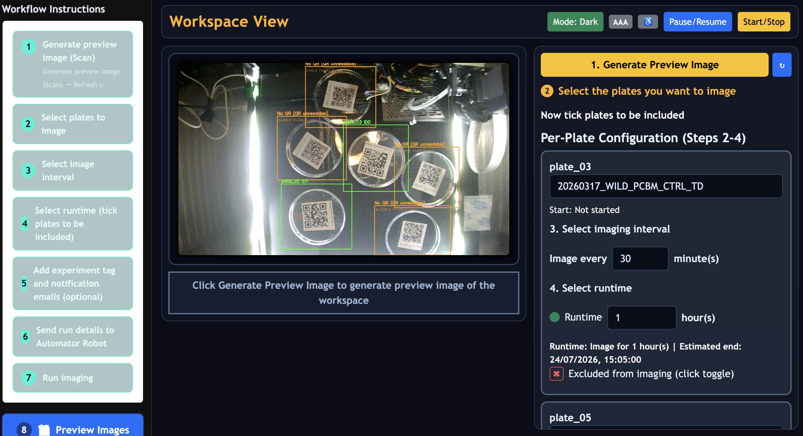
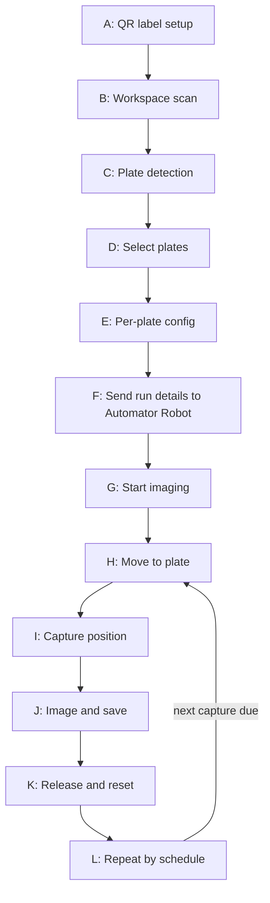

<!--
SPDX-License-Identifier: CC-BY-4.0
Copyright (c) 2025–2026 Rohan R
-->


# Automator: automated imaging of microbial round Petri dishes/plates

Real-time Petri dish imaging and tracking  

Current release line: **v3.0.0**

---
[](https://github.com/rotsl/Automator/actions/workflows/ci-python.yml)
[](https://github.com/rotsl/Automator/actions/workflows/lint.yml)
[](https://github.com/rotsl/Automator/actions/workflows/validate-assets.yml)
[](LICENSE)
[](LICENSE-CERN-OHL-S)
[](LICENSE-CC-BY-4.0)
[](https://pepy.tech/projects/automator-tsl)
[](https://rotsl.github.io/Automator/)
[](https://pypi.org/project/automator-tsl/)


## Workflow (A → L)



See [HowToUseAutomator.md](documentation/HowToUseAutomator.md) for the full step-by-step workflow guide.

---

## Repository structure

```text
Automator/
├─ config/                       # Raspberry Pi system-level config files
├─ data/                         # captured images, ONNX models, calibration files
├─ dev2/                         # main Python controller + web UI
├─ documentation/                # user and admin documentation
├─ hardware/                     # schematics, hardware docs, datasheets
├─ mechanical/                   # STLs, assembly images, mechanical guide
├─ raw/                          # runtime state/log outputs used by controller
├─ pyproject.toml                # Python package configuration
├─ setup.py                      # package entry point
├─ MANIFEST.in                   # packaging file manifest
├─ package.md                    # PyPI install guide
├─ requirements.txt
├─ requirements-dev.txt
├─ ChangeLog.md                  # project changelog
├─ README.md                     # project overview and quick start
├─ contributing.md               # contribution guidelines
├─ LICENSE                       # licensing overview
├─ LICENSE-MIT
├─ LICENSE-CERN-OHL-S
├─ LICENSE-CC-BY-4.0
└─ CITATION.cff
```

Primary documentation:

- [`HowToUseAutomator.md`](documentation/HowToUseAutomator.md) — end-user guide covering the web interface, QR code setup, imaging workflow, image retrieval (web browser, USB export), physical buttons, and troubleshooting. No installation or admin content.
- [`RunBook.md`](documentation/RunBook.md) — operational procedures, calibration checklists, maintenance schedule, and escalation matrix.

Normal users operate Automator in one of two ways: from a directly connected MacBook at `http://192.168.50.2:8080/` or `http://automator.local:8080/` (Ethernet cable via USB-C to Ethernet adapter, MacBook adapter set to Using DHCP), or from a monitor, keyboard, and mouse connected directly to the Raspberry Pi — the Pi boots into a full-screen kiosk at `http://127.0.0.1:8080/` automatically. Use only one interface at a time; running both simultaneously can cause latency. Image retrieval is through the UI preview/file browser or USB export. Raspberry Pi desktop and terminal access are for technical/admin maintenance — see [raspberry-pi-automator-kiosk-admin-desktop.md](documentation/raspberry-pi-automator-kiosk-admin-desktop.md) for the kiosk and admin desktop setup guide.

## System components

| Component | Role |
|-----------|------|
| Raspberry Pi 4B | System controller; runs the web server, cameras, and imaging schedule |
| MKS Robin Nano V3.1 | Motion controller; drives X/Y/Z stepper motors, servo, and relay outputs |
| Klipper | Motion control firmware running on the Pi and the motion controller board |
| Moonraker | API server that allows the controller to communicate with Klipper |

Full component descriptions are in the technical reference documentation.

## Runtime separation

The imaging controller and the diagnostics server are separate runtimes and must not run at the same time. The diagnostics server is for admin and technical use only. See [documentation/diagnosticsserver.md](documentation/diagnosticsserver.md).

## Hardware overview

### Physical hardware controls

Automator has two physical buttons for local run control, independent of the web interface.

| Button | What it does |
|--------|--------------|
| START | Starts the imaging run (after run details have been sent from the web UI) |
| STOP | First press: pause at the next safe point · Second press: resume. Does not stop the run — use the web interface to stop entirely. |

- Both buttons operate via GPIO and work even if the web interface is unreachable
- Pausing happens only at safe points, not mid-movement
- For emergency shutdown, use the hard-wired latching AC-side emergency stop (see [`hardware/images/estop.jpg`](hardware/images/estop.jpg))

Wiring, GPIO assignment, and service details are in the technical reference documentation.

## Quick start (Raspberry Pi)

Automator is also available as a pip-installable package (`automator-tsl`) bundling the controller, web UI, and reference docs. See [package.md](package.md) for Raspberry Pi install instructions via pip, or clone the repo and follow the steps below for a source install.

### 1. System prerequisites (Raspberry Pi OS lite 64-bit)

```bash
sudo apt update
sudo apt install -y \
  python3 python3-venv python3-dev \
  libcamera-dev libcamera-apps v4l-utils \
  libjpeg-dev libpng-dev libatlas-base-dev
```

Full instructions for installing the operating system and firmware are provided in [documentation/OS_and_Firmware_installation.md](documentation/OS_and_Firmware_installation.md).

### 2. Clone repo

```bash
   git clone https://github.com/rotsl/Automator.git
   cd Automator
```

### 3. Python env (runtime)

```bash
python -m venv venv_clean
source venv_clean/bin/activate
pip install --upgrade pip
pip install -r requirements.txt
```

This installs only the packages required to run the controller.

### Optional (developer tools)

```bash
pip install -r requirements-dev.txt
```

### 4. Generate security keys and review hardware controls

Follow instructions detailed in [documentation/Security_Model_Credential_Management.md](documentation/Security_Model_Credential_Management.md).

Run-completion notification emails are sent from `no-reply-tslautomator@nbi.ac.uk` via the NBI mail server. No credentials are required. Enter addresses in the Notification Emails field on the imaging page (below the experiment tag); use only institute addresses ending in `@nbi.ac.uk` or `@tsl.ac.uk`.

### 5. Start the system

Before starting the controller, confirm Klipper and Moonraker services are running:

```bash
sudo systemctl status klipper moonraker
```

Start the controller manually for testing:

```bash
cd /home/pi/Automator/dev2
source /home/pi/Automator/venv_clean/bin/activate
python maincontroller.py
```

For production, the controller runs as a systemd service. See [documentation/HARDWARE_BUTTONS_AND_SERVICES.md](documentation/HARDWARE_BUTTONS_AND_SERVICES.md) for service setup.

#### Kiosk display (monitor, keyboard, mouse connected to the Pi)

If a monitor, keyboard, and mouse are connected, the Pi boots into a full-screen kiosk automatically. No MacBook or Ethernet cable is needed. The Automator interface is available immediately at startup.

#### Connecting from a MacBook (normal users)

1. Check that your MacBook USB-C Ethernet adapter is set to Using DHCP (the default on most MacBooks — usually no change required). In macOS: System Settings → Network → USB Ethernet adapter → Details → TCP/IP → Configure IPv4: Using DHCP. (macOS lists USB-C Ethernet devices here automatically.)
2. Plug the USB-C to Ethernet adapter into your MacBook's USB-C port, then plug the Ethernet cable into the Ethernet port on the Automator.
3. Wait 15–20 seconds. The Automator switches to direct MacBook mode and assigns your MacBook an IP address via DHCP automatically.

Open a browser and go to `http://192.168.50.2:8080/` or `http://automator.local:8080/`.

> Use only one access method at a time. Running the kiosk display and a MacBook Ethernet connection simultaneously can cause latency.

Admin access (Pi desktop browser — requires exiting kiosk first with `Ctrl+Alt+A`):

- Pi desktop browser: `http://127.0.0.1:8080/` or `http://automator.local:8080/`
- Return to kiosk: `Windows+K`

See [raspberry-pi-automator-kiosk-admin-desktop.md](documentation/raspberry-pi-automator-kiosk-admin-desktop.md) for the full kiosk and admin desktop setup guide.

Once running, the web interface guides you through workspace scanning and plate detection (including automatic fallback detection for plates with unreadable QR codes, with manual identification via the UI), per-plate configuration (naming, imaging interval, end time), QR code label generation as a printable PDF, optional experiment tag and notification email entry, live imaging with status and Pause/Resume/Start-Stop controls, and image retrieval (local storage or USB export). The workspace accommodates up to 6 × 90–100 mm round Petri dishes/plates at one time; green sticker positions on the workspace floor mark where each plate should go. Images are retained for 21 days and the data folder is kept under 5 GiB automatically. See [HowToUseAutomator.md](documentation/HowToUseAutomator.md) for the full guide with screenshots. QR labels can also be generated offline on your own computer using the standalone [`qr-generator-Automator`](https://pypi.org/project/qr-generator-Automator/) package — see HowToUseAutomator.md for install/run instructions.

---

## Demo Video

<https://github.com/user-attachments/assets/8c4d05b0-ef04-4c6a-a5a6-2672bb57525a>

---

## Technical support

For problems with installation, network configuration, code, or services, contact the TSL Bioinformatics team:

- Dan MacLean: <dan.maclean@tsl.ac.uk>
- Rohan R: <phonics-tiffs1i@icloud.com> 

For IT or network-related issues (access permissions, IP address changes), contact TSL IT via Christopher Rickett: <christopher.rickett@tsl.ac.uk>.

---

## Troubleshooting

For common issues (servo behavior, system restarts, door interlock, resume-after-reboot, STOP button behavior, website access, completion emails), see the [Troubleshooting section in HowToUseAutomator.md](documentation/HowToUseAutomator.md#troubleshooting).

For hardware button and systemd service-level issues, see the [Troubleshooting section in HARDWARE_BUTTONS_AND_SERVICES.md](documentation/HARDWARE_BUTTONS_AND_SERVICES.md#troubleshooting).

---

## Contributing

This project accepts contributions under defined governance rules.

All contributors must follow the guidelines in
[`CONTRIBUTING.md`](https://github.com/rotsl/Automator/blob/main/contributing.md), particularly for changes involving
hardware operation, safety behavior, or core documentation.

## Changelog

All notable changes are documented in [`CHANGELOG.md`](https://github.com/rotsl/Automator/blob/main/ChangeLog.md).

## Acknowledgements

This project builds upon and integrates several open-source tools, services, and institutional infrastructure. The author gratefully acknowledges the following:

- [Klipper](https://www.klipper3d.org/): motion control framework, configuration system, and macros used for coordinated XY/Z movement, GPIO control, and timing-critical operations (e.g. `SET_PIN`, hardware PWM).

- [Moonraker](https://github.com/Arksine/moonraker): HTTP and WebSocket API layer enabling external control, monitoring, and integration of Klipper with custom software and web interfaces.

- [Mainsail](https://docs.mainsail.xyz/): reference web UI design patterns and operational workflows for interacting with Klipper-based systems.

- [ERCF Project (Enraged Rabbit Project)](https://github.com/EtteGit/EnragedRabbitProject): reference implementations and patterns for safe servo motion and ramping behaviour.

- [PiCamera2](https://datasheets.raspberrypi.com/camera/picamera2-manual.pdf) and [libcamera](https://www.libcamera.org/): Raspberry Pi camera support, image acquisition, and camera control.

- [NBI Core Computing](https://www.nbi.ac.uk/facilities/core-computing/) and [Christopher Rickett](https://www.tsl.ac.uk/about/people/christopher-rickett): provision and maintenance of the internal network infrastructure on which the current system is configured and operated.
- [Dan MacLean](https://www.tsl.ac.uk/about/people/dan-maclean) - My supervisor for providing support, guidance and direction.
- The broader open-source community: libraries, documentation, and shared knowledge that enabled rapid development and reliable system integration.

All third-party software is used in accordance with its respective license. Refer [`Third Party Notices`](https://github.com/rotsl/Automator/blob/main/documentation/Third_Party_Notices.md)

This project is not affiliated with, endorsed by, or officially supported by the above projects or organisations unless explicitly stated.

---

## Authorship, citation & use

This project was designed and developed by Rohan R under the supervision of Dan MacLean at
The Sainsbury Laboratory, Norwich (TSL).

If you use this software, hardware designs, or derivative works in academic
publications, preprints, theses, posters, or internal reports, please cite
this repository.

### Recommended citation

```bibtex
@software{R_Automator_Automated_Imaging_20252026,
author = {R, Rohan},
title = {{Automator: Automated Imaging of Round Petri Dishes/Plates (90–100 mm)}},
url = {https://github.com/rotsl/Automator},
year = {2025–2026}
}
```

- Note: You could directly do this in either format APA/BibTex from About section of this repository

---

## Related tools

Images from Automator can be used with the following tools for downstream colony analysis, or these tools can be used independently with images from other sources.

### metrics-petri

[`metrics-petri`](https://pypi.org/project/metrics-petri/) (v3.0.0) — Petri dish colony segmentation and morphometric analysis.

Measures how a biological sample (e.g. *Magnaporthe*) grows on a Petri dish, reporting: area, diameter, edge roughness, crack burden, texture entropy, and time-series growth rates — all in physical units calibrated from dish geometry.

- PyPI: <https://pypi.org/project/metrics-petri/>
- Repository: <https://github.com/rotsl/metrics-petri>

### petrimodel

[`petrimodel`](https://github.com/rotsl/petrimodel) — trains and evaluates the SmallUNet used by `metrics-petri`. Includes LabelMe JSON annotations, training data, sweep plots, trained checkpoints, and a PySide6 desktop tool for manual diameter validation against model-generated masks.

- Repository: <https://github.com/rotsl/petrimodel>

---

## Safety and intended use

This system is designed for **research and experimental automation** only.
It is not a certified laboratory instrument or safety-rated control system.

Physical buttons are provided for operational convenience and normal run control.
Emergency shutdown must use the physical AC-side latching emergency stop.

Users are responsible for ensuring:

- appropriate electrical protection
- mechanical guarding
- external emergency stop hardware
- compliance with local safety and laboratory regulations

## License and disclaimer

This repository is licensed by component type:

- Software: MIT License (`LICENSE-MIT`)
- Hardware designs: CERN Open Hardware Licence v2 - Strongly Reciprocal (`LICENSE-CERN-OHL-S`)
- Documentation: Creative Commons Attribution 4.0 International (`LICENSE-CC-BY-4.0`)

Third-party components remain under their original licenses and are not
re-licensed by this repository.

Unless required by applicable law, this project is provided "as is", without
warranty of any kind. See the respective license files for full terms.
Always wire and use the external hardware E-stop for emergency shutdown.

---

## Institutional note

This repository represents research automation tooling developed at [The Sainsbury Laboratory, Norwich.](https://www.tsl.ac.uk)  
It is provided as-is for research and engineering use and is not a certified laboratory instrument unless approved by the institute.

Users are responsible for:

- validating the system for their experimental context  
- complying with local safety, electrical, and biological regulations  
- ensuring appropriate risk assessments are in place  

Note: A separate repo is maintained with previous git history of this repo — [Automator-backup](https://github.com/rotsl/Automator-backup) [updated on 16/06/2026 17:00 Hrs]. This Repo was reinitialized on 26 July 2026 to remove any secrets/tokens that might have been previously committed.

<div align="center">

<hr>

<p>
  <strong style="color:#1f6feb; font-size:1.05em;">
    🦠 Built for reproducible research automation.👨‍🔬
  </strong>
</p>

<p>
  <strong style="color:#238636;">
    <em>“Make the instrument part of the method.”</em>
  </strong>
</p>

</div>
