<!--
SPDX-License-Identifier: CC-BY-4.0
Copyright (c) 2025–2026 Rohan R
-->

# Automator handover guide

This document is for a new maintainer taking over the Automator system. It covers what the system is, how it is built, how to install it from scratch, how to configure the network, and how to diagnose problems. No prior knowledge of the system is assumed.

For day-to-day user instructions, see [HowToUseAutomator.md](HowToUseAutomator.md).

---

## 1. What this system is

Automator is a Raspberry Pi-controlled robotic imaging platform for QR-labelled Petri dishes at The Sainsbury Laboratory, Norwich. It combines a motion gantry, two cameras, a vacuum plate-handling mechanism, and a web-based controller into a single instrument.

The system has four main software/hardware layers:

- **The Raspberry Pi** runs the web server, the cameras, the imaging schedule, and the state machine. It is the central brain.
- **The MKS Robin Nano V3.1** is a motion controller board that drives the stepper motors for the X, Y, and Z axes. It receives G-code commands from the Pi.
- **Klipper** is the firmware system linking the Pi and the MKS board. The Pi runs the Klipper host; the MKS board runs the Klipper MCU firmware.
- **Moonraker** is an API server on the Pi that exposes Klipper's functions over HTTP. The Automator controller calls Moonraker to send motion commands.

All code is stored at `/home/pi/Automator/` on the Raspberry Pi. Within that directory, the main runtime files are in `dev2/`, images are written to `data/`, and runtime state files live in `raw/`.

---

## 2. Component guide

This section explains what each major component is, for a maintainer who is new to this hardware.

### 2.1 Raspberry Pi 4B

A Raspberry Pi is a small single-board computer about the size of a credit card. It was designed by the Raspberry Pi Foundation and runs a full Linux operating system. The 4B model used here has a Broadcom BCM2711 processor, 8 GB of RAM, and 64 GB of storage on a microSD card.

In Automator, the Pi does several things at once:

- Runs the Flask web server (the UI you see in a browser, on port 8080)
- Controls the high-resolution Pi camera via the CSI ribbon cable
- Controls the USB camera used for QR code scanning
- Communicates with the MKS board over USB serial (via Klipper/Moonraker)
- Manages GPIO pins for the door sensor, LED relay, and button listener
- Stores all images locally to `data/`

The Pi uses two separate power supplies: a dedicated 5 V adapter for the Pi itself, and a separate 12 V supply for the rest of the electronics.

Normal operators access Automator in one of two ways, and should use only one at a time to avoid latency:

1. **Kiosk display** — if a monitor, keyboard, and mouse are connected to the Pi, the system boots directly into a full-screen Chromium kiosk at `http://127.0.0.1:8080/`. No MacBook or Ethernet cable is required.
2. **Direct MacBook Ethernet** — connect a MacBook with a USB-C to Ethernet adapter (plugs into the MacBook's USB-C port). The adapter must be set to Using DHCP (the default); the Pi assigns a `192.168.50.x` address automatically via DHCP when in direct mode. Access via `http://192.168.50.2:8080/`.

Access from other network computers is not supported.

#### Web UI login credentials

| Field | Value |
| --- | --- |
| Username | `admin` |
| Password | `tsl` |

For technical/admin maintenance, the Pi boots into kiosk mode by default. Admins can exit kiosk by pressing `Ctrl+Alt+A` (closes Chromium, reveals the full Raspberry Pi desktop including the top panel and terminal access), and return to kiosk by pressing `Windows+K`. From the Pi desktop browser, admins can open `http://127.0.0.1:8080/`. See [raspberry-pi-automator-kiosk-admin-desktop.md](raspberry-pi-automator-kiosk-admin-desktop.md) for the complete kiosk and admin desktop setup guide.

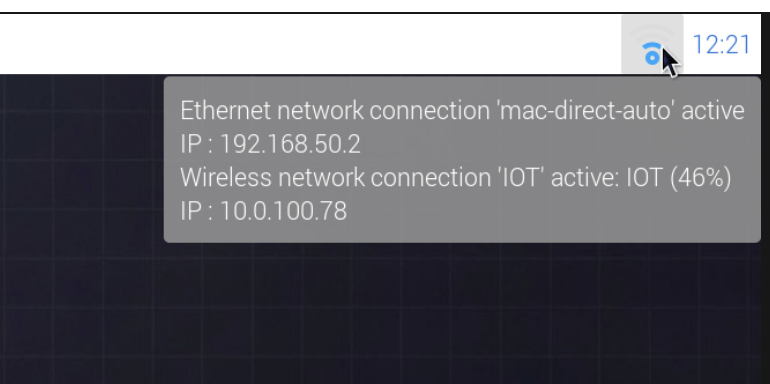

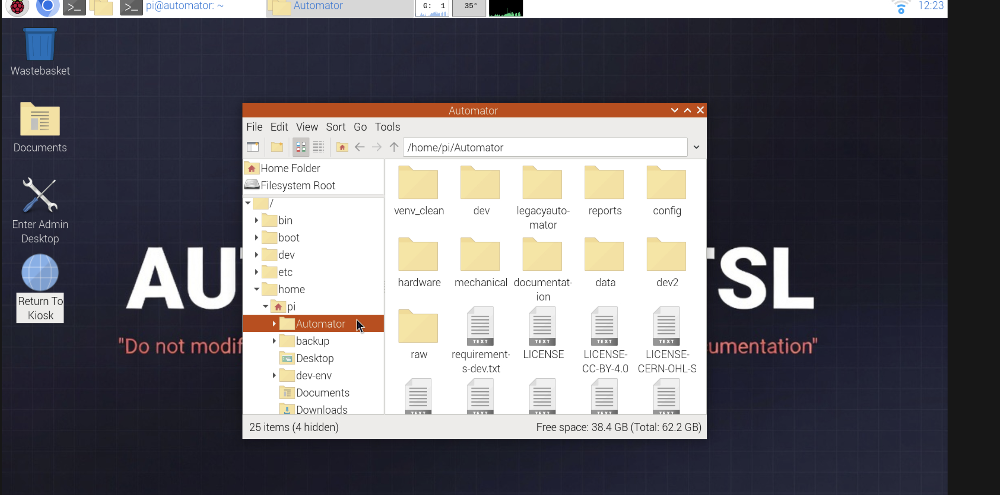

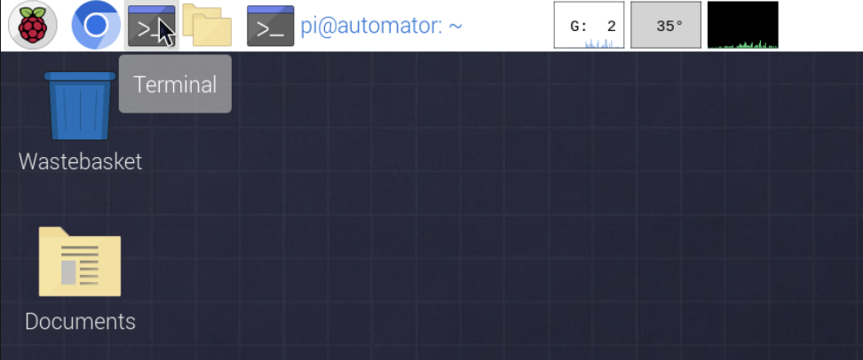

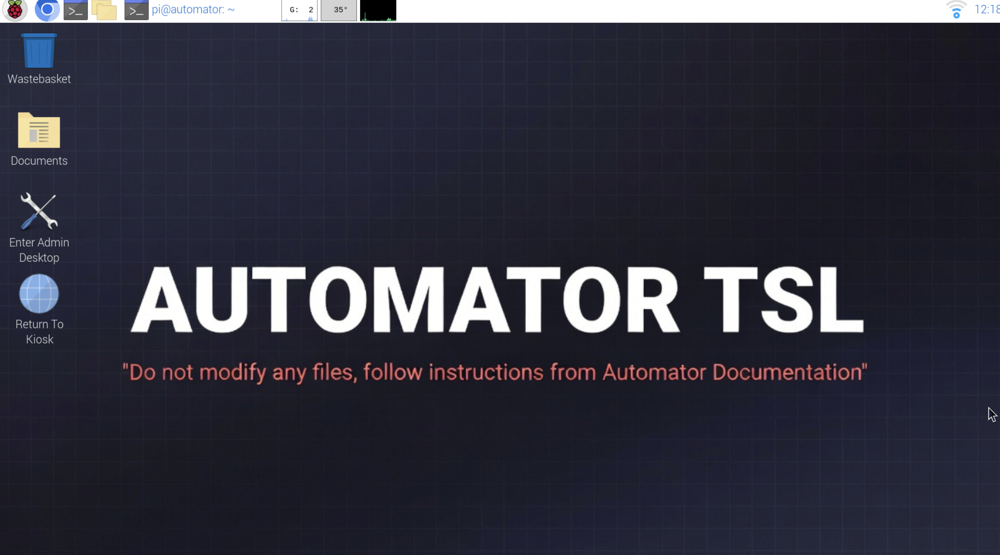

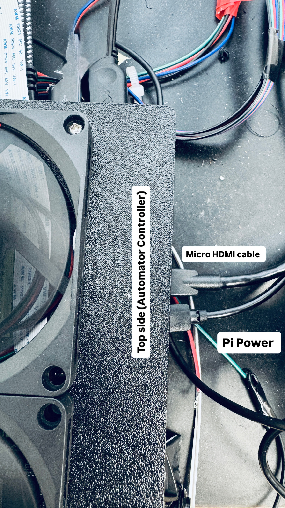

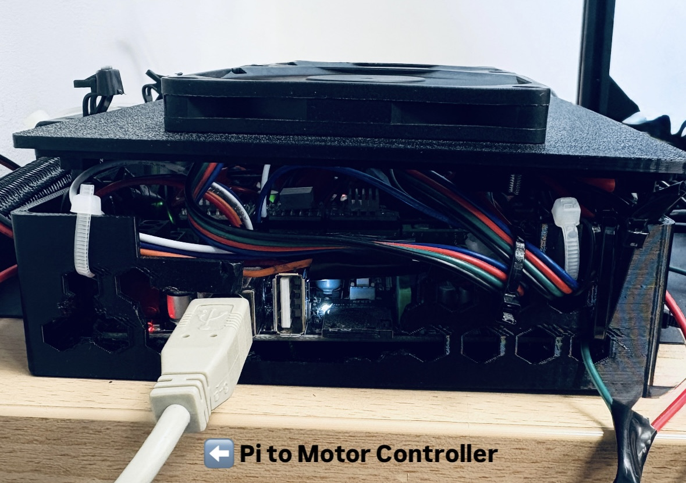

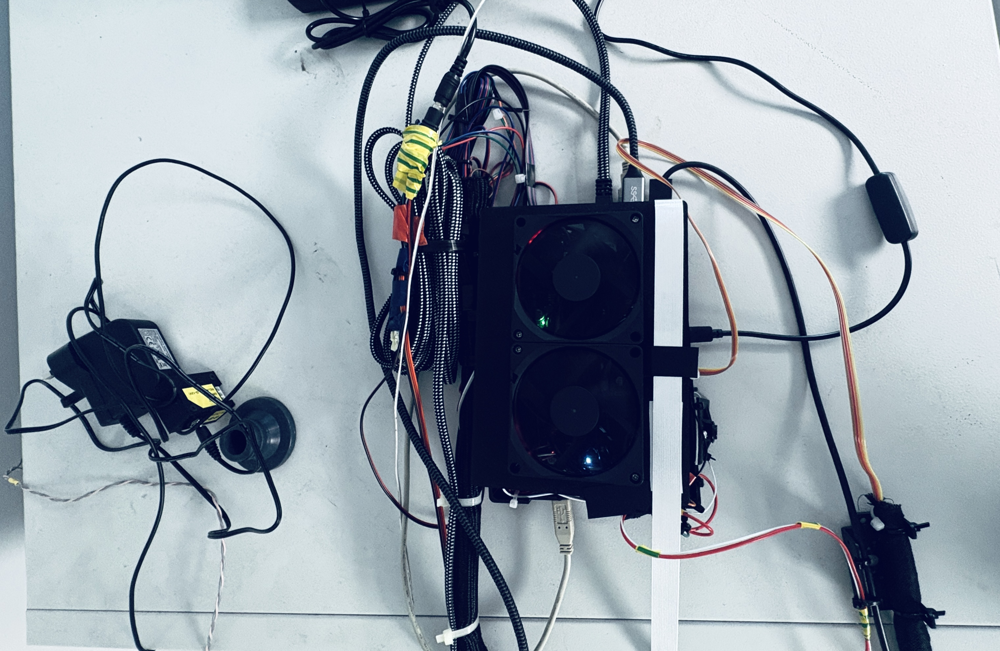

Reference: [hardware/Hardware_Documentation.md](../hardware/Hardware_Documentation.md) and [hardware/raspberry-pi-4-datasheet.pdf](../hardware/raspberry-pi-4-datasheet.pdf)

### 2.2 MKS Robin Nano V3.1

The MKS Robin Nano V3.1 is a motion controller board originally designed for 3D printers. It contains an STM32F407 microcontroller and provides four stepper motor driver slots, servo PWM outputs, and relay control outputs. In Automator it drives the X, Y, and Z axes of the camera gantry, plus the suction cup servo and the vacuum relay.

The board communicates with the Raspberry Pi via USB serial. It does not make any decisions on its own — it simply executes step pulses and pin toggles as instructed by the Klipper host running on the Pi.

When first received, the board has 3D printer firmware on it. To work with Automator, it must be re-flashed with Klipper's MCU firmware. This is covered in section 4.4.

<!-- IMAGE PLACEHOLDER: Photo of the MKS Robin Nano V3.1 board with labels pointing to the stepper driver slots, USB connector, power input, and servo/relay output pins -->

Reference: [hardware/Hardware_Documentation.md](../hardware/Hardware_Documentation.md) and the MKS hardware repository at <https://github.com/makerbase-mks/MKS-Robin-Nano-V3.X>

### 2.3 Klipper

Klipper is an open-source 3D printer firmware that splits motion processing between a host computer (the Pi) and a microcontroller (the MKS board). Traditional 3D printer firmware does all the motion planning on the microcontroller, which limits how complex it can get. Klipper moves all the complex work — G-code parsing, motion planning, and acceleration calculations — to the Pi, leaving the microcontroller to do only precise step-pulse timing.

This design means you configure everything through a text file (`printer.cfg`) on the Pi rather than recompiling firmware. Changes to motor speeds, pin assignments, or macros take effect after a simple restart.

Klipper runs as a systemd service called `klipper`. Its configuration file for Automator is at `~/printer_data/config/printer.cfg`. The source of truth for this file is `config/printer.cfg` in the repository.

Reference: <https://www.klipper3d.org/>

### 2.4 Moonraker

Moonraker is a web API server that runs alongside Klipper on the Pi. It listens on port 7125 and provides HTTP endpoints that external software can call to send G-code, query machine state, and manage macros.

The Automator controller (`dev2/maincontroller.py`) uses Moonraker's API rather than talking to Klipper directly. This means the controller can send a motion command like `G1 X100 Y50` by making an HTTP POST to Moonraker, without needing a direct serial connection to the MKS board.

Moonraker runs as a systemd service called `moonraker`. Its configuration is at `~/printer_data/config/moonraker.conf`.

Reference: <https://moonraker.readthedocs.io/>

---

## 3. Hardware overview

The hardware documentation is at `/home/pi/Automator/hardware/Hardware_Documentation.md`. What follows is a summary for context.

### 3.0 Physical location

The Automator is installed inside **TSL PGC07** (BINDER growth chamber) in the Growth Room on the TSL Building Ground Floor, at the end nearest the window.

Do not move the setup and do not pull any cables — the cable routing is calibrated to the installation position.

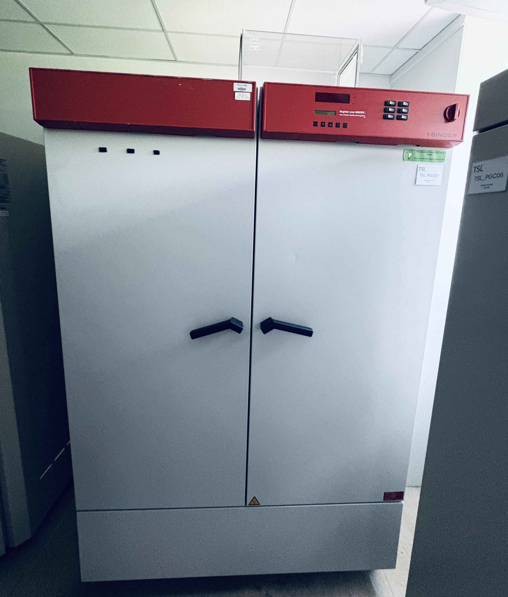

TSL PGC07 — the growth chamber housing the Automator

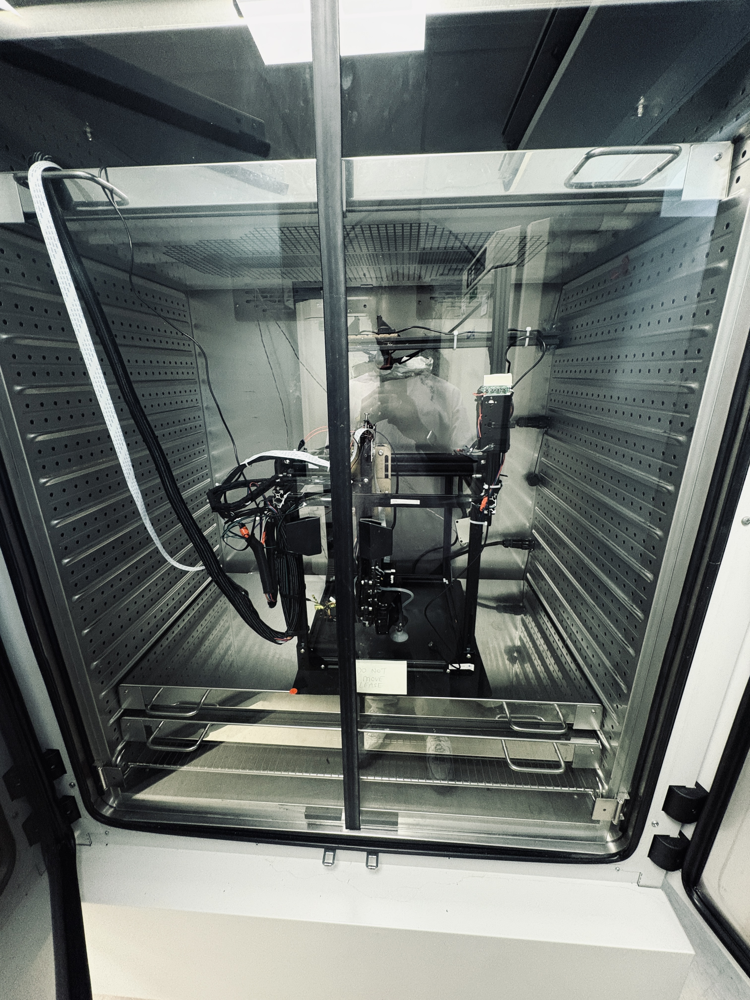

Automator inside TSL PGC07 with the door open

### 3.1 Power architecture

Mains AC feeds two DC supplies, both downstream of a single latching AC-side emergency stop:

- **12 V supply** → MKS Robin Nano V3.1, stepper motors, a 12 V–to–5 V buck converter
- **5 V supply** (dedicated adapter) → Raspberry Pi only

The buck converter powers the servo, proximity sensor, vacuum pump, solenoid valve, fans, relay module, and LED strip.

Activating the hardware emergency stop cuts AC to both supplies immediately.

<!-- IMAGE PLACEHOLDER: Diagram of the power tree showing AC mains → emergency stop → 12V PSU (→ MKS board → buck converter → peripherals) and 5V PSU → Raspberry Pi separately -->

### 3.2 Motion system

Three stepper motors drive the X, Y, and Z axes of the camera gantry. All three are NEMA17 and run from the MKS board on 12 V. End-stops are normally open and ground-triggered on all three axes.

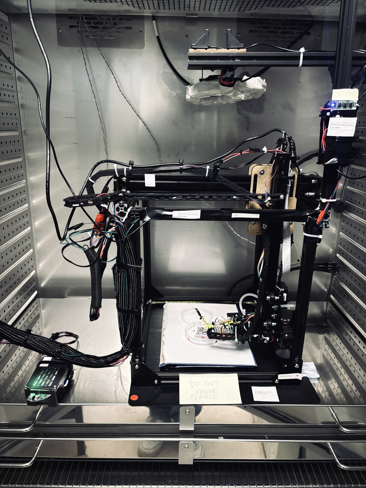

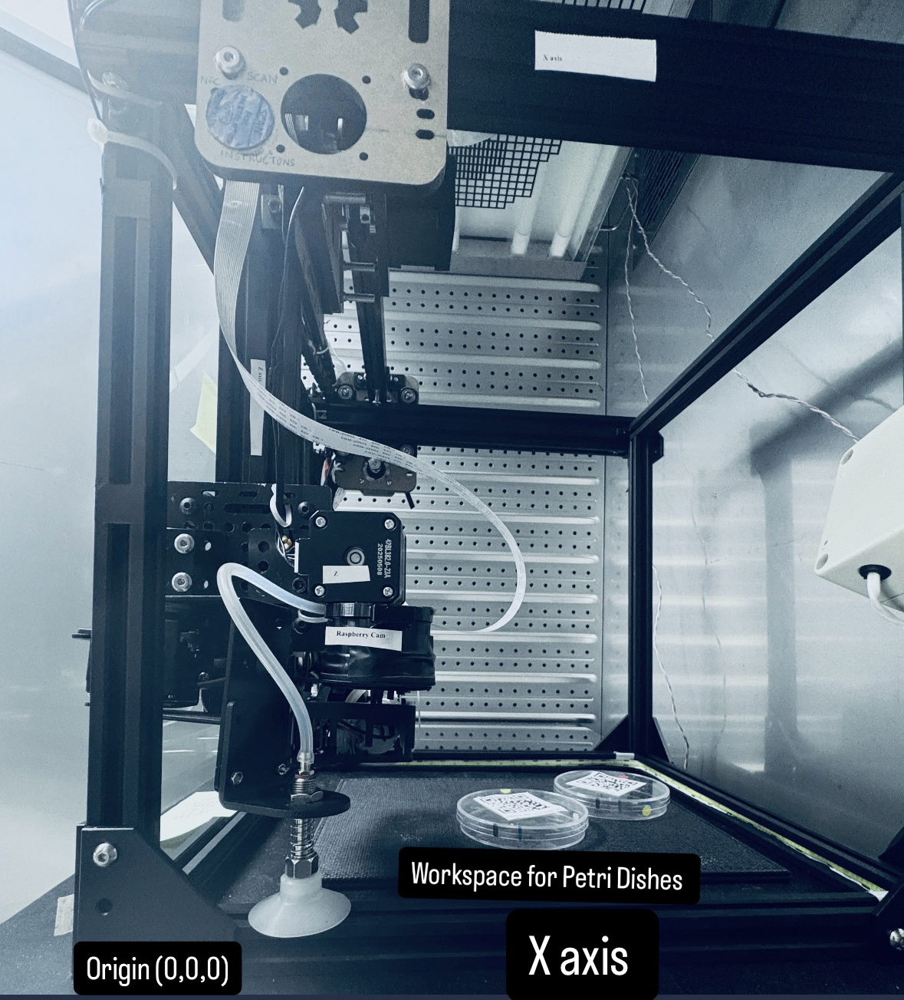

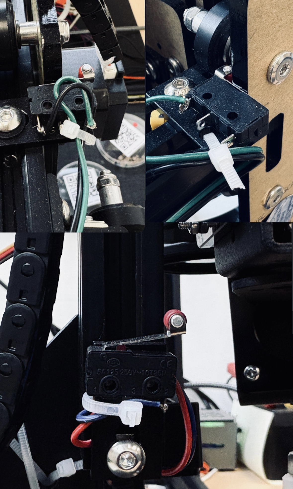

### 3.3 Plate handling

The suction cup grips the plate lid during imaging. The chain is: vacuum pump generates negative pressure → air solenoid valve routes it → suction cup holds the lid. A servo then rotates the lid 90° away from the dish base to expose the colony surface.

The vacuum pump and solenoid are controlled via relay outputs from the MKS board. The servo is on a hardware PWM output.

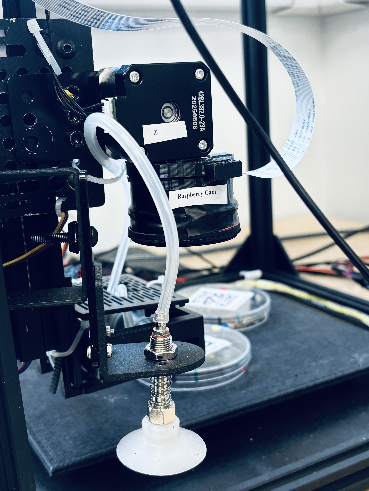

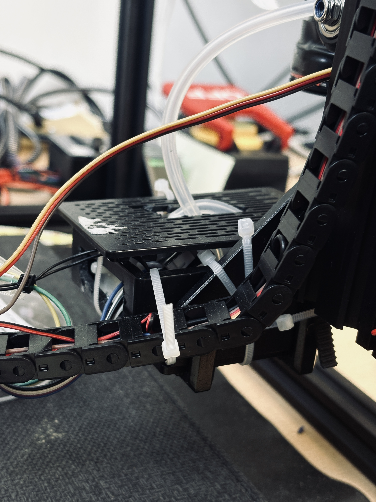

### 3.4 Cameras

Two cameras are in use:

- **Raspberry Pi Camera Module 3** — high-resolution still images of colonies, connected via CSI ribbon cable. Used only during the imaging step.
- **USB camera** — wide-angle view of the workspace, used to detect plate positions and read QR codes. Connected via USB.

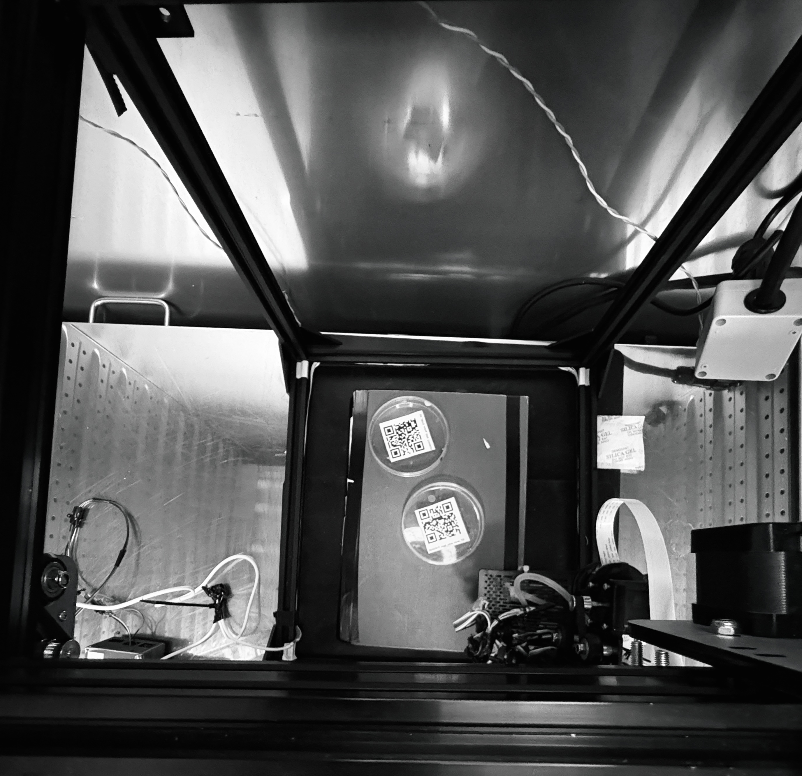

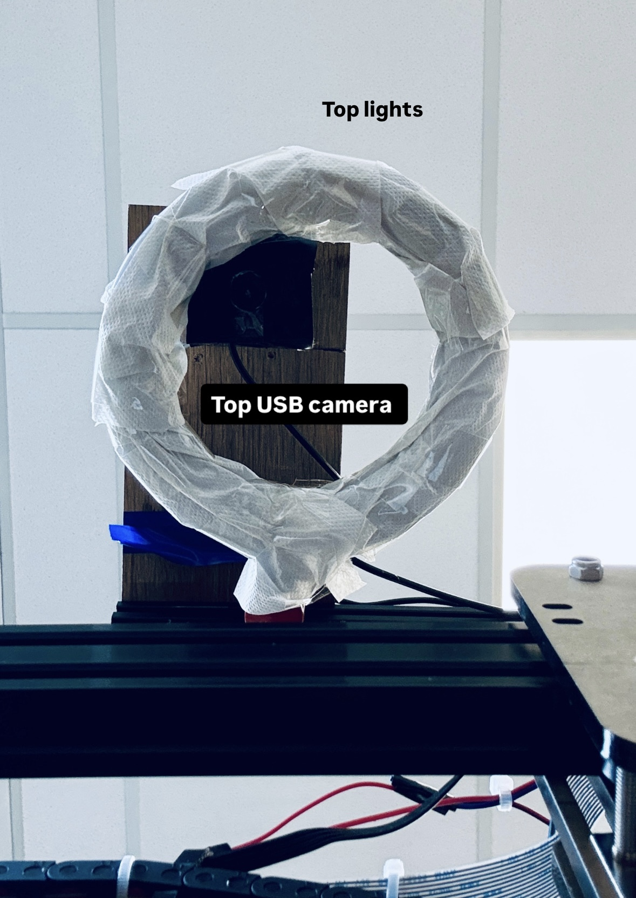

#### Plate detection pipeline

The USB camera scan uses two detection stages:

1. **YOLO stage** (`bestnew.onnx`, confidence ≥ 0.75): Detects plate bounding boxes. For each box, the system attempts to read the QR code. Plates with a readable QR are resolved immediately. Plates detected by YOLO but with an unreadable QR are placed in the unresolved detections list.

2. **Geometric fallback stage** (`detect_geometric_plate_candidates` in `mainusbcamera.py`): For plates missed entirely by YOLO, an OpenCV pipeline (Canny edges → contour extraction → `fitEllipse`) identifies ellipse candidates that match the expected circularity, aspect ratio, and size of a 90–100 mm round Petri dish/plate. Candidates must be confirmed across multiple consecutive scan frames before being reported. Confirmed fallback plates also appear in the unresolved detections list.

Both types of unresolved detection expose **Identify** and **Dismiss** controls in the web UI. Identifying a plate associates it with a manually entered QR payload and assigns it a persistent SQLite-backed plate ID.

### 3.5 Safety hardware

- AC-side latching emergency stop switch — physically cuts all power when pressed
- Door interlock — proximity sensor on GPIO 26. Opening the door triggers a controlled halt.
- Axis end-stops — hard limits on X, Y, and Z

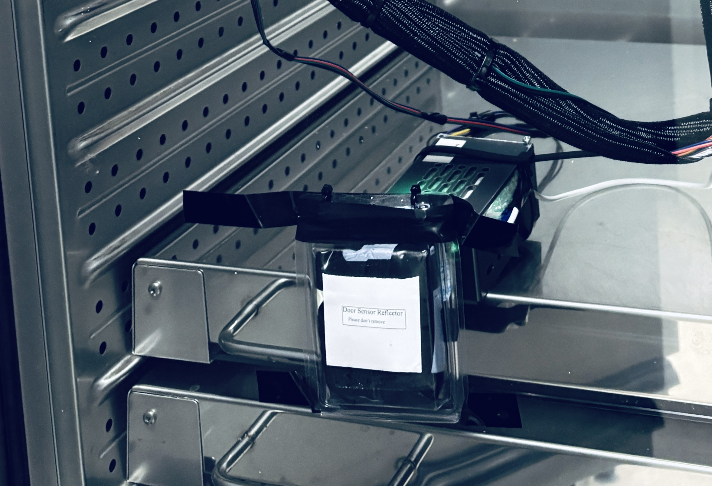

---

## 4. Full installation

This section walks through setting up a fresh Automator system from a blank Raspberry Pi. Follow the steps in order.

### 4.1 Hardware and OS prerequisites

Minimum hardware:

- Raspberry Pi 4B (8 GB RAM)
- microSD card, 32 GB or larger
- 5 V / 3 A power supply for the Pi
- MKS Robin Nano V3.1 controller board
- Network access (Wi-Fi and/or Ethernet)

#### Flashing the OS

Download and install Raspberry Pi Imager from <https://www.raspberrypi.com/software/>. Insert the microSD card into your computer.

In Raspberry Pi Imager:

1. Select: Raspberry Pi OS (64-bit)
2. Select the target microSD card
3. Open Advanced Options:
   - Enable SSH
   - Set username to `pi` and a password
   - Configure Wi-Fi if needed
   - Set locale and timezone
4. Write the image and eject the card

Insert the card into the Pi and power it on.

### 4.2 First boot and base packages

Connect via SSH:

```bash
ssh pi@automator.local
```

Update the system:

```bash
sudo apt update
sudo apt full-upgrade -y
sudo reboot
```

Set the deployed hostname to `automator` and ensure local name resolution works:

```bash
sudo hostnamectl set-hostname automator
sudo nano /etc/hosts
```

The hosts file should include:

```text
127.0.1.1    automator
```

Install and enable Avahi/mDNS so `automator.local` resolves from local machines:

```bash
sudo apt install -y avahi-daemon
sudo systemctl enable --now avahi-daemon
systemctl status avahi-daemon --no-pager
```

After reboot, install required system packages:

```bash
sudo apt update
sudo apt install -y \
  python3 python3-venv python3-dev \
  libcamera-dev libcamera-apps v4l-utils \
  libjpeg-dev libpng-dev libatlas-base-dev \
  rsync exfatprogs ntfs-3g util-linux
```

The `libcamera` packages support the Pi Camera Module 3 via Picamera2. The storage utilities (`rsync`, `exfatprogs`, etc.) are needed for the USB image export system.

### 4.3 Clone the repository

All code expects to live at `/home/pi/Automator/`. Do not change this path without also updating the hard-coded paths throughout `dev2/maincontroller.py` and all service files.

```bash
cd /home/pi
git clone https://github.com/rotsl/Automator.git
cd /home/pi/Automator
```

### 4.4 Klipper and Moonraker installation

**What this step does**: Klipper splits motion planning between the Pi and the MKS board. This step installs the host side (on the Pi) and the API layer (Moonraker).

Clone and install Klipper:

```bash
cd ~
git clone https://github.com/Klipper3d/klipper.git
./klipper/scripts/install-octopi.sh
```

This installs the Klipper host service, Moonraker, and a web interface (Mainsail or Fluidd). The web interface is not used by Automator day-to-day, but it is useful for diagnosing Klipper directly.

Reference: <https://www.klipper3d.org/Installation.html>

### 4.5 Building Klipper firmware for the MKS Robin Nano V3.1

The MKS board needs Klipper's MCU firmware flashed onto it. This firmware is compiled on the Pi and then transferred to the board via SD card.

> **Pre-built firmware available:** A compiled firmware binary for this exact setup is already included in the repository at `config/firmware mks/firmware.bin`. If you are re-flashing the same board configuration, you can use this file directly — rename it to `robin_nano.bin`, copy to a FAT32 SD card, and follow the flashing steps below. Only rebuild from source if the Klipper version or board configuration has changed.

**Why this step is needed**: The board ships with 3D printer firmware. Klipper replaces it entirely with firmware designed to receive step commands from the Pi's host process.

Build the firmware:

```bash
cd ~/klipper
make menuconfig
```

In the menuconfig interface, set:

| Setting | Value |
| --- | --- |
| MCU Architecture | STM32 |
| Processor model | STM32F407 |
| Bootloader offset | 32 KiB |
| Clock reference | 8 MHz crystal |
| Communication interface | USB (PA11/PA12) |

Save and exit, then compile:

```bash
make clean
make
```

The compiled firmware is at `out/klipper.bin`.

#### Flashing the firmware to the board

1. Rename `out/klipper.bin` to `robin_nano.bin`
2. Copy `robin_nano.bin` to a FAT32-formatted SD card
3. Insert the SD card into the MKS Robin Nano's card slot
4. Power the board on
5. Wait approximately 10 seconds

Successful flashing renames the file on the SD card to `FIRMWARE.CUR`. Power cycle the board after flashing.

Reference: <https://github.com/makerbase-mks/MKS-Robin-Nano-V3.X>

### 4.6 Connecting the MKS board to the Raspberry Pi

Connect the MKS board to the Pi via USB. Identify the serial device:

```bash
ls /dev/serial/by-id/
```

You should see something like:

```text
usb-Klipper_stm32f407xx_47003B001951343035323830-if00
```

This path goes into `printer.cfg` as the `serial:` value under `[mcu]`.

### 4.7 Klipper printer configuration

The authoritative `printer.cfg` for Automator is in the repository at `config/printer.cfg`. Copy it to Klipper's config directory:

```bash
cp /home/pi/Automator/config/printer.cfg ~/printer_data/config/printer.cfg
```

This file defines all pin assignments, stepper motor parameters, servo positions, and custom G-code macros that the Automator controller relies on. Do not modify it without testing the effects, since the controller calls specific macros by name (`RELEASE`, `HOLD`/`SUCK_HOLD`, `arm_rotate`, `vacuum_pump`, `solenoid_valve`).

Restart Klipper after copying:

```bash
sudo systemctl restart klipper
sudo systemctl restart moonraker
```

Verify Moonraker is listening:

```bash
curl -s http://localhost:7125/printer/info
```

Moonraker CORS should contain only local/trusted Automator origins. Keep entries like:

```ini
cors_domains:
    http://automator.local:8080
    http://127.0.0.1:8080
```

Restart Moonraker after editing:

```bash
sudo systemctl restart moonraker
```

### 4.8 Network configuration

The Raspberry Pi has two network interfaces:

| Interface | Role | Profile name |
| --- | --- | --- |
| `wlan0` | IOT Wi-Fi (primary internet) | `IOT` (active) |
| `eth0` | Direct MacBook access only | `mac-direct-auto` |

Internet traffic uses Wi-Fi as the primary path. `eth0` is used exclusively for direct MacBook Ethernet connections. Do not connect the Ethernet cable to the institute or instrument network.

Set Wi-Fi as primary internet (low metric):

```bash
sudo nmcli connection modify e51d7392-116a-4dc6-8333-39fd9c718dbf \
  ipv4.route-metric 100
```

Verify internet traffic uses Wi-Fi:

```bash
ip route get 8.8.8.8
```

Expected: `via 10.0.112.1 dev wlan0`

#### QR sheet PDF download

The Automator controller no longer sends QR sheets directly to a CUPS printer. The `/qr/print_sheet` route generates the A4 QR PDF in memory and returns it to the browser as a download.

For normal users, QR sheet PDF download is done from the directly connected MacBook workflow at `http://192.168.50.2:8080/`. Admins can also download from the Pi desktop browser at `http://127.0.0.1:8080/`. The user opens the downloaded PDF on their own computer and prints it using an available printer.

#### NTP time synchronisation

The system uses the NBI site-approved NTP server. Public NTP pools are not used, per IT policy.

Create the configuration file:

```bash
sudo mkdir -p /etc/systemd/timesyncd.conf.d
sudo nano /etc/systemd/timesyncd.conf.d/nbi-ntp.conf
```

Paste:

```ini
[Time]
NTP=ntp.nbi.ac.uk
FallbackNTP=
```

Apply and verify:

```bash
sudo systemctl restart systemd-timesyncd
timedatectl timesync-status
timedatectl status
```

Correct time synchronisation matters for image timestamping, run logs, and experiment traceability.

### 4.9 Automatic Mac direct Ethernet access

This setup lets a MacBook connect directly to the Raspberry Pi by Ethernet cable. A script at `/usr/local/sbin/eth0-auto-switch.sh` activates the `mac-direct-auto` profile (`192.168.50.2/24`) and starts a small DHCP server (`automator-direct-dhcp.service`, using `dnsmasq`) that assigns the MacBook a `192.168.50.x` address automatically. The MacBook user does not need to configure anything manually — the USB-C Ethernet adapter just needs to be on Using DHCP, which is the macOS default. Wi-Fi on `wlan0` is not affected.

All files for this system are at the OS level. Nothing is in the Automator repository at `/home/pi/Automator/`.

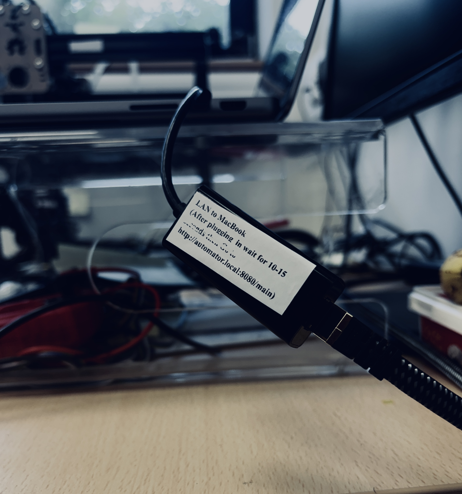

The script is triggered three ways:

- At boot by a systemd service (`eth0-auto-switch.service`)
- On every Ethernet event by a NetworkManager dispatcher hook at `/etc/NetworkManager/dispatcher.d/90-eth0-auto-switch`
- Every 15 seconds by a systemd timer (`eth0-auto-switch.timer`), to self-correct after missed cable events

The `192.168.50.0/24` private subnet with DHCP is used because macOS link-local (`169.254.x.x`) addressing was unreliable — macOS sometimes routed those packets over Wi-Fi instead of Ethernet.

#### Confirmed profile UUIDs

| Purpose | Profile name | UUID | Interface |
| --- | --- | --- | --- |
| Direct MacBook (auto) | `mac-direct-auto` | `65c3e7b6-303b-421a-9590-e41b9f1ce6b2` | `eth0` |
| IOT Wi-Fi | `IOT` | `e51d7392-116a-4dc6-8333-39fd9c718dbf` | `wlan0` |

#### Step 1: Verify current state

```bash
nmcli dev status
nmcli con show
nmcli con show --active
```

Expected when directly connected to a MacBook:

```text
IOT        wifi      wlan0
mac-direct-auto    ethernet  eth0
```

#### Step 2: Disable the old manual profile

The old `mac-direct` profile must not autoconnect.

```bash
sudo nmcli con modify 1039be5f-55ea-481a-aa92-bccda19095d1 \
  connection.autoconnect no
```

Verify:

```bash
nmcli con show 1039be5f-55ea-481a-aa92-bccda19095d1 | grep -E 'connection.id|connection.autoconnect'
```

Expected:

```text
connection.id:           mac-direct
connection.autoconnect:  no
```

#### Step 3: Create the mac-direct-auto profile

Create the profile if it does not already exist:

```bash
sudo nmcli con add type ethernet ifname eth0 con-name mac-direct-auto \
  ipv4.method manual \
  ipv4.addresses 192.168.50.2/24 \
  ipv4.gateway "" \
  ipv4.never-default yes \
  ipv6.method ignore \
  connection.autoconnect yes \
  connection.autoconnect-priority -50
```

If it already exists, enforce the correct settings:

```bash
sudo nmcli con modify mac-direct-auto \
  ipv4.method manual \
  ipv4.addresses 192.168.50.2/24 \
  ipv4.gateway "" \
  ipv4.routes "" \
  ipv4.never-default yes \
  ipv6.method ignore \
  connection.autoconnect yes \
  connection.autoconnect-priority -50
```

Verify:

```bash
nmcli con show mac-direct-auto | grep -E 'connection.id|connection.interface-name|connection.autoconnect|connection.autoconnect-priority|ipv4.method|ipv4.addresses|ipv4.gateway|ipv4.never-default|ipv6.method'
```

Expected:

```text
connection.id:                     mac-direct-auto
connection.interface-name:         eth0
connection.autoconnect:            yes
connection.autoconnect-priority:   -50
ipv4.method:                       manual
ipv4.addresses:                    192.168.50.2/24
ipv4.gateway:                      --
ipv4.never-default:                yes
ipv6.method:                       ignore
```

#### Step 4: Install arping

`arping` sends ARP packets at the Ethernet layer. A standard `ping` (ICMP) follows the routing table, which may not reflect what is physically connected. ARP checks physical presence at the link layer.

```bash
sudo apt install -y arping
```

Verify:

```bash
command -v arping
```

Expected: `/usr/sbin/arping`

#### Step 5: Create the auto-switch script

```bash
sudo nano /usr/local/sbin/eth0-auto-switch.sh
```

Paste:

```bash
#!/usr/bin/env bash
set -u

LOCK_FILE="/run/eth0-auto-switch.lock"
ETH_DEV="eth0"

INSTITUTE_PROFILE_UUID="c3612a53-4d0a-4587-b00c-6f6eaaef9f04"
INSTITUTE_PROFILE_NAME="Instrument connection"
INSTITUTE_GATEWAY="10.0.8.1"

DIRECT_PROFILE="mac-direct-auto"
DIRECT_IP="192.168.50.2"
DIRECT_PREFIX="24"
DIRECT_DHCP_SERVICE="automator-direct-dhcp.service"

LOG_TAG="eth0-auto-switch"

log() {
  logger -t "$LOG_TAG" "$*"
  echo "$*"
}

start_direct_dhcp() {
  log "Starting direct MacBook DHCP service: $DIRECT_DHCP_SERVICE"
  systemctl start "$DIRECT_DHCP_SERVICE" >/dev/null 2>&1 || true
}

stop_direct_dhcp() {
  log "Stopping direct MacBook DHCP service: $DIRECT_DHCP_SERVICE"
  systemctl stop "$DIRECT_DHCP_SERVICE" >/dev/null 2>&1 || true
}

# Prevent overlapping runs from dispatcher/service/timer.
exec 9>"$LOCK_FILE"
if ! flock -n 9; then
  log "Another eth0-auto-switch instance is already running; exiting"
  exit 0
fi

if ! ip link show "$ETH_DEV" >/dev/null 2>&1; then
  log "$ETH_DEV does not exist; exiting"
  exit 0
fi

CARRIER_FILE="/sys/class/net/${ETH_DEV}/carrier"

if [ ! -f "$CARRIER_FILE" ]; then
  log "No carrier file for $ETH_DEV; exiting"
  exit 0
fi

if [ "$(cat "$CARRIER_FILE")" != "1" ]; then
  log "$ETH_DEV has no Ethernet carrier; stopping direct DHCP and exiting"
  stop_direct_dhcp
  exit 0
fi

CURRENT_CON="$(nmcli -t -f NAME,DEVICE con show --active | awk -F: -v dev="$ETH_DEV" '$2==dev{print $1; exit}')"
CURRENT_UUID="$(nmcli -t -f UUID,DEVICE con show --active | awk -F: -v dev="$ETH_DEV" '$2==dev{print $1; exit}')"

log "$ETH_DEV has carrier; current active eth0 profile: ${CURRENT_CON:-none}"
log "Checking whether Institute gateway $INSTITUTE_GATEWAY is reachable on $ETH_DEV"

# Do not bring up Instrument connection before this test.
# This checks whether the real Institute LAN gateway exists on the physical Ethernet link.
if arping -I "$ETH_DEV" -c 3 -w 3 "$INSTITUTE_GATEWAY" >/dev/null 2>&1; then
  log "Institute gateway $INSTITUTE_GATEWAY is reachable; Institute LAN is physically connected"

  # Safety: never run the direct MacBook DHCP server on the Institute LAN.
  stop_direct_dhcp

  if [ "$CURRENT_UUID" = "$INSTITUTE_PROFILE_UUID" ] || [ "$CURRENT_CON" = "$INSTITUTE_PROFILE_NAME" ]; then
    log "Already on $INSTITUTE_PROFILE_NAME; no switch needed"
    exit 0
  fi

  log "Switching to $INSTITUTE_PROFILE_NAME"
  nmcli con up "$INSTITUTE_PROFILE_UUID" ifname "$ETH_DEV" >/dev/null 2>&1 || true

  sleep 3

  if ip -4 addr show "$ETH_DEV" | grep -q "inet 10.0.8.72/"; then
    log "$INSTITUTE_PROFILE_NAME active on 10.0.8.72/24"
  else
    log "WARNING: $INSTITUTE_PROFILE_NAME did not show 10.0.8.72/24 after switching"
    ip -4 addr show "$ETH_DEV" | logger -t "$LOG_TAG"
  fi

  exit 0
fi

log "Institute gateway $INSTITUTE_GATEWAY not reachable; assuming direct MacBook cable"

if [ "$CURRENT_CON" = "$DIRECT_PROFILE" ]; then
  if ip -4 addr show "$ETH_DEV" | grep -q "inet ${DIRECT_IP}/"; then
    log "Already on $DIRECT_PROFILE with ${DIRECT_IP}/${DIRECT_PREFIX}; ensuring DHCP service is running"
    start_direct_dhcp
    exit 0
  fi
fi

log "Switching to $DIRECT_PROFILE"

nmcli con up "$DIRECT_PROFILE" ifname "$ETH_DEV" >/dev/null 2>&1 || true

for i in $(seq 1 15); do
  if ip -4 addr show "$ETH_DEV" | grep -q "inet ${DIRECT_IP}/"; then
    log "Direct MacBook mode active on ${DIRECT_IP}/${DIRECT_PREFIX}"
    start_direct_dhcp
    exit 0
  fi
  sleep 1
done

log "WARNING: $DIRECT_PROFILE did not appear to assign ${DIRECT_IP}/${DIRECT_PREFIX} after waiting"
ip -4 addr show "$ETH_DEV" | logger -t "$LOG_TAG"

# If direct IP did not come up, do not run DHCP.
stop_direct_dhcp

exit 0
```

Make it executable:

```bash
sudo chmod +x /usr/local/sbin/eth0-auto-switch.sh
```

#### Step 6: Test the script manually

Connect the Pi directly to a MacBook and run:

```bash
sudo /usr/local/sbin/eth0-auto-switch.sh
```

Expected output:

```text
eth0 has carrier; current active eth0 profile: none
Checking whether Institute gateway 10.0.8.1 is reachable on eth0
Institute gateway 10.0.8.1 not reachable; assuming direct MacBook cable
Switching to mac-direct-auto
Direct MacBook mode active on 192.168.50.2/24
```

Verify:

```bash
nmcli con show --active
ip -4 addr show eth0
sudo ss -ltnp | grep ':8080'
```

Expected in direct mode:

```text
mac-direct-auto   ethernet  eth0
inet 192.168.50.2/24
LISTEN ... 0.0.0.0:8080
```

If the web server only shows `127.0.0.1:8080`, it is not reachable from outside the Pi. Check the Flask bind address in `/home/pi/Automator/dev2/maincontroller.py`.

#### Step 7: Create the boot-time systemd service

```bash
sudo nano /etc/systemd/system/eth0-auto-switch.service
```

Paste:

```ini
[Unit]
Description=Auto switch eth0 between Institute LAN and direct MacBook mode
After=NetworkManager.service
Wants=NetworkManager.service

[Service]
Type=oneshot
ExecStart=/usr/local/sbin/eth0-auto-switch.sh
RemainAfterExit=no

[Install]
WantedBy=multi-user.target
```

Enable:

```bash
sudo systemctl daemon-reload
sudo systemctl enable eth0-auto-switch.service
```

Test the service:

```bash
sudo systemctl start eth0-auto-switch.service
systemctl status eth0-auto-switch.service --no-pager
```

Expected for a successful oneshot:

```text
Active: inactive (dead)
code=exited, status=0/SUCCESS
```

If an old failed state remains:

```bash
sudo systemctl reset-failed eth0-auto-switch.service
```

#### Step 8: Create the NetworkManager dispatcher hook

The dispatcher fires the script on Ethernet up or connectivity-change events, catching most cable insertions immediately.

```bash
sudo nano /etc/NetworkManager/dispatcher.d/90-eth0-auto-switch
```

Paste:

```bash
#!/usr/bin/env bash

IFACE="$1"
STATUS="$2"

if [ "$IFACE" != "eth0" ]; then
  exit 0
fi

case "$STATUS" in
  up|connectivity-change)
    /usr/local/sbin/eth0-auto-switch.sh &
    ;;
esac

exit 0
```

Make it executable and restart NetworkManager:

```bash
sudo chmod +x /etc/NetworkManager/dispatcher.d/90-eth0-auto-switch
sudo systemctl restart NetworkManager
```

Repeated log messages of `Another eth0-auto-switch instance is already running; exiting` are acceptable — the `flock` lock prevents concurrent runs. Continuous profile switching is not acceptable.

#### Step 9: Create the systemd timer

Cable changes do not always produce a dispatcher event. The timer re-checks every 15 seconds and self-corrects.

```bash
sudo nano /etc/systemd/system/eth0-auto-switch.timer
```

Paste:

```ini
[Unit]
Description=Run eth0 auto switch periodically

[Timer]
OnBootSec=20
OnUnitActiveSec=15
AccuracySec=5
Unit=eth0-auto-switch.service

[Install]
WantedBy=timers.target
```

Enable and start:

```bash
sudo systemctl daemon-reload
sudo systemctl enable --now eth0-auto-switch.timer
```

Verify:

```bash
systemctl status eth0-auto-switch.timer --no-pager
systemctl list-timers --all | grep eth0-auto-switch
```

Expected:

```text
eth0-auto-switch.timer loaded active waiting
```

After a cable change, the Pi should self-correct within 15–20 seconds.

#### Final validation

With the Pi directly connected to a MacBook, run:

```bash
nmcli con show --active
ip -4 addr show eth0
journalctl -t eth0-auto-switch --no-pager -n 30
```

Expected:

```text
mac-direct-auto   ethernet  eth0
inet 192.168.50.2/24
```

Expected log pattern:

```text
Institute gateway 10.0.8.1 not reachable; assuming direct MacBook cable
Direct MacBook mode active on 192.168.50.2/24
```

#### MacBook-side setup and admin testing

Normal users set the MacBook Ethernet adapter through macOS Settings (see [HowToUseAutomator.md](HowToUseAutomator.md)). For admin testing in a terminal:

Find the active Ethernet interface:

```bash
ifconfig
```

It may be named `en5`, `en6`, `en7`, `en8`, or similar.

Set the MacBook address manually (replace `en8` with the correct interface name):

```bash
sudo ifconfig en8 inet 192.168.50.10 netmask 255.255.255.0 up
```

Add a host route via Ethernet:

```bash
sudo route -n delete -host 192.168.50.2 2>/dev/null
sudo route -n add -host 192.168.50.2 -interface en8
```

Verify the route goes over Ethernet, not Wi-Fi:

```bash
route -n get 192.168.50.2
```

Expected: `interface: en8`. If it shows `en0` (Wi-Fi), re-add the explicit host route.

Test connectivity:

```bash
ping -c 4 192.168.50.2
curl -v http://192.168.50.2:8080/
```

A successful unauthenticated curl returns:

```text
HTTP/1.1 401 UNAUTHORIZED
Www-Authenticate: Basic realm="Automator"
```

That confirms the web UI is reachable and prompting for authentication.

If stale `169.254.50.2` routes from the old design cause interference, remove them:

```bash
sudo route -n delete -host 169.254.50.2 2>/dev/null
sudo route -n delete -net 169.254.0.0/16 2>/dev/null
```

#### Recovery commands

Force direct MacBook mode:

```bash
sudo nmcli con up mac-direct-auto ifname eth0
```

Temporarily disable the dispatcher (stops auto-switching for testing):

```bash
sudo chmod -x /etc/NetworkManager/dispatcher.d/90-eth0-auto-switch
```

Re-enable the dispatcher:

```bash
sudo chmod +x /etc/NetworkManager/dispatcher.d/90-eth0-auto-switch
```

Disable and re-enable the timer:

```bash
sudo systemctl disable --now eth0-auto-switch.timer
sudo systemctl enable --now eth0-auto-switch.timer
```

Check logs:

```bash
journalctl -t eth0-auto-switch --no-pager -n 50
```

Live view:

```bash
journalctl -t eth0-auto-switch --since "now" --follow
```

Clear an old failed service state:

```bash
sudo systemctl reset-failed eth0-auto-switch.service
```

Wi-Fi is not affected by any of these operations. The `IOT` connection on `wlan0` remains active throughout.

### 4.10 USB image export system

This system automatically copies the Automator image/data folder from the Pi's local storage to a USB pen drive when one is plugged in. It uses udev to detect the USB drive, and a systemd service to run the copy.

For operators, the workflow is intentionally simple and headless: plug in a USB drive, wait 2-3 minutes, then remove the drive. Exported files are placed under `USB drive/images/`. If the expected files are not present on the USB drive, the local Pi copy should be treated as the authoritative source.

The setup creates three files. All code for this system is at the system level, not in the Automator repository.

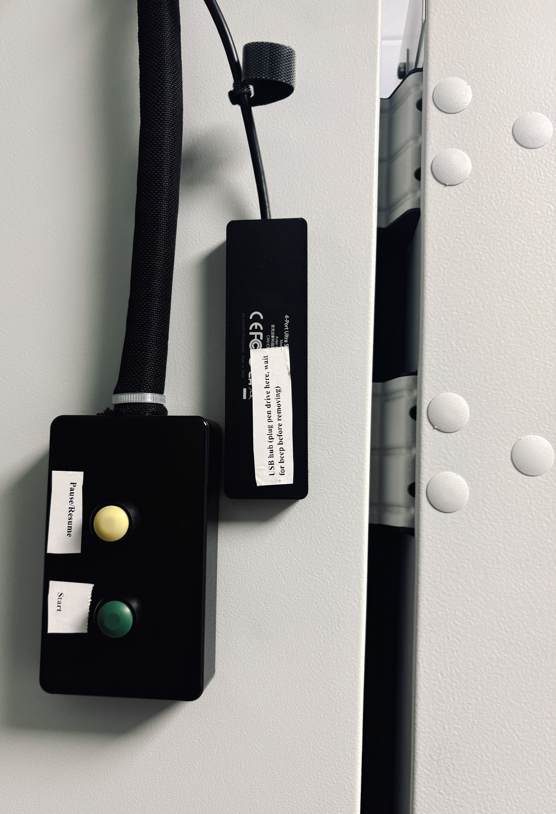

**Install required packages** (if not already done in step 4.2):

```bash
sudo apt install -y rsync exfatprogs ntfs-3g util-linux udev systemd
```

#### Create the export script

```bash
sudo nano /usr/local/sbin/export-images-to-usb.sh
```

Paste the following:

```bash
#!/usr/bin/env bash
set -Eeuo pipefail

readonly SOURCE_DIR="/home/pi/Automator/data"
readonly MOUNT_POINT="/mnt/image-export-usb"
readonly LOCK_FILE="/run/export-images-to-usb.lock"
readonly EXPORT_SUBDIR="images"

log() { echo "export-images-to-usb[$$]: $*"; }
fail() { log "ERROR: $*"; exit 1; }

DEVICE_NAME="${1:-}"
[[ -z "$DEVICE_NAME" ]] && fail "No device name supplied."
[[ ! "$DEVICE_NAME" =~ ^[A-Za-z0-9._+-]+$ ]] && fail "Invalid device name: $DEVICE_NAME"

readonly DEVICE="/dev/$DEVICE_NAME"
exec 9>"$LOCK_FILE"
flock -n 9 || { log "Another export is already running."; exit 0; }

[[ ! -d "$SOURCE_DIR" ]] && fail "Source directory does not exist: $SOURCE_DIR"
[[ ! -b "$DEVICE" ]] && fail "Device is not a block device: $DEVICE"

DEVTYPE="$(lsblk -no TYPE "$DEVICE" 2>/dev/null | head -n1 | tr -d '[:space:]' || true)"
[[ "$DEVTYPE" != "part" ]] && fail "Device is not a partition: $DEVICE type=$DEVTYPE"

PKNAME="$(lsblk -no PKNAME "$DEVICE" 2>/dev/null | head -n1 | tr -d '[:space:]' || true)"
[[ -z "$PKNAME" ]] && fail "Could not determine parent block device for $DEVICE"

PARENT_DEVICE="/dev/$PKNAME"
TRAN="$(lsblk -dn -o TRAN "$PARENT_DEVICE" 2>/dev/null | head -n1 | tr -d '[:space:]' || true)"
[[ "$TRAN" != "usb" ]] && fail "Parent device is not USB: $PARENT_DEVICE transport=$TRAN"

FSTYPE="$(blkid -o value -s TYPE "$DEVICE" 2>/dev/null || true)"
LABEL="$(blkid -o value -s LABEL "$DEVICE" 2>/dev/null || true)"
[[ -z "$FSTYPE" ]] && fail "Could not detect filesystem on $DEVICE"

case "$LABEL" in
  bootfs|rootfs) log "Skipping system partition: $DEVICE label=$LABEL"; exit 0 ;;
esac

case "$FSTYPE" in
  vfat|exfat|ext4|ntfs) log "Filesystem: $FSTYPE label=${LABEL:-none}" ;;
  *) fail "Unsupported filesystem: $FSTYPE" ;;
esac

mkdir -p "$MOUNT_POINT"
MOUNTED_BY_SCRIPT=0
EXPORT_OK=0

write_status_file() {
  local sf="$1" st="$2"
  mountpoint -q "$MOUNT_POINT" && {
    { echo "$st"; echo "Device: $DEVICE"; echo "Filesystem: $FSTYPE";
      echo "Timestamp UTC: $(date -u '+%Y-%m-%dT%H:%M:%SZ')"; echo "Hostname: $(hostname)";
    } > "$MOUNT_POINT/$sf" || true
  }
}

cleanup() {
  local ec=$?; set +e
  if [[ "$MOUNTED_BY_SCRIPT" -eq 1 ]] && mountpoint -q "$MOUNT_POINT"; then
    [[ "$EXPORT_OK" -eq 1 ]] \
      && write_status_file "EXPORT_DONE.txt" "Export completed successfully." \
      || write_status_file "EXPORT_FAILED.txt" "Export failed or was interrupted."
    log "Syncing and unmounting..."; sync; umount "$MOUNT_POINT"
    command -v udisksctl >/dev/null 2>&1 \
      && udisksctl power-off -b "$PARENT_DEVICE" >/dev/null 2>&1 || true
  fi
  exit "$ec"
}
trap cleanup EXIT INT TERM

EXISTING_MOUNTS="$(findmnt -rn -S "$DEVICE" -o TARGET 2>/dev/null || true)"
if [[ -n "$EXISTING_MOUNTS" ]]; then
  while IFS= read -r em; do
    [[ -z "$em" ]] && continue
    umount "$em" || fail "Could not unmount existing mount: $em"
  done <<< "$EXISTING_MOUNTS"
fi

mountpoint -q "$MOUNT_POINT" && fail "Mount point already in use: $MOUNT_POINT"

log "Mounting $DEVICE at $MOUNT_POINT..."
case "$FSTYPE" in
  ext4)  mount -t ext4  -o rw,noexec,nodev,nosuid "$DEVICE" "$MOUNT_POINT" ;;
  vfat)  mount -t vfat  -o rw,noexec,nodev,nosuid,uid=0,gid=0,umask=022,flush "$DEVICE" "$MOUNT_POINT" ;;
  exfat) mount -t exfat -o rw,noexec,nodev,nosuid,uid=0,gid=0,umask=022 "$DEVICE" "$MOUNT_POINT" ;;
  ntfs)  mount -t ntfs3 -o rw,noexec,nodev,nosuid,uid=0,gid=0,umask=022 "$DEVICE" "$MOUNT_POINT" \
           2>/dev/null || ntfs-3g -o rw,noexec,nodev,nosuid,uid=0,gid=0,umask=022 "$DEVICE" "$MOUNT_POINT" \
           || fail "NTFS: neither ntfs3 nor ntfs-3g available." ;;
esac
MOUNTED_BY_SCRIPT=1
mkdir -p "$MOUNT_POINT/$EXPORT_SUBDIR"

log "Starting rsync from $SOURCE_DIR/ to $MOUNT_POINT/$EXPORT_SUBDIR/"
if rsync -rt --ignore-existing --no-owner --no-group --no-perms --omit-dir-times \
    -- "$SOURCE_DIR"/ "$MOUNT_POINT/$EXPORT_SUBDIR"/; then
  EXPORT_OK=1; log "rsync completed."
else
  EXPORT_OK=0; log "ERROR: rsync failed."; exit 1
fi
exit 0
```

Set permissions:

```bash
sudo chmod 0755 /usr/local/sbin/export-images-to-usb.sh
sudo chown root:root /usr/local/sbin/export-images-to-usb.sh
```

#### Create the systemd service

```bash
sudo nano /etc/systemd/system/export-images-to-usb@.service
```

Paste:

```ini
[Unit]
Description=Export Automator capture images to USB partition %I
After=systemd-udevd.service local-fs.target
Wants=systemd-udevd.service

[Service]
Type=oneshot
ExecStart=/usr/local/sbin/export-images-to-usb.sh %I
TimeoutStartSec=30min
User=root
Group=root
StandardOutput=journal
StandardError=journal
NoNewPrivileges=true
PrivateTmp=true

[Install]
WantedBy=multi-user.target
```

Reload systemd:

```bash
sudo systemctl daemon-reload
```

#### Create the udev rule

```bash
sudo nano /etc/udev/rules.d/99-export-images-usb.rules
```

Paste:

```text
ACTION=="add", SUBSYSTEM=="block", ENV{DEVTYPE}=="partition", ENV{ID_BUS}=="usb", ENV{ID_FS_USAGE}=="filesystem", ENV{UDISKS_IGNORE}="1"

ACTION=="add", SUBSYSTEM=="block", ENV{DEVTYPE}=="partition", ENV{ID_BUS}=="usb", ENV{ID_FS_USAGE}=="filesystem", ENV{ID_FS_LABEL}=="bootfs", GOTO="export_images_usb_end"
ACTION=="add", SUBSYSTEM=="block", ENV{DEVTYPE}=="partition", ENV{ID_BUS}=="usb", ENV{ID_FS_USAGE}=="filesystem", ENV{ID_FS_LABEL}=="rootfs", GOTO="export_images_usb_end"

ACTION=="add", SUBSYSTEM=="block", ENV{DEVTYPE}=="partition", ENV{ID_BUS}=="usb", ENV{ID_FS_USAGE}=="filesystem", TAG+="systemd", ENV{SYSTEMD_WANTS}+="export-images-to-usb@%k.service"

LABEL="export_images_usb_end"
```

Reload udev:

```bash
sudo udevadm control --reload-rules
```

#### Testing

Plug in a USB drive and check its partition name:

```bash
lsblk -f
```

Start the service manually (replace `sda1` with the actual partition name):

```bash
sudo systemctl start export-images-to-usb@sda1.service
```

Check logs:

```bash
journalctl -u export-images-to-usb@sda1.service --no-pager -n 50
```

Successful output ends with `Unmounted /mnt/image-export-usb successfully.`

Note: The udev rule uses `ENV{UDISKS_IGNORE}="1"` to stop the Raspberry Pi desktop automounter from mounting the USB drive while the export service is running. If the desktop still automounts it, unmount manually with `sudo umount /media/pi/<label>`.

### 4.11 Python virtual environment

From the repository root:

```bash
python3 -m venv venv_clean
source venv_clean/bin/activate
python -m pip install --upgrade pip
pip install -r requirements.txt
```

The `requirements.txt` includes Flask, SocketIO, OpenCV, ONNX runtime, Picamera2, GPIO libraries, and QR decoding libraries.

For development tools:

```bash
pip install -r requirements-dev.txt
```

### 4.12 Secrets and environment variables

The controller requires these environment variables at startup. If `AUTOMATOR_ADMIN_PASSWORD` is not set, `maincontroller.py` raises a `RuntimeError` and the service will not start.

```bash
export AUTOMATOR_ADMIN_PASSWORD='choose-a-strong-password'
export AUTOMATOR_SESSION_SECRET='long-random-secret-string'
```

Run-completion emails are sent automatically from `no-reply-tslautomator@nbi.ac.uk` via `smtp.nbi.ac.uk` (port 25, no auth). No email credentials are required in the environment or the systemd service file.

> **Note:** Unauthenticated SMTP on port 25 is acceptable here because `smtp.nbi.ac.uk` is an internal institute relay that accepts submissions only from within the NBI network. The Automator Pi is always on the IOT network segment behind the institute firewall, so this relay is never reachable from the public internet.

### 4.13 systemd services

Two services manage the Automator runtime.

**automator-controller.service** — runs the main controller

Create `/etc/systemd/system/automator-controller.service`:

```ini
[Unit]
Description=Automator Controller
After=network.target

[Service]
Type=simple
User=pi
WorkingDirectory=/home/pi/Automator/dev2
Environment=AUTOMATOR_ADMIN_PASSWORD=<password>
Environment=AUTOMATOR_SESSION_SECRET=<secret>

ExecStart=/home/pi/Automator/venv_clean/bin/python /home/pi/Automator/dev2/maincontroller.py
Restart=no
StandardOutput=journal
StandardError=journal

[Install]
WantedBy=multi-user.target
```

`Restart=no` is intentional. The controller should not restart automatically after an operator stops it for safety review or maintenance.

**automator-buttons.service** — listens for GPIO button presses

Create `/etc/systemd/system/automator-buttons.service`:

```ini
[Unit]
Description=Automator GPIO Button Listener
After=network.target moonraker.service klipper.service
Requires=moonraker.service klipper.service

[Service]
Type=simple
User=pi
WorkingDirectory=/home/pi/Automator/dev2
Environment=AUTOMATOR_ADMIN_PASSWORD=<password>
ExecStartPre=/bin/sleep 5
ExecStart=/home/pi/Automator/venv_clean/bin/python /home/pi/Automator/dev2/button_listener.py
Restart=always
RestartSec=2
StandardOutput=journal
StandardError=journal

[Install]
WantedBy=multi-user.target
```

`Restart=always` is correct here. The button listener should recover if it crashes.

**Activate both services**:

```bash
sudo systemctl daemon-reload
sudo systemctl enable automator-controller.service
sudo systemctl enable automator-buttons.service
sudo systemctl start automator-controller.service
sudo systemctl start automator-buttons.service
```

### 4.14 PolicyKit rule

Moonraker and the button listener need permission to manage systemd units and issue reboots. Create the PolicyKit rule:

```bash
sudo nano /etc/polkit-1/rules.d/10-moonraker.rules
```

Paste:

```javascript
polkit.addRule(function(action, subject) {
    if (
        action.id == "org.freedesktop.systemd1.manage-units" ||
        action.id == "org.freedesktop.login1.power-off" ||
        action.id == "org.freedesktop.login1.power-off-multiple-sessions" ||
        action.id == "org.freedesktop.login1.reboot" ||
        action.id == "org.freedesktop.login1.reboot-multiple-sessions"
    ) {
        if (subject.user == "pi") {
            return polkit.Result.YES;
        }
    }
});
```

### 4.15 GPIO allocation

| GPIO | Physical pin | Function |
| --- | --- | --- |
| 17 | 11 | START button input |
| 27 | 13 | STOP button input |
| 23 | 16 | LED relay output |
| 26 | 37 | Door sensor input |
| 4 | 7 | Relay pulse trigger output |

Internal pull-ups are used on all inputs. No external resistors are required.

### 4.16 Validate the installation

After completing all steps above, run through this checklist:

```bash
# Check all services are running
sudo systemctl status klipper moonraker automator-controller.service automator-buttons.service

# Check the API responds
curl -u admin:<password> http://localhost:8080/system/version
curl -u admin:<password> http://localhost:8080/system/state

# Check Moonraker
curl -s http://localhost:7125/printer/info

# Check routing
ip route
ip route get 8.8.8.8
```

Then run one complete imaging cycle with a single plate to confirm end-to-end operation.

---

### 4.17 Kiosk and admin desktop

The Raspberry Pi uses a Labwc/Wayland desktop session with Chromium running in kiosk mode on boot. General users see the Automator interface full-screen on the HDMI display without needing a MacBook or Ethernet cable. Admins can exit kiosk to the full Pi desktop and return to kiosk using keyboard shortcuts.

| Action                    | Shortcut       |
|---------------------------|----------------|
| Exit kiosk → Pi desktop   | `Ctrl+Alt+A`   |
| Return to kiosk           | `Windows+K`    |

The kiosk uses two small scripts in `~/.local/bin/`:

- `enter-admin-desktop.sh` — kills Chromium, restores the Pi panel
- `start-kiosk.sh` — starts Chromium in kiosk mode at `http://127.0.0.1:8080/`

Keyboard shortcuts are bound via `~/.config/labwc/rc.xml`. Kiosk auto-starts on boot via `~/.config/labwc/autostart`. Desktop icons (`~/Desktop/*.desktop`) provide fallback access if shortcuts fail.

For the full step-by-step setup (including copy-paste setup block, troubleshooting, and safety rules), see [raspberry-pi-automator-kiosk-admin-desktop.md](raspberry-pi-automator-kiosk-admin-desktop.md).

---

## 5. Running the controller

### Direct (testing only)

```bash
cd /home/pi/Automator/dev2
source /home/pi/Automator/venv_clean/bin/activate
export AUTOMATOR_ADMIN_PASSWORD='<password>'
export AUTOMATOR_SESSION_SECRET='<secret>'
python maincontroller.py
```

From the Raspberry Pi desktop browser, admins can use:

```text
http://127.0.0.1:8080/
```

Normal users should use the directly connected MacBook route:

```text
http://192.168.50.2:8080/
```

### Via systemd (production)

```bash
sudo systemctl restart automator-controller.service
sudo systemctl status automator-controller.service
```

---

## 6. Code guide

All runtime Python files are at `/home/pi/Automator/dev2/`. Within that directory:

### 6.1 Core runtime

**`dev2/maincontroller.py`** — the main Flask + SocketIO application, port 8080.

Key responsibilities:

- Workspace QR detection via `/detect` (optional `?pulse=1` pre-scan pulse)
- Imaging configuration via `/config`
- Per-plate scheduling in `runtime` (hours) mode
- Imaging lifecycle: start, pause, resume, stop
- Pause-safe actuator handling: releases hold/vacuum and turns LEDs off on pause; restores them on resume
- Post-capture re-grip prevention: if a pause fires after the image is captured but before cleanup, the resume path skips the spurious re-grip (controlled by `_post_capture` flag in `stage_state`)
- Per-plate first-grip extended vacuum dwell: each plate gets a longer settle (8 s vs 6 s) on its first grip per sequence; flags reset after each inter-cycle park so post-park first grips also get the extended dwell
- Door sensor debounce: door-open events are confirmed after a 3 s delay; transients shorter than 3 s (e.g. from servo PWM noise on GPIO 26) are silently discarded and do not trigger a pause
- Inter-cycle parking: if the gap before the next capture is greater than 5 minutes, the arm parks at home and wakes up automatically before the next due capture
- Local Basic Auth for `/` and `/main`
- QR generation via `/qr/generate` and A4 QR PDF download via `/qr/print_sheet`
- Local file browsing via `/files/` and `/files/<path>`
- State persistence to `/home/pi/Automator/raw/controller_state.json` — survives unplanned reboots

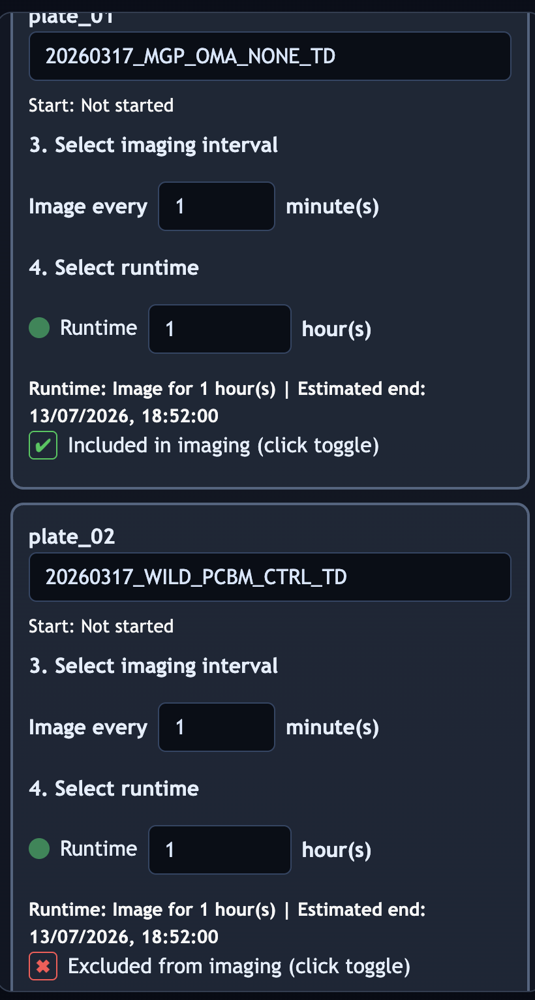

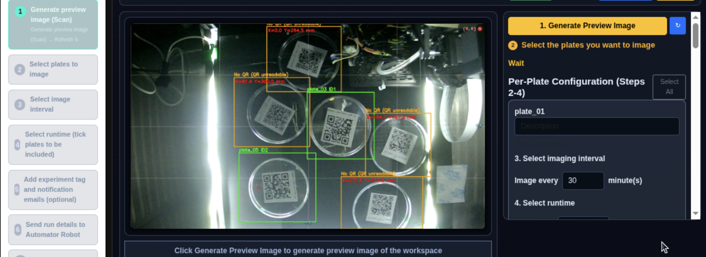

**`dev2/maingcodesender.py`** — Klipper/Moonraker G-code communication.

Thread-safe `send_gcode`, motion helpers, vacuum and rotation control wrappers, position readback.

**`dev2/mainusbcamera.py`** — USB camera detection pipeline.

ONNX dish detection, QR decoding, homography mapping. Caches the USB camera index in `data/usb_camera_index.json`. The detection system handles two QR label orientations: top-down (`TOP`) and bottom-down (`BOTTOM`).

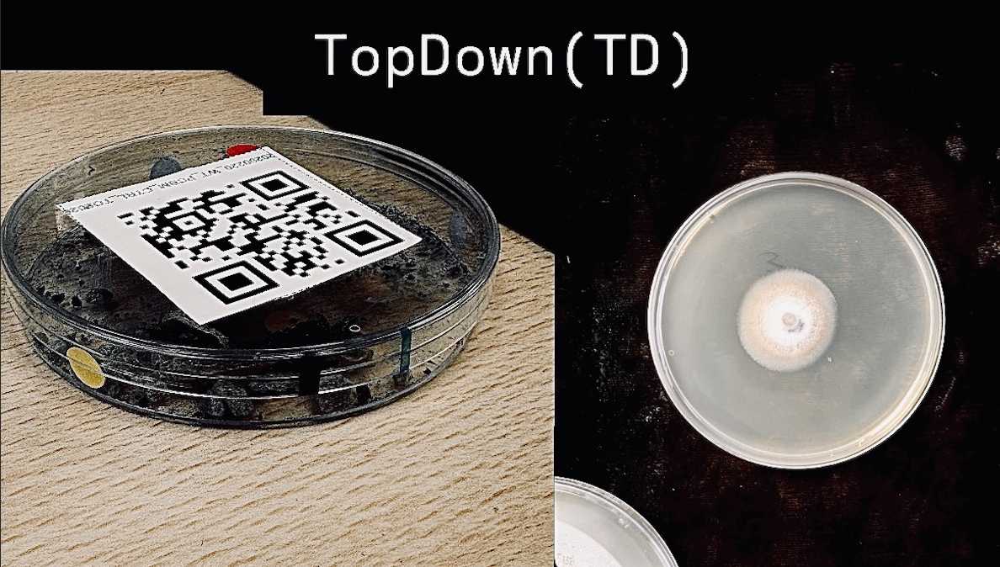 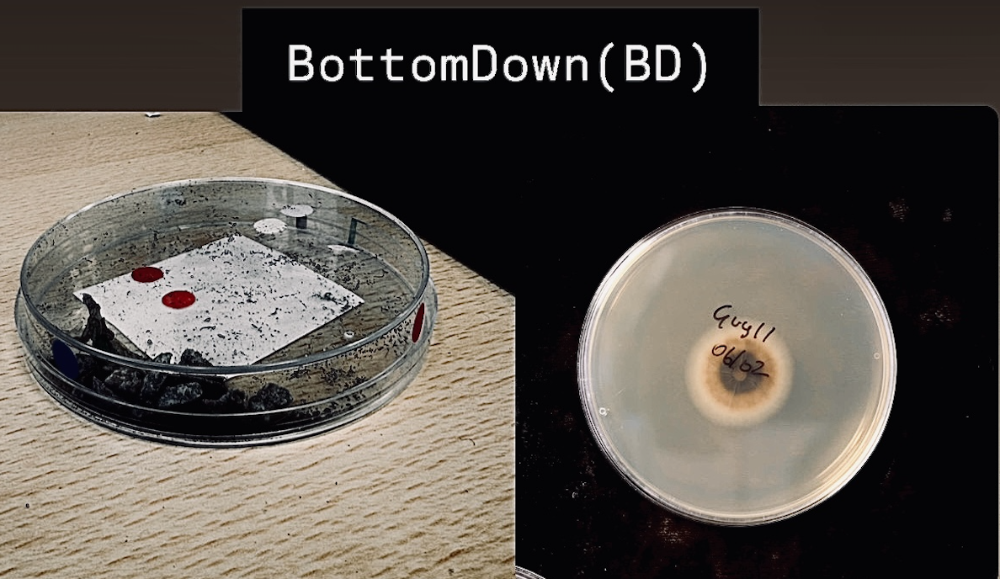

**`dev2/raspberry_camera.py`** — PiCamera2 still image capture.

### 6.2 Hardware and safety

**`dev2/doorsense.py`** — door sensor on GPIO 26 (open/closed state). Registers an `atexit` handler to release GPIO pin 26 on process exit.

**`dev2/led.py`** — LED relay on GPIO 23. Registers an `atexit` handler to drive the relay LOW and release GPIO pins 23 and 4 on process exit.

**`dev2/button_listener.py`** — hardware button logic.

- START (GPIO 17): `systemctl start automator-controller.service`
- STOP short press: pause/resume via API

### 6.3 Diagnostics (internal use only)

**`dev2/maindiagnostics.py`** — separate diagnostics web app for internal testing. Provides live MJPEG, machine state telemetry, and movement/vacuum/rotation test endpoints. Not used during production imaging.

**`dev2/main_mjpeg_server.py`** — standalone MJPEG streaming server on port 9000. Internal only.

**`dev2/calibration.py`** — interactive calibration scripts for homography and corner mapping.

**`dev2/qrtest.py`** — QR detection test utility.

### 6.4 UI assets

**`dev2/templates/index_qr.html`** — QR generator/setup UI for plate details and downloadable A4 QR PDF sheet. A standalone equivalent of this page is published separately as the `qr-generator-Automator` PyPI package for users who want to generate labels without connecting to the Automator; it is not part of this repo's `requirements.txt` and is not installed on the Pi.

**`dev2/templates/index.html`** — main imaging workflow view; includes the optional Notification Emails field (below the experiment tag; institute addresses only: `@nbi.ac.uk` or `@tsl.ac.uk`). A **Select All** button beside the Per-Plate Configuration heading selects every detected plate in one click; individual plates can still be unticked using their per-card toggle. After clicking **Send Run Details to Automator**, an auto-dismissing popup confirms the estimated run finish time, total image count, and notification email recipient. Footer includes a **Go back to QR page** button (beside ● Kp ● Mk) that navigates to `/`; a confirm dialogue is shown if `imaging_active` is true when the button is clicked. Footer also includes a **Troubleshooting** button that opens a modal to restart Klipper or Moonraker via `POST /system/restart-klipper` and `POST /system/restart-moonraker` (both `@require_auth`; each runs `sudo systemctl restart <service>` on the Pi). If either Klipper or Moonraker goes offline, a non-blocking popup appears at the bottom-right of the page prompting the operator to use the Troubleshooting section; the popup auto-dismisses after 40 s and has a manual dismiss button.

**`dev2/static/`** — logo, overlays, preview images.

### 6.5 Configuration and state files

| File | Purpose |
| --- | --- |
| `~/printer_data/config/printer.cfg` | Klipper pin/macro configuration |
| `/home/pi/Automator/raw/controller_state.json` | Run state, survives reboot |
| `/home/pi/Automator/raw/plates_db.json` | Plate detection database |
| `/home/pi/Automator/raw/controller.log` | Controller log |
| `/home/pi/Automator/data/` | All captured images |
| `/home/pi/Automator/data/usb_camera_index.json` | USB camera device cache |

Do not delete `controller_state.json` during a run. The system reads it on startup to resume an interrupted session.

---

## 7. Admin troubleshooting

### 7.1 Service does not start

```bash
systemctl status automator-controller.service
journalctl -u automator-controller.service -f
```

If the log shows `RuntimeError: AUTOMATOR_ADMIN_PASSWORD is not set`, the password is missing from the service environment. Edit the service file, add the environment variable, then `sudo systemctl daemon-reload && sudo systemctl restart automator-controller.service`.

### 7.2 Motion commands fail or no homing

```bash
sudo systemctl status klipper
curl -s http://localhost:7125/printer/info
journalctl -u klipper -n 50
```

If Klipper is not running or the printer info returns an error:

Users can also restart Klipper or Moonraker from the web UI **Troubleshooting** button (footer of `/main`) without terminal access.

- Restart Klipper: `sudo systemctl restart klipper`
- Verify the MKS board is connected: `ls /dev/serial/by-id/`
- Verify `printer.cfg` macros and pin names match the hardware
- Confirm the board was flashed correctly (see section 4.5)

### 7.3 USB camera not detected

```bash
v4l2-ctl --list-devices
python /home/pi/Automator/dev2/qrtest.py
```

If no camera appears, try a different USB port and restart the service. If the wrong camera index is cached, remove the stale cache file:

```bash
rm /home/pi/Automator/data/usb_camera_index.json
sudo systemctl restart automator-controller.service
```

### 7.4 Pi camera capture fails

```bash
libcamera-hello
```

If this fails, the Picamera2/libcamera stack is not installed correctly or the CSI ribbon cable is not seated. Check the ribbon cable orientation on both ends (the Pi CSI connector and the camera itself).

### 7.5 Buttons not working

```bash
systemctl status automator-buttons.service
journalctl -u automator-buttons.service -f
curl -u admin:<password> http://127.0.0.1:8080/system/state
```

If the button service logs auth errors, the `AUTOMATOR_ADMIN_PASSWORD` in `automator-buttons.service` does not match the one in `automator-controller.service`. They must be identical.

If the service shows GPIO busy errors, another process is holding the GPIO pins. Check for duplicate processes with `ps aux | grep button_listener`.

### 7.6 Controller restarts unexpectedly

The `automator-controller.service` unit must have `Restart=no`. If the controller restarts automatically after being stopped for safety review or maintenance, the unit file has been changed. Correct it and reload:

```bash
sudo systemctl daemon-reload
sudo systemctl restart automator-controller.service
```

### 7.7 After relocation or path change

If the repository is moved from `/home/pi/Automator/`, update all hard-coded paths in:

- `dev2/maincontroller.py`
- `/etc/systemd/system/automator-controller.service`
- `/etc/systemd/system/automator-buttons.service`
- `config/printer.cfg` (if paths are referenced there)

Then reload systemd.

### 7.8 Quick checks

```bash
# Controller status
curl -u admin:<password> http://127.0.0.1:8080/system/version
curl -u admin:<password> http://127.0.0.1:8080/system/state

# Logs
tail -n 200 /home/pi/Automator/raw/controller.log
journalctl -u automator-controller.service -n 200 --no-pager

# Disk space
curl -u admin:<password> http://127.0.0.1:8080/system/disk
df -h /home/pi/Automator/data

# JPG cleanup — timer status and last run log
systemctl is-active cleanup-jpgs.timer
journalctl -u cleanup-jpgs.service -n 20 --no-pager
python3 /home/pi/Automator/dev2/cleanup_jpgs.py   # dry run, no deletion

# Temperature
vcgencmd measure_temp
```

---

## 8. Maintenance schedule

### Daily

- Visual inspection: no obstructions in the gantry path, no loose cables
- Check disk space (local) — imaging stops if local storage drops below 5%; confirm cleanup timer is active (`systemctl is-active cleanup-jpgs.timer`); automated cleanup runs every 3 days via `cleanup-jpgs.timer` (see [JPG_Cleanup_Workflow.md](JPG_Cleanup_Workflow.md))
- Review the tail of the controller log for errors

### Weekly

- Inspect the Pi camera lens for dust or condensation
- Verify all services are running: `systemctl status automator-controller.service klipper moonraker automator-buttons.service`
- Test the door interlock: open the door during a test scan and confirm the UI shows the door-open state. If the door opens while the servo is at 0° (mid-capture), the controller retracts the servo to 90° before releasing vacuum to prevent the lid dropping onto the sample.

### Monthly

- Verify the latest backup is less than 3 days old
- Test the physical AC-side emergency stop and confirm all system supplies lose power
- Check CPU temperature at load: should stay below 75°C

### Quarterly

- Review firmware and dependency updates on GitHub. Test in a non-production run before deploying.
- Inspect mechanical components: belts, bearings, stepper motor mounts for wear or loose fasteners

### Every 6 months

- Rotate `AUTOMATOR_ADMIN_PASSWORD` and `AUTOMATOR_SESSION_SECRET`. Update both service files, reload systemd, restart services.
- Review this document against the current codebase for accuracy.

#### Backup procedure

Images accumulate in `/home/pi/Automator/data/`. Export to a USB drive as described in the user guide, or copy via `scp` from another machine on the same network.

#### Software update procedure

1. Announce a maintenance window.
2. Stop active imaging.
3. Back up data and raw directory.
4. Pull reviewed code: `cd /home/pi/Automator && git pull`
5. Update Python dependencies: `source venv_clean/bin/activate && pip install -r requirements.txt`
6. Restart services: `sudo systemctl restart automator-controller.service`
7. Verify with `curl -u admin:<password> http://localhost:8080/system/version`
8. Run a test imaging cycle.

---

## 9. Security

### Credentials

- `AUTOMATOR_ADMIN_PASSWORD` and `AUTOMATOR_SESSION_SECRET` must never be committed to the git repository.
- Set them only in the systemd service environment, not in shell profiles or code.
- Rotate after any incident and on the 6-monthly schedule.

### Network access

- The controller binds to `0.0.0.0` (all interfaces) by default for direct MacBook Ethernet, kiosk display, and Pi-local/admin workflows, but should never be exposed to an untrusted network.
- Keep the controller behind the institutional network boundary. Do not open it to the internet.
- Do not use the kiosk display and a MacBook Ethernet connection simultaneously — running both at once can cause latency.

### Access control

- The `admin` credential is the only account. There is no separate read-only user.
- Restrict knowledge of the admin password to technical staff.
- Revoke or rotate the password promptly when personnel with access leave.

### Audit logs

Retain:

- `/home/pi/Automator/raw/controller.log`
- `journalctl -u automator-controller.service`
- Any incident notes
- `journalctl -t eth0-auto-switch`

---

## 10. Practical takeover checklist

Run through this list when taking over an existing deployment:

1. Confirm the hardware emergency stop (AC-side latching switch) works — press it, verify all motion ceases and all power indicators go off. Reference photo: [hardware/images/estop.jpg](../hardware/images/estop.jpg).
2. Confirm Klipper and Moonraker are running: `systemctl status klipper moonraker`.
3. Confirm `AUTOMATOR_ADMIN_PASSWORD` and `AUTOMATOR_SESSION_SECRET` are set in the systemd unit file.
4. Confirm `automator-buttons.service` is running and uses the same admin password as `automator-controller.service`.
5. If email notifications are used, confirm the Pi can reach `smtp.nbi.ac.uk` on port 25: `nc -vz smtp.nbi.ac.uk 25`.
6. Confirm routing is correct: `ip route get 8.8.8.8` should go via `wlan0`.
7. Confirm QR PDF download works from `/` by adding one QR code and clicking **Download PDF Sheet**.
8. Confirm normal-user direct MacBook access works from `http://192.168.50.2:8080/`. For admin desktop checks, confirm `http://127.0.0.1:8080/` works from the Pi desktop browser.
9. Run one complete imaging cycle with a single test plate. Confirm the image appears in `/home/pi/Automator/data/`.

---

## 11. Rebuild from scratch

### Option A: Same hardware, same configuration

Follow sections 4.1 through 4.16 in order. Keep the repository at `/home/pi/Automator/`. Run the takeover checklist in section 10.

### Option B: New or different hardware components

Start from a clean clone of the repository and work through the installation in order, but update each layer where the hardware differs:

1. Update `config/printer.cfg` for any new pin assignments, motor parameters, or axis limits. Validate Klipper motion independently before running the Automator controller.
2. Update `dev2/doorsense.py` if the door sensor pin changed.
3. Update `dev2/led.py` if the LED relay pin changed.
4. Update `dev2/button_listener.py` if button GPIO pins changed.
5. Re-run workspace calibration with `dev2/calibration.py`. Confirm a valid `data/calibration.json` exists before attempting a full imaging run.
6. Validate the USB camera detection pipeline: run `dev2/qrtest.py` and confirm QR codes are readable.
7. Validate the Pi camera capture path: run a test capture and inspect the output.
8. Test all safety paths before production use: pause, resume, physical AC-side emergency stop, door-open interrupt.

A new build should be accepted only after all items in the acceptance checklist above pass.

---

## 12. Technical support

For code, system, or hardware problems:

- Dan MacLean: <dan.maclean@tsl.ac.uk>
- Rohan R: <phonics-tiffs1i@icloud.com>

For network, IT, or access permission issues: <christopher.rickett@tsl.ac.uk>

Repository: <https://github.com/rotsl/Automator>

For detailed runbook procedures, commissioning checklists, and acceptance tests, see [RunBook.md](RunBook.md).
