<!--
SPDX-License-Identifier: CC-BY-4.0
Copyright (c) 2025–2026 Rohan R
-->

# How to use Automator

Automator is a robotic imaging system at The Sainsbury Laboratory, Norwich. It photographs QR-labelled Petri dishes automatically at set intervals over the course of an experiment. You set up a schedule in a web browser, place your plates in the workspace, and the system handles the imaging without you needing to be present.

The robot arm carries a camera. At each scheduled interval, it moves over a plate, uses a small suction cup to lift the lid slightly, takes a photograph with a high-resolution camera, replaces the lid, and moves to the next plate. This repeats on a schedule you define, for as long as you need.


Automator gantry — front view

You control everything through a web browser. There is no software to install on your computer.

---

## 1. User requirements

### A. Equipment

#### 1. Desktop display available (monitor, keyboard, mouse)

If a monitor, keyboard, and mouse are connected to the Automator, no laptop is required. The interface opens automatically on the screen when the system starts.

#### 2. No desktop display — laptop required

If no monitor is connected, you need:

- A MacBook (or laptop) with a USB-C to Ethernet adapter
- An Ethernet cable

MacBook connected to Automator via USB-C to Ethernet adapter

### B. USB pen drive

Have a USB pen drive available if you need to export images directly to your computer. See [Exporting images to a USB drive](#exporting-images-to-a-usb-drive) for details.

### C. Login credentials

| Field | Value |
| --- | --- |
| Username | `admin` |
| Password | `tsl` |

---

## Location

The Automator is located inside **TSL PGC07** (a BINDER growth chamber) in the Growth Room on the TSL Building Ground Floor, at the end of the room nearest the window.


TSL PGC07 — BINDER growth chamber housing the Automator


Automator inside TSL PGC07 with the door open

> **Do not move the setup and do not pull any cables.** The Automator is a precision instrument with calibrated cable routing. Disturbing it may break wiring connections or shift the workspace calibration. If the setup has been moved or cables are disconnected, contact the TSL Bioinformatics team before use.

---

## 2. Accessing the system and setting up for a run

### Accessing the web interface

There are two ways to access Automator. Use only one at a time — running both simultaneously can cause latency.

If a desktop display (monitor, keyboard, mouse) is available, use kiosk mode. If not, use the direct MacBook Ethernet connection.

#### Kiosk display (monitor, keyboard, mouse)

If a monitor, keyboard, and mouse are connected directly to the Raspberry Pi, the Automator interface opens automatically on boot. No MacBook or Ethernet cable is required.

Log in with username `admin` and the password from Section 1.C.

#### Direct MacBook Ethernet connection

You need a USB-C to Ethernet adapter and an Ethernet cable to connect to the Automator. Plug the USB-C adapter directly into your MacBook's USB-C port.


MacBook connected to Automator via USB-C to Ethernet adapter

The Ethernet cable hangs on the wall beside TSL PGC07. Unclip it when needed and connect it to your USB-C to Ethernet adapter. Do not pull the cables that are routed through or into the chamber.

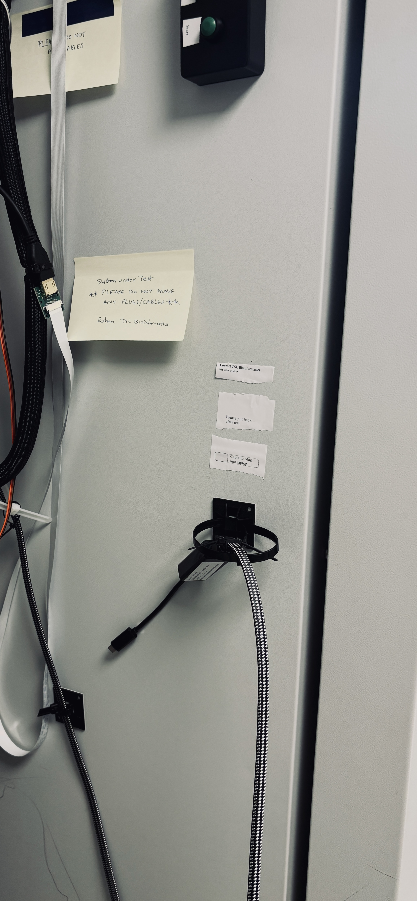

Ethernet cable location — beside TSL PGC07

1. Plug the USB-C to Ethernet adapter into your MacBook's USB-C port, then plug the Ethernet cable from the adapter into the Ethernet port on the Automator. Connect directly to the Automator only — do not connect to any other network port.

2. Wait 15–20 seconds. The Automator switches to direct MacBook mode and assigns your MacBook an IP address automatically.

Open your browser and go to:

```text
http://automator.local:8080/
```

or

```text
http://192.168.50.2:8080/
```

Log in with username `admin` and the password from Section 1.C. If you cannot reach the interface, contact the TSL Bioinformatics team.

---

## Physical buttons

The device has two physical buttons on the front panel. They work even if the web interface is unavailable.

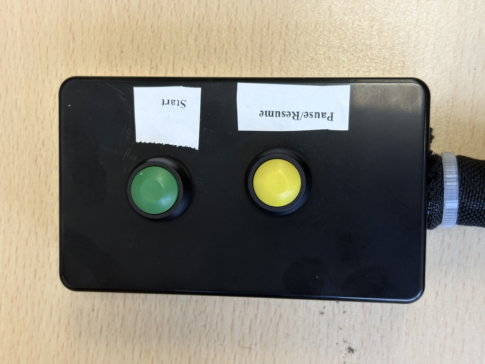

Physical START and STOP buttons

The buttons are on the side wall of TSL PGC07, next to the Automator.


Physical button location — side of TSL PGC07

| Button | Function |
| --- | --- |
| START | Starts the Automator controller |
| STOP | Pauses or resumes a run |

### START button

| Situation | Result |
| --- | --- |
| Controller not running | Starts the controller |
| Controller already running | No effect |

### STOP button

| How pressed | Result |
| --- | --- |
| Short press during a run | Pauses at the next safe point |
| Short press while paused | Resumes from where it stopped |

---

## Web interface controls

### Start/Stop button

Before acting, the interface shows a confirmation message:

- During a run: "Are you sure you want to Stop? System will start from beginning. Follow Workflow instructions."
- When idle: "Starting New Cycle, Follow Workflow Instructions."

| State | What happens |
| --- | --- |
| Imaging running | Controlled stop at the next safe point |
| Imaging idle | Runs safe-home, arm moves to ready position |
| During start preparation | Cancels the run before it launches |

### Pause/Resume button (blue)

A single button that toggles between paused and running.

| State | What happens |
| --- | --- |
| During imaging | Pauses at the next safe checkpoint |
| While paused | Resumes from exactly where it stopped |
| Imaging not active | Ignored |

While paused, the suction hold releases and the LEDs turn off. On resume, both restore to their previous state before imaging continues.

---

## 3. QR code labels for your plates

Every plate must have a QR code label attached before you place it in the workspace. The system reads these codes to identify each plate and name the output images.


QR-labelled plates in the workspace

### What the QR code encodes

The QR code stores a text string in this structure:

```text
YYYYMMDD_STRAIN_MEDIA_CONDITION_VIEW
```

Example:

```text
20260219_WT_PCBM_CTRL_TOP
```

| Part | Meaning |
| --- | --- |
| `YYYYMMDD` | Experiment start date |
| `STRAIN` | Genotype or organism |
| `MEDIA` | Growth medium |
| `CONDITION` | Treatment or control label |
| `VIEW` | Imaging orientation (usually `TOP`) |

Top-down and bottom-down labels look like this:


Top-down (TD) label orientation


Bottom-down (BD) label orientation

### Generating QR codes

The web interface has a built-in QR code generator. The QR setup page is accessible at:

```text
http://automator.local:8080/
```

This is available whether you are connected via MacBook Ethernet or using the kiosk display. Once you have generated and downloaded your labels, click **Proceed to imaging system** — this takes you to `http://automator.local:8080/` where you set up and start your run.

To return to the QR setup page from the main imaging page at any time, click **Go back to QR page** in the footer (beside the ● Kp ● Mk status indicators). If an imaging run is currently in progress, a confirmation prompt will appear before navigating away.

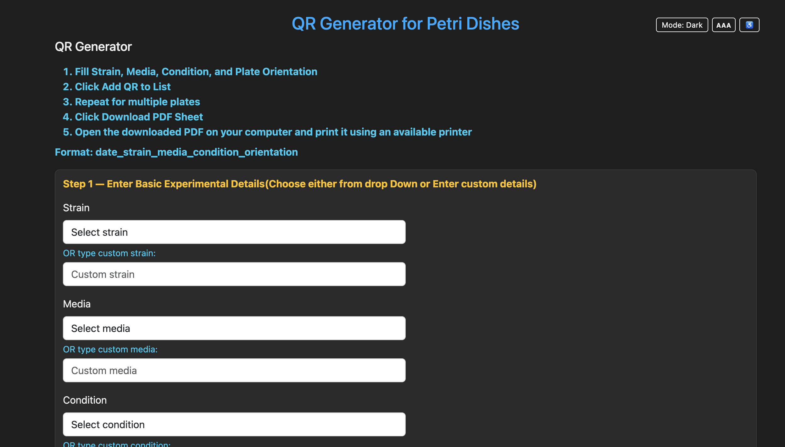

QR code generator — experimental details form

Use the dropdowns for standard values, or type custom values into the custom fields. Select the plate orientation as `TD` (top down) or `BD` (bottom down), then click **Add QR to List**.

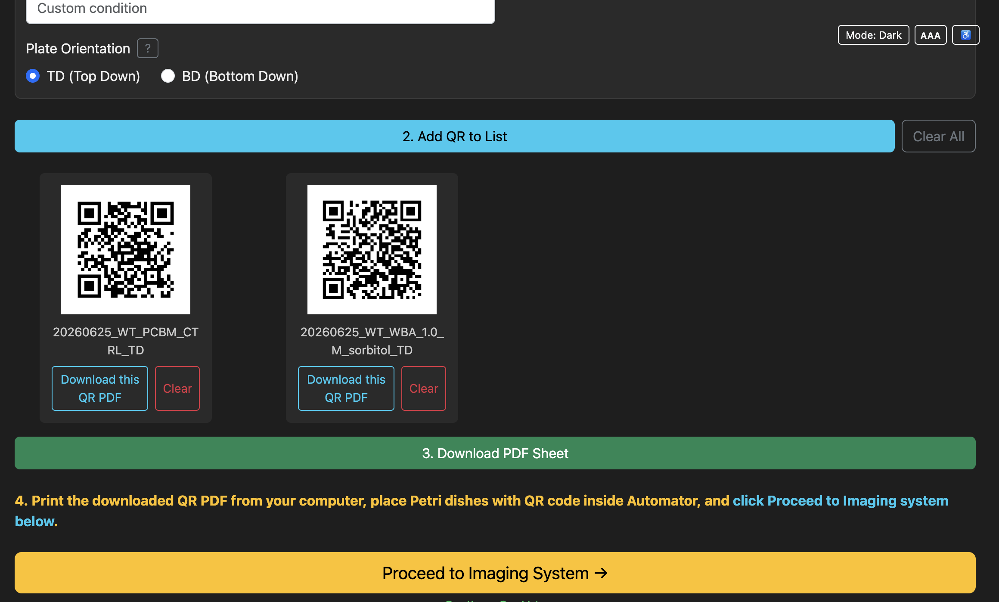

QR code generator — orientation and Add QR controls

Generated QR labels appear in a list below the form. You can remove individual labels with **Clear** or remove all labels with **Clear All**.

Once generated, click **Download PDF Sheet**. The PDF downloads to the computer you are using, so you can open it and print it from any available printer.

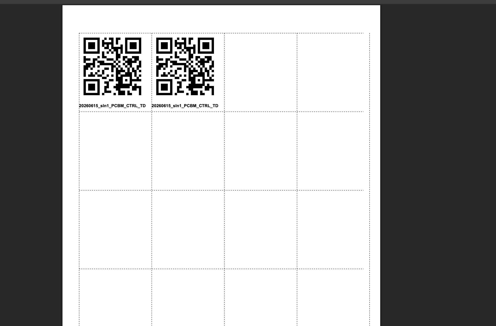

Printable QR label PDF sheet

### Standalone QR generator (optional, runs on your own computer)

If you want to prepare QR labels without connecting to the Automator, a standalone version of the QR generator is available as a Python package on PyPI: [`qr-generator-Automator`](https://pypi.org/project/qr-generator-Automator/). It provides the same label/PDF generation as the built-in QR setup page, but runs locally on your computer.

Install it in a virtual environment:

```bash
python3 -m venv qrenv
source qrenv/bin/activate
pip install --upgrade pip
pip install qr-generator-Automator
```

Run it:

```bash
qr-generator
```

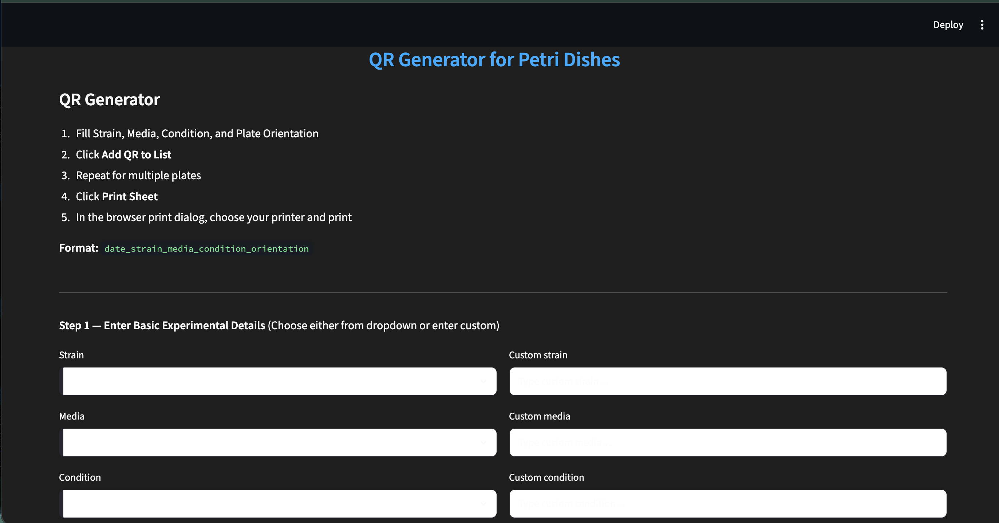

Standalone QR generator — entering experimental details

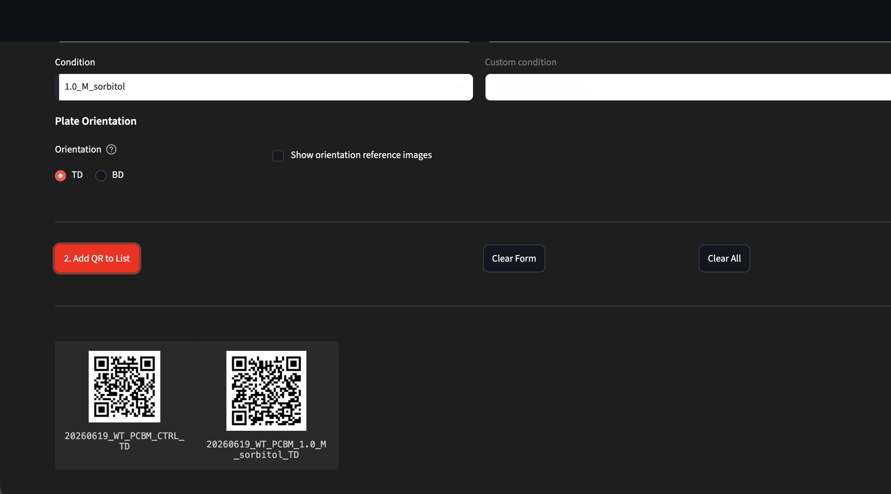

Standalone QR generator — plate orientation and QR list

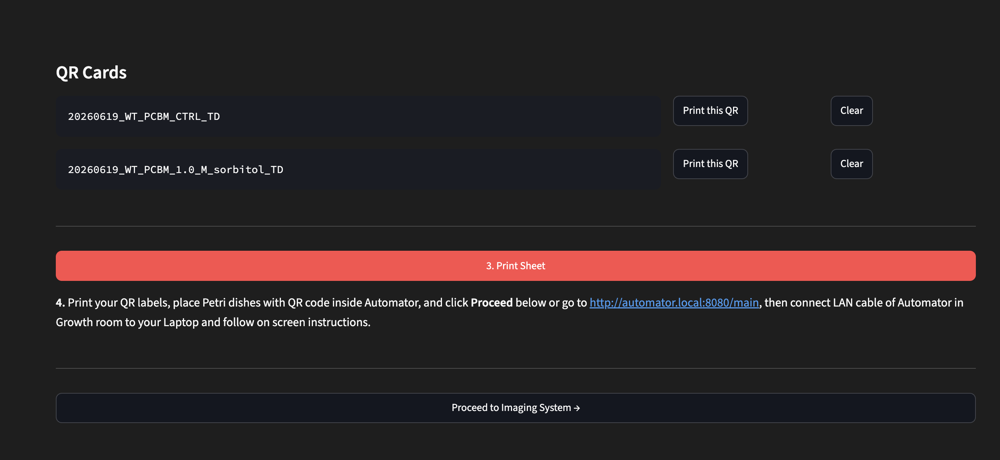

Standalone QR generator — QR Cards and Print Sheet

The standalone generator runs independently on your own laptop. Once you have printed your labels, click **Proceed to imaging system** — this takes you to `http://automator.local:8080/` where you set up and start your run.

### Where to place labels on the dish

Stick the label onto the top dish lid of the Petri dish.

The top-mounted camera reads labels placed on top of the lid from above.

Common reasons detection fails:

- Label is wrinkled or starting to peel
- Label is angled steeply, causing glare under the camera light
- Print is not clear, has glue on it, or is soiled

---

## Step-by-step imaging workflow

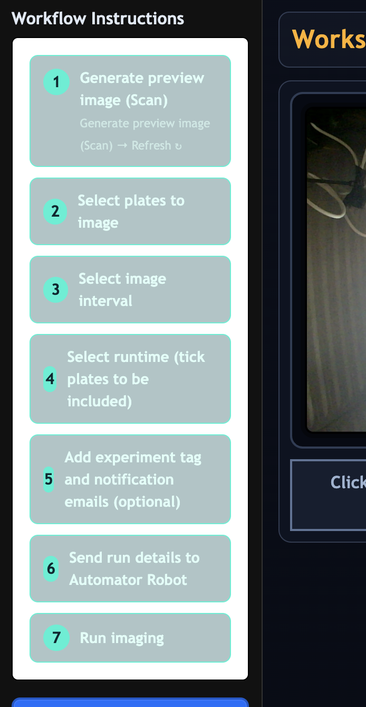

Left panel — imaging workflow steps overview

### Step 1: Scan the workspace

Place your QR-labelled plates inside the Automator workspace and close the enclosure door. Round Petri dishes/plates of 90–100 mm are supported. **Up to 6 dishes can be placed at one time** — this is a hardware limit. Place each dish flat on one of the **green sticker positions** marked on the workspace floor, with the QR label facing up. Do not stack plates. Then click **Generate Preview Image**. A **↻** button beside it reloads the page if needed without triggering a new scan.

> **When placing plates, do not touch the gantry frame, cables, or any part of the setup.** Reach carefully into the workspace from the front and place each Petri dish flat on the workspace mat with the QR label facing up, as shown in the image above. Do not lean on or push the structure.

The overhead USB camera scans for QR codes. When it finishes, the status text changes from `Wait` to `Now tick plates to be included`. A preview image appears showing the detected plate positions.

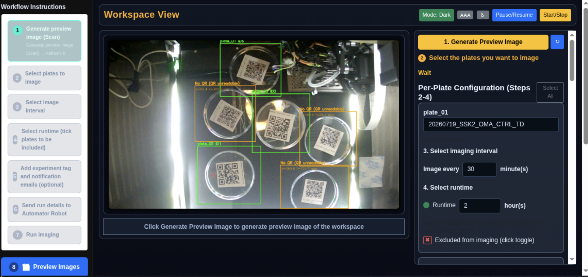

Workspace scan — detected plate positions

If a plate is not detected:

- Check the label is flat, fully visible, and unobscured
- Avoid strong shadows or reflections across the QR code
- Keep the plate within the marked boundary on the workspace floor
- Try rotating the plate slightly if the code is at an awkward angle
- Click **Generate Preview Image** again

### Plates detected with unreadable QR codes

The system can detect a plate's physical position even when its QR code cannot be read — for example, if the label is wrinkled, glare-affected, or the print is unclear.

Plates in this state appear in the preview image with an **orange bounding box** and the label **"No QR (QR unreadable)"**. They also appear in a separate **Unresolved plates** panel below the scan preview.

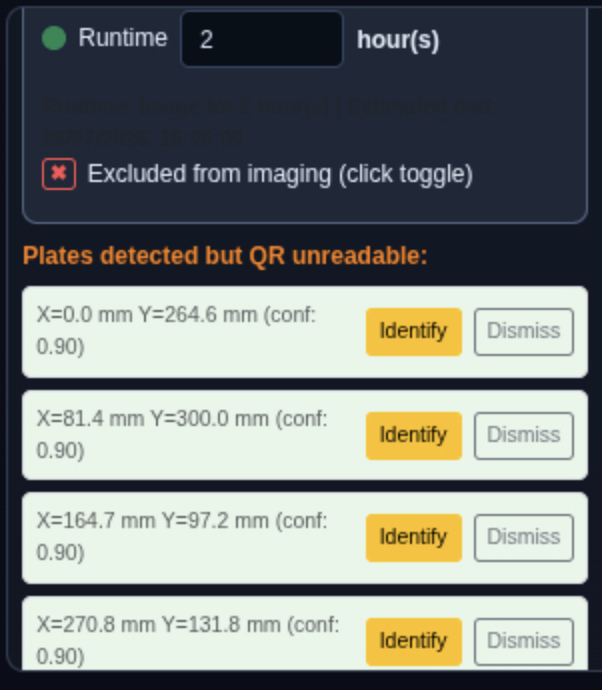

Unresolved plates panel — plates detected but QR unreadable

For each unresolved plate you have two options:

- **Identify** — click Identify, type in the QR data string (same format as your labels), and press Save. The plate is added to the plate list with the description you entered, ready to configure like any other plate.
- **Dismiss** — click Dismiss to remove the entry from the unresolved list. Dismissed plates will not appear again in subsequent scans of the same session.

If you identify an unresolved plate, it behaves exactly like a normally detected plate: you configure the interval and runtime, then include it in the run.

If the QR code is completely obscured and you cannot determine which label belongs to that dish, replace or reattach the QR label and click **Generate Preview Image** again.

### Step 2: Configure each plate

Each detected plate appears as a row in the configuration panel below the preview.

The workspace scan view shows the detected plate boxes and the per-plate configuration panel side by side.


Per-plate run configuration panel

For each plate you want to include:

1. Confirm the description has filled in correctly from the QR code. (Autofilled when Scan workspace is pressed from previous step)
2. Set **Image every (minutes)**: type the interval in minutes (e.g., `30` for every 30 minutes).
3. Set the runtime in hours. The estimated end time appears automatically.
4. Click the include/exclude toggle at the bottom of the card to include the plate in the run.

> **Tip:** Use the **Select All** button at the top of the Per-Plate Configuration panel to include every detected plate in one click. You can still untick individual plates using their toggle afterwards.

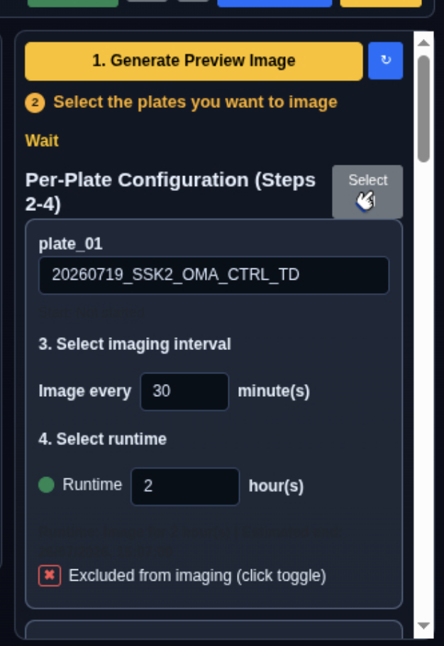

Per-plate configuration panel with Select All button

When all plates are configured, click **Send Run Details to Automator**.

A confirmation popup appears briefly showing the estimated run finish time, total number of images scheduled, and the notification email address (if entered). It dismisses automatically after a short delay or can be closed with **Dismiss**.

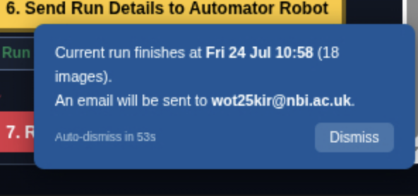

Run details confirmation popup

#### Experiment tag (optional)

On the main imaging page, you may fill in an experiment tag before starting:

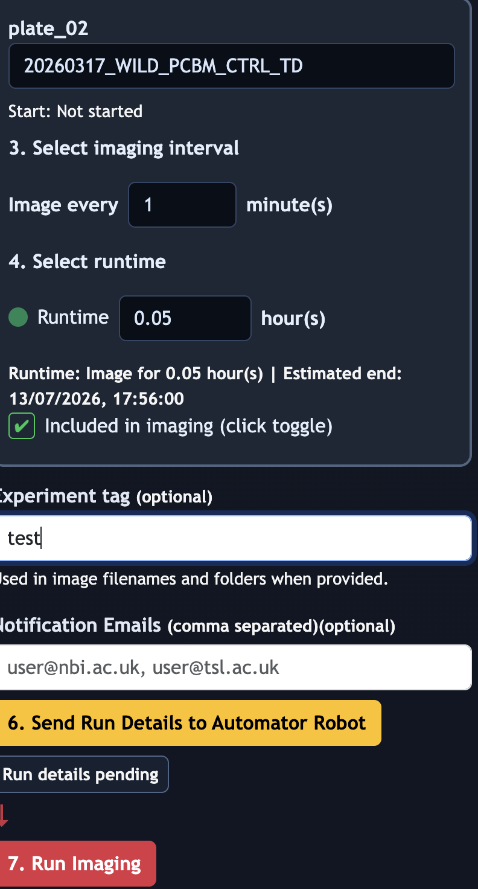

Experiment tag and notification email fields

> `Experiment tag`

Rules for the tag:

- Optional — imaging works when it is empty
- Maximum 15 characters, no spaces
- When supplied, the tag is appended to every image filename and folder name as `_tag-<your-tag>`

Choose something short and recognisable: `rex_mgp_mon`, `jb_trial2`, `ctrl_jan26`.

#### Notification emails (optional but recommended)

Enter one or more email addresses in the **Notification Emails** field on the imaging page (below the experiment tag), separated by commas. You will receive a summary email when each plate's run finishes.

- Use only institute email addresses ending in `@nbi.ac.uk` or `@tsl.ac.uk`. External addresses are not supported and may not receive notifications.
- Entered addresses are stored in the browser and pre-filled on your next visit.

Notification emails are sent from `no-reply-tslautomator@nbi.ac.uk` via the NBI mail server.

> **Data handling:** Email addresses entered here are used solely to send run-completion notifications and are not stored on the Pi beyond the current browser session. Emails are delivered over the NBI internal network and handled in accordance with NBI data handling policies. Do not enter personal email addresses outside `@nbi.ac.uk` or `@tsl.ac.uk`.

### Step 3: Start imaging

Click **Run Imaging**.

The system will:

1. Move the camera arm to its home position
2. Move to the first plate
3. Lower to imaging height, turn on LEDs, and apply suction to the plate lid
4. Take the photograph and save it
5. Release the plate, turn off LEDs, return to safe travel height
6. Move to the next plate and repeat
7. If the gap before the next capture is longer than 5 minutes, the arm parks at home and resumes automatically just before the next scheduled capture
8. Continue until all plates finish their schedules
9. Send completion emails to any entered recipients

Live status updates and a running log appear in the web interface throughout.


Live imaging view with run status and log

---

## What happens during each imaging cycle

Each time a plate is imaged, these steps happen in order:

1. Camera arm lifts to safe travel height
2. Arm moves horizontally to the plate position
3. Arm lowers to capture height
4. LED strip turns on
5. Suction cup contacts the plate lid and applies vacuum hold
6. Servo rotates the lid away from the dish base to expose the colony surface

   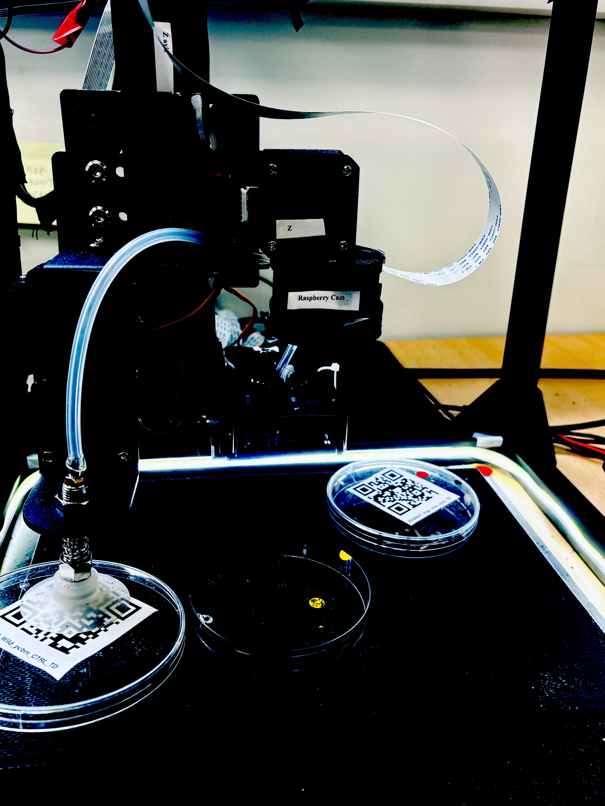

   Plate lid lifted during imaging

7. Raspberry Pi camera captures the image
8. Image is saved to local storage with full metadata
9. Lid is released, LEDs turn off, arm returns to safe travel height

If the enclosure door opens during imaging, the system pauses and holds in a safe position. Imaging resumes automatically when the door is closed again. Very brief transients (under 3 seconds) are filtered out and do not trigger a pause — this prevents false interruptions caused by vibration or servo PWM noise on the door sensor line.

---

## Image naming

Images are named automatically in this format:

```text
YYYYMMDD_P###_DDMMM_STRAIN_MEDIA_COND_d##_HHMMSSmmm_VIEW_tag-<yourtag>.JPG
```

Example:

```text
20260317_P002_17MAR_WT_PCBM_CTRL_d26_114130997_TOP_tag-rex_mgp_mon.JPG
```

| Part | Meaning |
| --- | --- |
| `20260317` | Capture date |
| `P002` | Plate ID assigned by the system |
| `17MAR` | Day of imaging |
| `WT_PCBM_CTRL` | From your QR code |
| `d26` | Day number since experiment start |
| `114130997` | Capture time (HHMMSSmmm format) |
| `TOP` | View direction |
| `tag-rex_mgp_mon` | Your experiment tag |

Day numbers start at `d01` and increment daily, so images sort chronologically when sorted by filename.

---

## Where images are stored

All images are saved to the Raspberry Pi's internal storage. The base path for all images is `/home/pi/Automator/data/`. Within that, each experiment run gets its own folder:

```text
/home/pi/Automator/data/DDMMM_STRAIN_MEDIA_COND_tag-<yourtag>/
```

For example:

```text
/home/pi/Automator/data/17MAR_WT_PCBM_CTRL_tag-rex_mgp_mon/
```

This local copy is always written. It is the primary copy.

### Browsing images in the web interface

In the main web interface, click the file browser icon (the preview images row in the left panel) to browse images stored on the Raspberry Pi. This works over the direct Ethernet connection.

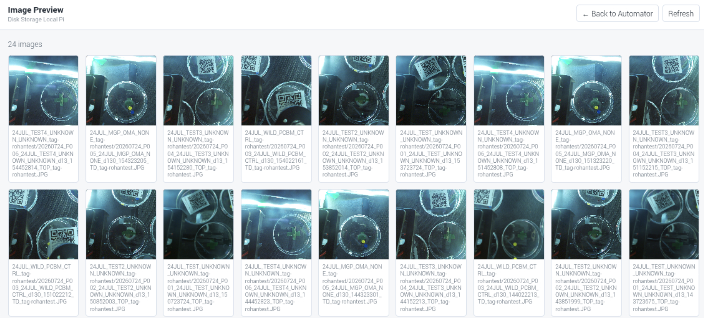

Image gallery browser

Once in the image browser, click **← Back to Automator** in the page header (beside the Refresh button) to return to the main imaging page.

### Exporting images to a USB drive

All images are saved to the Raspberry Pi's internal storage at `/home/pi/Automator/data/`. To take images off the Automator, plug a USB pen drive into the USB hub provided. The system will automatically copy the data folder to a folder called `images` on the USB drive.


USB pen drive connected for image export

Use a USB drive formatted as exFAT, FAT32, NTFS, or ext4. The export starts automatically after you plug the drive in; there is no button to press in the web interface.

Wait until you hear a beep, then remove the pen drive from the USB hub. The beep confirms the copy is complete and the drive has been safely unmounted. Open the exported images on your computer under:

```text
USB drive/images/
```

If the expected images are not present on the USB drive, try again with a different USB drive, or contact the TSL Bioinformatics team.

Do not pull the USB drive out while files are still copying — doing so can corrupt the USB filesystem.

### Automatic image retention

Images in the `captures/` folder are automatically deleted after 21 days. Run folders under `/home/pi/Automator/data/` are also deleted after 21 days. The data folder is kept under 5 GiB automatically — if it exceeds this limit, the oldest items (minimum 14 days old) are removed first. Export any images you want to keep permanently before the 21-day window closes.

---

## Good experimental practice

- Keep plates in the same orientation throughout an experiment
- Only round Petri dishes/plates of 90–100 mm are supported — do not use dishes of other sizes
- Do not place more than 6 dishes in the workspace at once — this is a hardware limit
- Place each dish on one of the green sticker positions marked on the workspace floor
- Do not stack plates in the workspace — each dish must sit flat as a single layer
- Do not move or reattach QR labels after the initial workspace scan — the system maps positions from the first scan
- Do not change imaging intervals once a run has started
- Check that images are appearing in the file browser during the first hour of a new setup
- For long experiments, monitor available local storage periodically — if the Raspberry Pi's drive fills up, new captures will fail
- The LED system controls lighting for each capture, but avoid pointing external light sources directly into the workspace, as stray light can affect image quality

---

## Safety

Automator is a research tool. It is not a certified laboratory instrument.

You must:

- Ensure all mechanical guarding is in place before running
- Use the external, hard-wired, latching emergency stop on the AC side of the device for emergency shutdown. The E-stop is located outside the growth chamber, at the controller unit. This cuts all system power.
- Follow all TSL and institutional safety rules and risk assessments
- Never reach into the workspace while the arm is in motion
- Not leave the system unattended during the first imaging cycle of a new experimental setup

---

## Checklist before each run

- [ ] QR labels attached flat to each plate
- [ ] Labels not placed on the flat lid surface (suction cup contact area)
- [ ] No more than 6 dishes placed in the workspace at once
- [ ] Each dish placed on a green sticker position on the workspace floor
- [ ] Plates not stacked — each dish flat, single layer
- [ ] Only 90–100 mm round Petri dishes/plates used
- [ ] **Generate Preview Image** clicked — all expected plates detected
- [ ] Imaging interval set for each plate (minutes)
- [ ] Runtime (hours) entered for each plate
- [ ] All required plates ticked for inclusion
- [ ] **Send Run Details to Automator** clicked
- [ ] Enclosure door closed
- [ ] Experiment tag entered if wanted (optional — max 15 characters, no spaces)
- [ ] Notification email addresses entered (optional)

Press **Run Imaging**.

---

## Troubleshooting

### Web interface does not load

- Check the device is powered on
- Press the physical START button and wait 20 seconds, then try the address again
- Confirm you are using the correct address (see Section 2 of this document)
- Try a different browser or clear the browser cache
- Contact the TSL Bioinformatics team if it still does not respond

### Plates are not detected after scanning

- Labels must be flat, fully visible, and unobscured
- Avoid shadows or reflections over the QR code area
- Plates must sit within the marked workspace boundary
- Try clicking **Generate Preview Image** again, or use the **↻** button beside it to reload the page first
- If the camera appears completely stuck with no scan activity, press the physical START button to restart the controller

### Images are not being saved

- Check the log panel in the web interface for error messages
- A `Camera capture failed` message means the camera needs attention. Contact the TSL Bioinformatics team.
- A `Camera unavailable — imaging aborted` status message means the camera could not be initialised at the start of the run. The run will have stopped automatically. Check the camera ribbon cable connection and restart the controller service, then try again.

### Completion email not received

- Confirm email addresses were entered in the Notification Emails field on the imaging page before pressing Run Imaging
- Only institute addresses (`@nbi.ac.uk` or `@tsl.ac.uk`) are supported
- Check your junk or spam folder for messages from `no-reply-tslautomator@nbi.ac.uk`

### System stops unexpectedly during a run

The most common cause is power instability. The Raspberry Pi and the motor electronics each have a dedicated power supply. Do not connect them to the same power strip or socket as other high-draw equipment.

### "Start: not started" shows in the status bar

This is normal before the first imaging run of a session. The experiment start time records automatically once imaging begins.

### System does not resume after a reboot

The system stores its run state in a file on the Raspberry Pi and can resume after an unplanned reboot. If the previous run completed successfully, it will start a new run rather than resume.

If a run was interrupted (e.g. by a power cut or reboot), an amber banner will appear at the top of the imaging page when the system restarts, stating that plates and schedule have been restored. Press **Run Imaging** to continue from where it left off. If no banner appears and you expected one, contact the TSL Bioinformatics team.

### ● Kp or ● Mk status indicator is red

The ● Kp (Klipper) and ● Mk (Moonraker) indicators in the footer show the health of the motion and API services. If either shows red, click **Troubleshooting** in the footer (beside ● Kp ● Mk) and use the "Restart Klipper" or "Restart Moonraker" button. Only restart during downtime — restarting during an active imaging run will interrupt it. If the indicator does not turn green within 20 seconds, contact the TSL Bioinformatics team.

When either service goes offline, a notification banner also appears automatically at the bottom-right of the page:

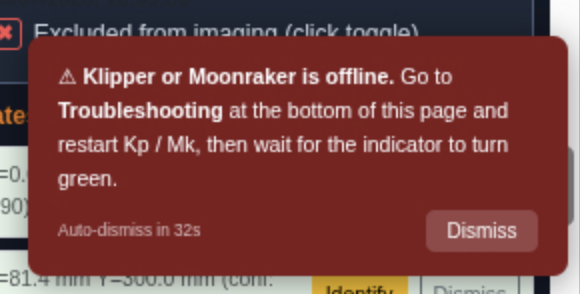

Kp/Mk offline banner — auto-dismisses after 40 s or click Dismiss

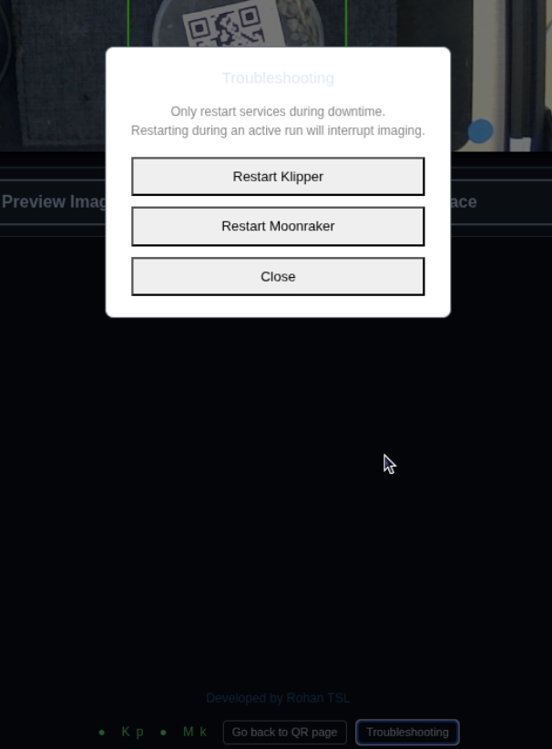

Troubleshooting modal — Restart Klipper / Restart Moonraker

---

## Technical support

For problems that cannot be resolved using this guide, contact the TSL Bioinformatics team:

- Dan MacLean: <dan.maclean@tsl.ac.uk>
- Rohan R: <phonics-tiffs1i@icloud.com>

For IT or network-related issues (access permissions, IP address changes, printer registration), contact TSL IT via Christopher Rickett: <christopher.rickett@tsl.ac.uk>.

For system administration, installation details, and code architecture, see [HandOver.md](HandOver.md).

---

## FAQ

### Do I need to install anything on my computer?

No. Automator is controlled entirely through a web browser. There is no app or software to install.

### Which computer can I use?

A MacBook connected directly to the Automator by an Ethernet cable via a USB-C to Ethernet adapter. Access from other computers on the lab network is not supported.

### Does my MacBook need any special network settings to connect?

No special settings are needed. MacBooks connect to DHCP networks automatically. If you want to verify: in macOS open System Settings → Network → select your USB Ethernet adapter → Details → TCP/IP and confirm Configure IPv4 is set to Using DHCP. This is the default on most MacBooks and usually requires no change.

### How do I check if the system is running?

Open the web interface URL in your browser. If the page loads, the controller is running.

If the page does not load:

1. Press the physical START button on the front of the device. Wait 20 seconds.
2. Try the URL again.
3. If it still does not load, contact the TSL Bioinformatics team.

If you see an error about a password not being set, an administrator needs to configure it. Contact the TSL Bioinformatics team.

### I can't log in, or I don't have a password. What do I do?

Contact the TSL Bioinformatics team (see Technical support, above). An administrator needs to set or share the password.

### Can I move a plate or its QR label after the workspace scan?

No. The system maps plate positions from the first scan. Moving or reattaching a label afterwards will cause the system to image the wrong position. If you need to change plate positions, run **Generate Preview Image** again before starting the run.

### Can I add a plate or change settings after a run has started?

No. Plate selection, imaging interval, and runtime duration are locked in once **Run Imaging** is pressed. To include additional plates or change settings, wait for the current run to finish, or start a new run.

### What happens if I open the enclosure door while imaging is running?

The system pauses and holds in a safe position automatically. Imaging resumes on its own once the door is closed again — you don't need to press anything.

### Do I have to enter an experiment tag or notification emails?

No, both are optional. The experiment tag (max 15 characters, no spaces) helps you identify your images later. Notification emails let you know by email when each plate's run finishes — use only institute addresses ending in `@nbi.ac.uk` or `@tsl.ac.uk`.

### How do I get my images off the device?

Two ways: browse them in the web interface's file browser, or plug in a USB drive for automatic export. See "Where images are stored" above for details.

### What plate sizes does the Automator support?

Round Petri dishes/plates of 90–100 mm only. Other sizes are not supported. Dishes must be placed flat — do not stack plates. Up to 6 dishes can be placed at one time due to hardware constraints; place each dish on a green sticker position on the workspace floor.

### What if the system detects a plate but cannot read its QR code?

The system detects plate positions geometrically, independently of QR reading. Plates with unreadable QR codes appear with an orange bounding box labeled "No QR (QR unreadable)" in the preview image, and in a separate Unresolved plates panel. Click **Identify** to enter the QR data manually, or **Dismiss** to ignore the plate. See "Plates detected with unreadable QR codes" above.

### Can I pause a run without stopping it?

Yes. Click the **Pause/Resume** button in the web interface, or press the physical STOP button briefly. The arm holds at a safe position and resumes from the same point when you press again. Pausing during a run does not reset the schedule.

### Can I go back to the QR setup page after I have moved to the imaging page?

Yes. Click **Go back to QR page** in the footer (beside the ● Kp ● Mk indicators). If an imaging run is in progress a confirmation prompt appears before navigating away.

### What are the ● Kp and ● Mk indicators in the footer?

They show the live status of the two motion services:

- **● Kp** — Klipper (motion controller firmware)
- **● Mk** — Moonraker (Klipper API)

Green means the service is running. Red means it is down and the system cannot move the camera arm.

### A status indicator is red. What do I do?

Click **Troubleshooting** in the footer (beside the ● Kp ● Mk indicators) and press **Restart Klipper** or **Restart Moonraker**. Only restart during downtime — restarting during an active imaging run will interrupt it. If the indicator does not return to green within 20 seconds, contact the TSL Bioinformatics team.

### Can I use the Automator from the lab's Raspberry Pi screen, not my MacBook?

Yes. The Raspberry Pi runs a kiosk browser on the attached HDMI display, showing the imaging page directly. The full workflow — scanning, configuring, and starting a run — works from the kiosk screen. You do not need a MacBook if you are working at the instrument.
