<!--
SPDX-License-Identifier: CC-BY-4.0
Copyright (c) 2025–2026 Rohan R
-->

# ONNX model provenance

This document records the origin, license, training evidence, and integrity information for the ONNX model files used by the Automator system.

---

## Models

Both models were trained by **Rohan R** (TSL) for petri-dish / colony detection on the Automator imaging system.

| File | Role | License | SHA-256 |
|---|---|---|---|
| `bestnew.onnx` | **Active model** — fine-tuned from `best.onnx`; used in production | MIT | `b8eaa58a86a20b3ba6c8527a9013b69fb6674bf383426eea90cab17fa486a5d2` |
| `best.onnx` | Base model — original training run; not used in production code. **Removed from repository.** | MIT | `fad770965392596ac3bb2e9aeaba766d9bd7c25bfbb2b63129778fee9f0e95fe` |

---

## Model to cite

> `bestnew.onnx` is the current project model: a single-class ONNX detector for Petri dish / colony detection on the Automator imaging system. The provenance record identifies it as the active production model trained by Rohan R (TSL), licensed under MIT, and verified by SHA-256 `b8eaa58a86a20b3ba6c8527a9013b69fb6674bf383426eea90cab17fa486a5d2`.

---

## Source of truth

| Field | Value |
|---|---|
| Current model file | `bestnew.onnx` |
| Role | Active project / production model |
| Task | Petri dish / colony object detection |
| Algorithm | YOLOv8 object detection, single-class detector |
| Classes | 1 |
| Class metadata | `{0: 'Petri dish'}` |
| License | MIT |
| Trainer | Rohan R (TSL) |
| SHA-256 | `b8eaa58a86a20b3ba6c8527a9013b69fb6674bf383426eea90cab17fa486a5d2` |
| Local size | 27 MB |
| Published location | <https://huggingface.co/rotsl/petri_dish_yolo> |

---

## ONNX metadata

Local structural inspection of `bestnew.onnx`:

| Property | Value |
|---|---|
| Producer | PyTorch `2.9.0` |
| ONNX IR version | 10 |
| ONNX opset | 18 |
| Graph name | `main_graph` |
| Input | `images` |
| Input type | float32 |
| Input shape | `[1, 3, 640, 640]` |
| Output | `output0` |
| Output type | float32 |
| Output shape | `[1, 25200, 6]` |
| Metadata `stride` | `32` |
| Metadata `names` | `{0: 'Petri dish'}` |
| Graph nodes | 236 |
| Initializers | 138 |
| External ONNX data files | None |

The fixed input shape means `bestnew.onnx` is a deployment-oriented export for 640×640 inference.

---

## Availability

- `bestnew.onnx` — bundled in this repository under `data/` and published at <https://huggingface.co/rotsl/petri_dish_yolo>
- `best.onnx` — base model; not referenced by any production code. **Removed from repository** (SHA-256 preserved in the table above for reference).

---

## Fetching `bestnew.onnx`

The model is not included in the PyPI package. Use the provided console script after install:

```bash
automator-fetch-model
```

The download is verified against the SHA-256 above before being placed at `~/Automator/data/bestnew.onnx`. If the checksum does not match, the file is removed and an error is raised.

---

## Integrity verification (manual)

To verify a model file already on disk:

```bash
sha256sum ~/Automator/data/bestnew.onnx
```

Expected output:

```
b8eaa58a86a20b3ba6c8527a9013b69fb6674bf383426eea90cab17fa486a5d2  /home/pi/Automator/data/bestnew.onnx
```

---

## Training data

`bestnew.onnx` was trained on the Petri dish dataset stored under `yolov8/petri_dish/`.

Dataset configuration (`data.yaml`):

```yaml
train: petri_dish/train/images
val:   petri_dish/valid/images
test:  petri_dish/test/images

nc: 1
names: ['Petri dish']
```

Dataset summary:

| Field | Value |
|---|---|
| Dataset name | `Main Petri class - v3 7 November Yolo` |
| Source | Roboflow |
| Dataset URL | <https://universe.roboflow.com/test-gfyaj/main-petri-class-lxjtm> |
| Version used | 3 |
| Version URL | <https://universe.roboflow.com/test-gfyaj/main-petri-class-lxjtm/dataset/3> |
| Export date | 2025-11-07 at 15:08 GMT |
| Annotation format | YOLO text object-detection format |
| Total images | 492 |
| Train images | 435 (88%) |
| Validation images | 38 (8%) |
| Test images | 19 (4%) |
| Class count | 1 |
| Class name | Petri dish |
| Dataset license | Public Domain |

Preprocessing applied by the dataset export:

- Auto-Orient: Applied
- Resize: Fit within 320×224

Augmentation applied by the dataset export (outputs per training example: 3):

- Flip: Horizontal, Vertical
- 90° Rotate: Clockwise, Counter-Clockwise, Upside Down
- Crop: 0% minimum zoom, 46% maximum zoom
- Rotation: between −15° and +15°
- Shear: ±1° horizontal, ±8° vertical
- Grayscale: applied to 23% of images
- Hue: between −133° and +133°
- Saturation: between −82% and +82%
- Brightness: between −75% and +75%
- Exposure: between −70% and +70%
- Blur: up to 2.5 px
- Noise: up to 4.46% of pixels

---

## Training evidence

Training evidence is stored under `yolov8/runs/train/petri_v16/`.

### Run settings (`opt.yaml`)

| Setting | Value |
|---|---|
| Data config | `petri_dish/data.yaml` |
| Epochs | 150 |
| Batch size | 8 |
| Image size | 640 |
| Cache | RAM |
| Optimizer | SGD |
| Workers | 8 |
| Patience | 20 |
| Seed | 0 |

### Hyperparameters (`hyp.yaml`)

| Hyperparameter | Value |
|---|---|
| lr0 | 0.01 |
| lrf | 0.01 |
| momentum | 0.937 |
| weight_decay | 0.0005 |
| warmup_epochs | 3.0 |
| warmup_momentum | 0.8 |
| warmup_bias_lr | 0.1 |
| box | 0.05 |
| cls | 0.5 |
| obj | 1.0 |
| iou_t | 0.2 |
| anchor_t | 4.0 |
| hsv_h | 0.015 |
| hsv_s | 0.7 |
| hsv_v | 0.4 |
| translate | 0.1 |
| scale | 0.5 |
| fliplr | 0.5 |
| mosaic | 1.0 |

### Recorded metrics (`results.csv`)

| Selection | Epoch | Precision | Recall | mAP@0.5 | mAP@0.5:0.95 |
|---|---|---|---|---|---|
| Best fitness row | 135 | 0.8435 | 0.9035 | 0.8816 | 0.5707 |
| Final row | 149 | 0.8542 | 0.8947 | 0.8802 | 0.5693 |

---

## Reproduction commands

The model uses the YOLOv8 object-detection algorithm. Training ran for 150 epochs as a single-class detector, then the best checkpoint was exported to ONNX.

Initial training:

```bash
yolo detect train \
  model=yolov8s.pt \
  data=yolov8/petri_dish/data.yaml \
  epochs=150 \
  batch=8 \
  imgsz=640 \
  cache=True \
  optimizer=SGD \
  project=yolov8/runs/train \
  name=petri_v1 \
  patience=20
```

Resume (as recorded in retained run metadata):

```bash
yolo detect train resume=True model=yolov8/runs/train/petri_v16/weights/last.pt
```

Export to ONNX:

```bash
yolo export \
  model=path/to/bestnew.pt \
  format=onnx \
  imgsz=640 \
  batch=1 \
  opset=18 \
  dynamic=False
```

Why these export flags match the deployed model:

- `format=onnx` — exports the PyTorch checkpoint to ONNX
- `imgsz=640` — matches inspected input shape `[1, 3, 640, 640]`
- `batch=1` — matches the fixed batch dimension
- `opset=18` — matches the inspected ONNX opset
- `dynamic=False` — matches the fixed-shape deployed model

---

## Training graphs

### Training curves

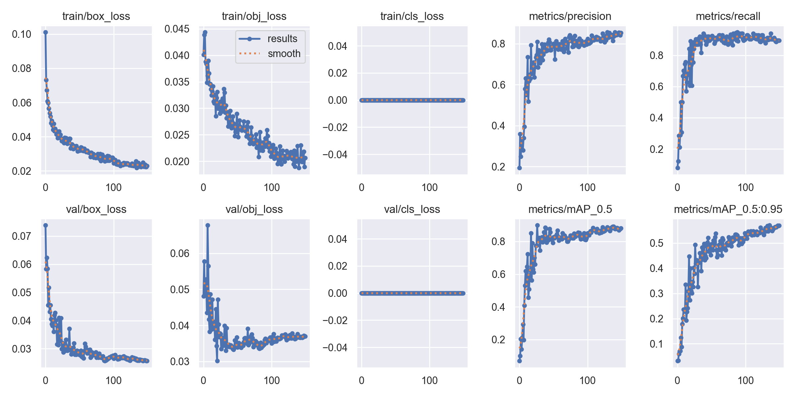

### Precision–recall curve

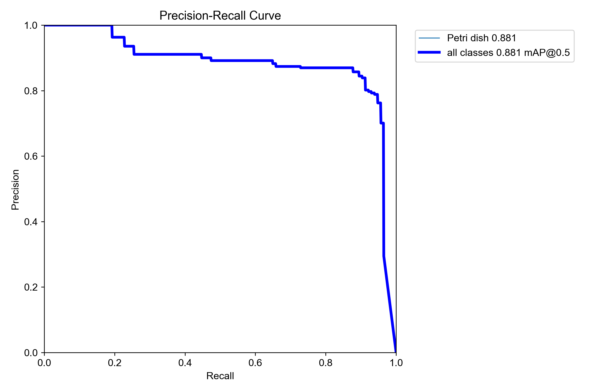

### F1 confidence curve

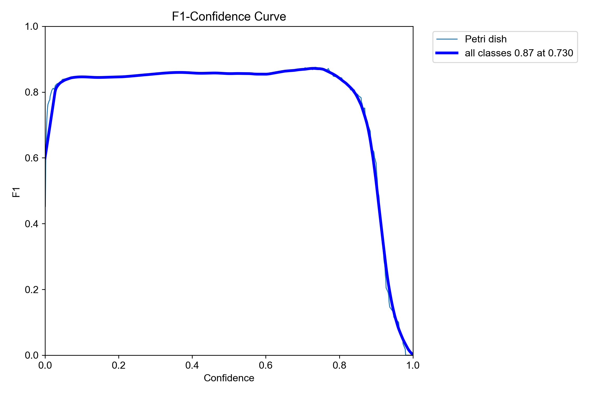

### Precision confidence curve

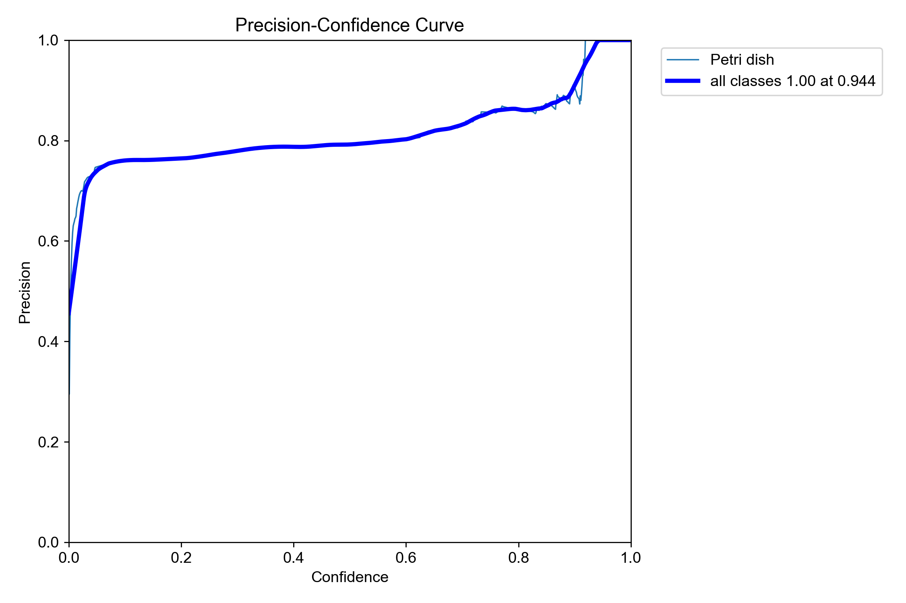

### Recall confidence curve

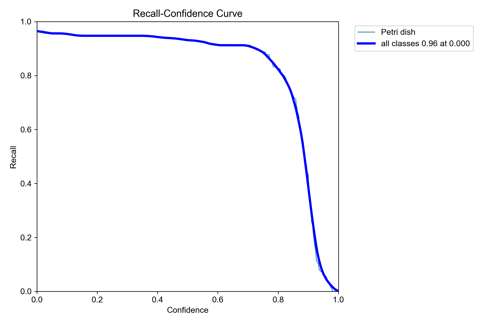

### Confusion matrix

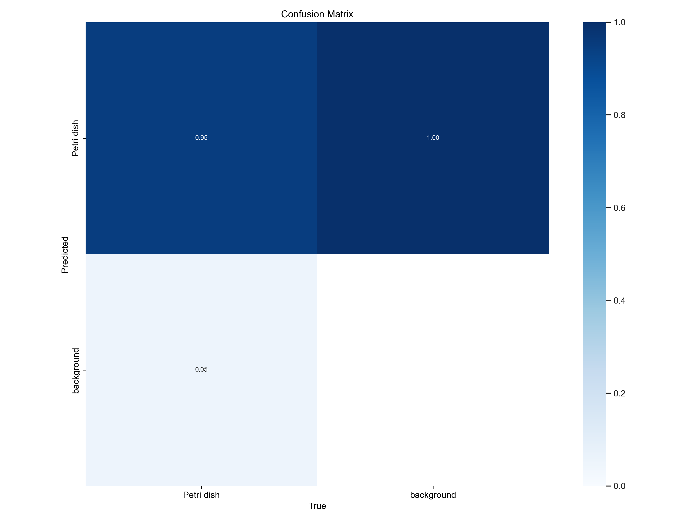

### Label distribution

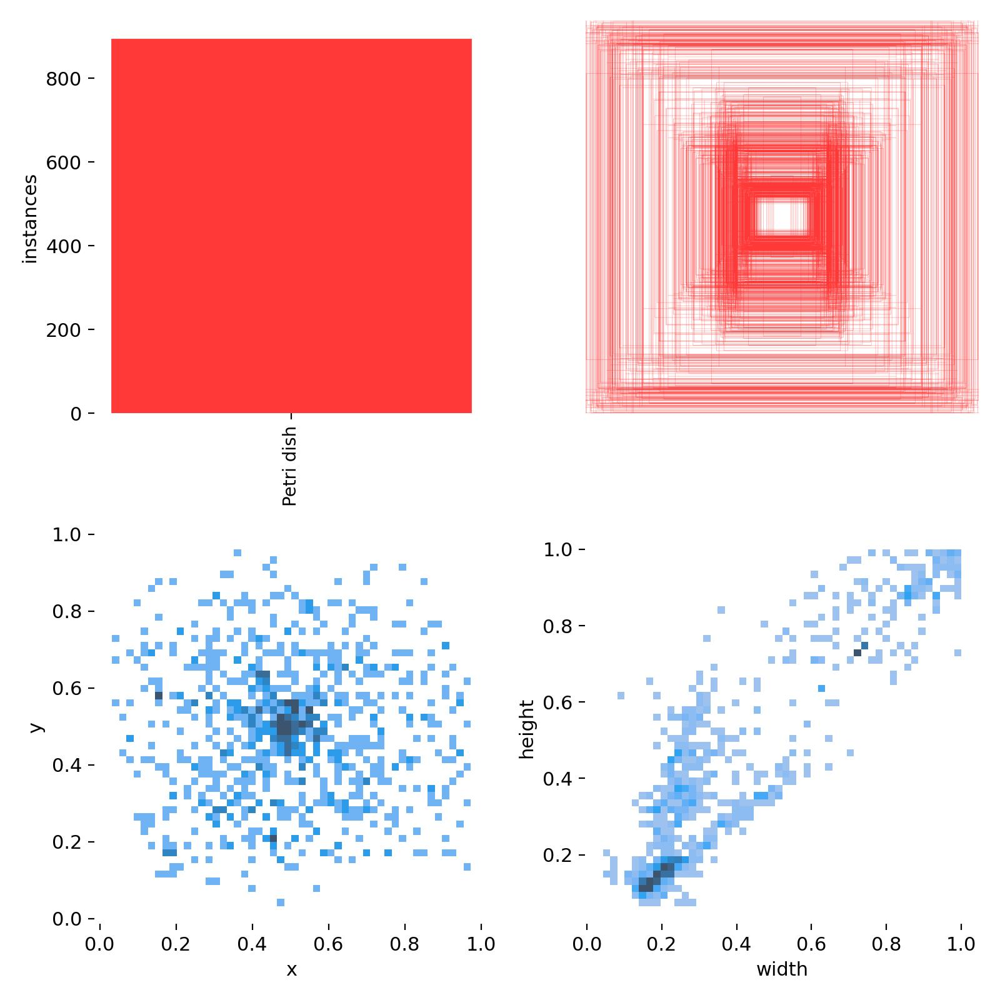

### Label correlogram

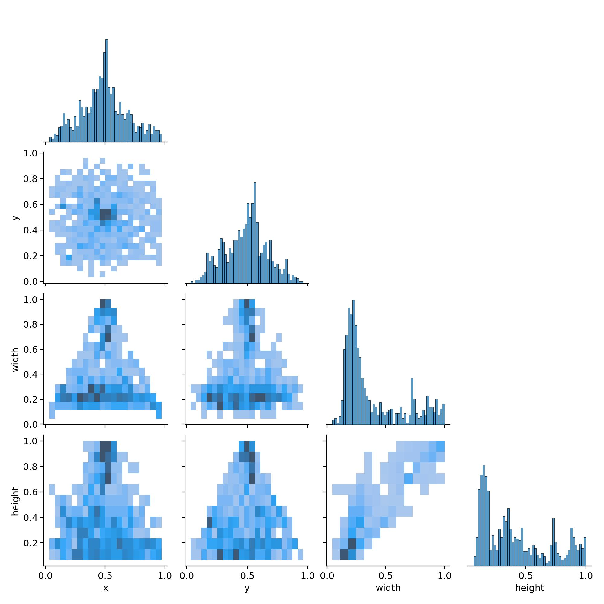

---

## Sample images

### Training batch

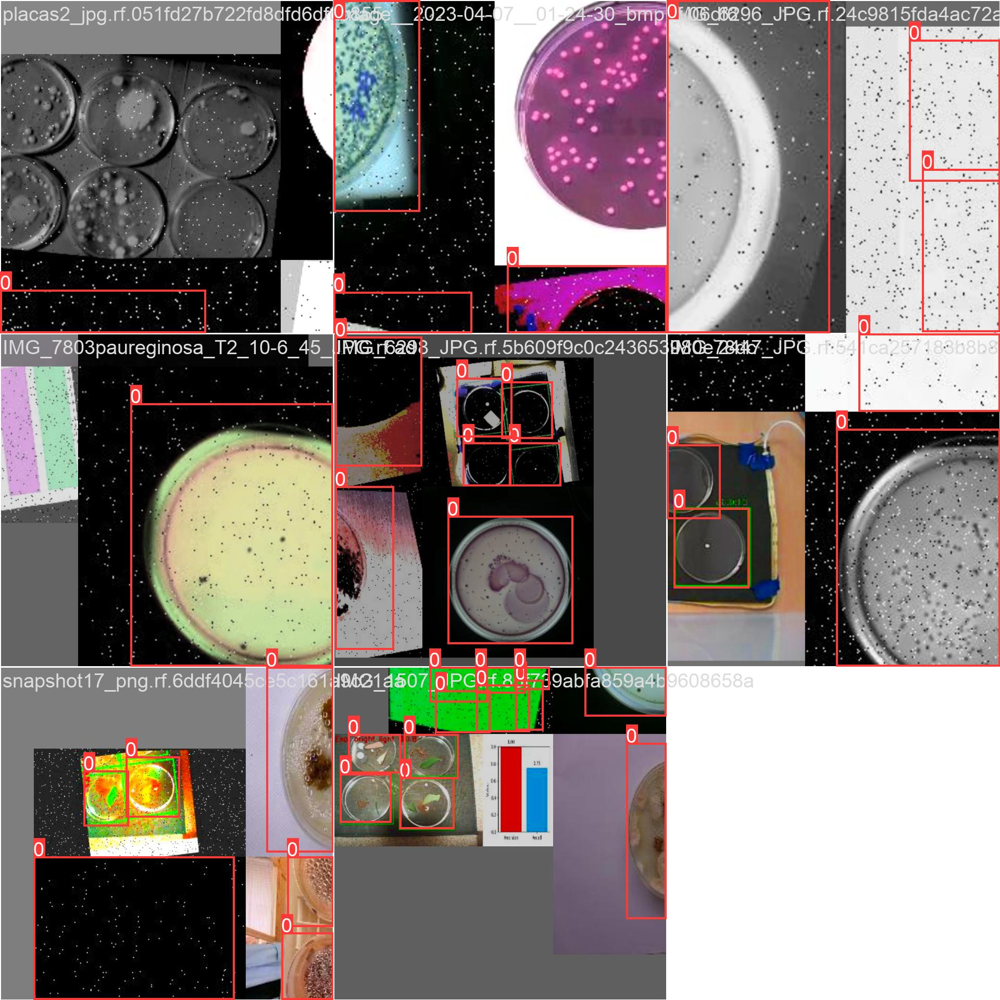

### Validation labels

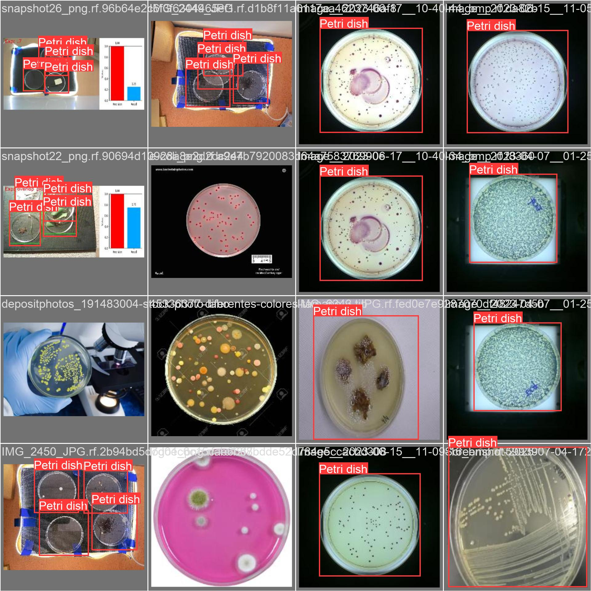

### Validation predictions

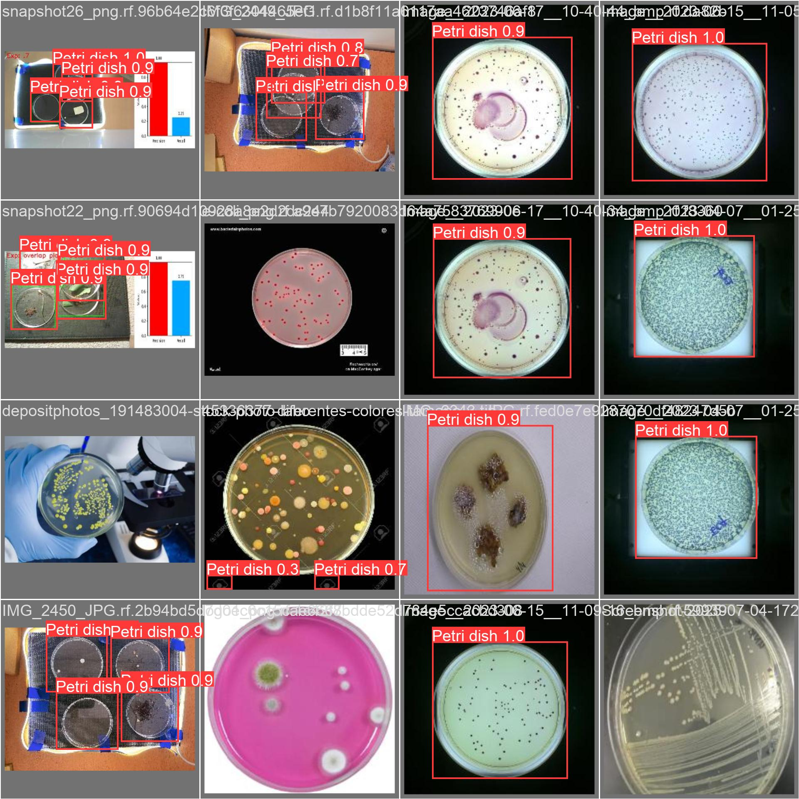
