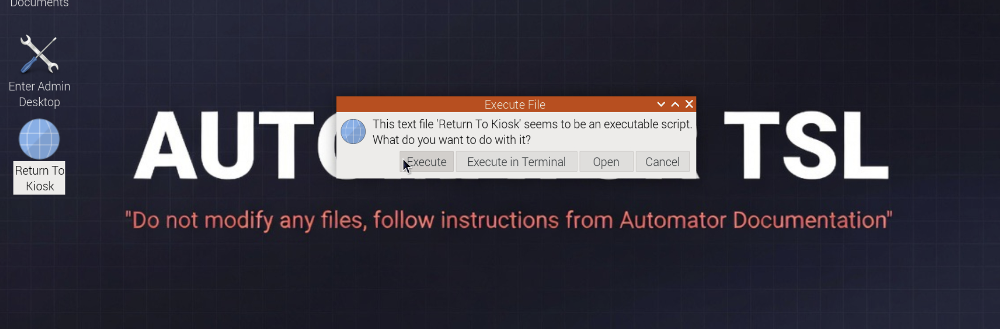

<!--
SPDX-License-Identifier: CC-BY-4.0
Copyright (c) 2025–2026 Rohan R
-->

# Raspberry Pi 4B — Automator Kiosk + Admin Desktop Access

**Updated working version**  
**System user:** `pi`  
**Device name shown in shell:** `automator`  
**Desktop session:** Raspberry Pi OS Bookworm Desktop using Wayland / Labwc  
**Kiosk URL:** `http://127.0.0.1:8080/`

---

## 1. Operating Model

This setup uses **one desktop user only**:

```text
pi
```

There is no separate kiosk user.

### General users

General users use:

- HDMI monitor
- Keyboard
- Mouse

They normally see only:

```text
http://127.0.0.1:8080/
```

Chromium runs in kiosk mode and covers the Raspberry Pi desktop.

### Admins / tech team

Admins use local keyboard/mouse or SSH for terminal access.

Admins can enter full desktop mode by using:

```text
Ctrl + Alt + A
```

Admins can return to kiosk mode by using:

```text
Windows + K
```

On many keyboards, the Windows key is also called the **Super** key.


---

## 2. Confirm the Correct User

Run:

```bash
whoami
```

Expected output:

```text
pi
```

If the output is `pi`, continue with this guide.

---

## 3. Enable Persistent User Services

Enable lingering for the `pi` user:

```bash
sudo loginctl enable-linger pi
```

Verify:

```bash
loginctl show-user pi | grep Linger
```

Expected output:

```text
Linger=yes
```

This helps user-level services remain reliable for the `pi` account.

---

## 4. Create Required Directories

Run:

```bash
mkdir -p ~/.config/labwc ~/.local/bin ~/Desktop
```

---

## 5. Create the Admin Desktop Script

This script closes Chromium kiosk mode and restores the Raspberry Pi desktop panel if needed.

Run:

```bash
cat > ~/.local/bin/enter-admin-desktop.sh <<'EOF'
#!/bin/bash

pkill chromium 2>/dev/null || true
pkill -f chromium 2>/dev/null || true

sleep 1

pgrep -x wf-panel-pi >/dev/null || wf-panel-pi &
EOF

chmod +x ~/.local/bin/enter-admin-desktop.sh
```

Manual test:

```bash
/home/pi/.local/bin/enter-admin-desktop.sh
```

Expected result:

- Chromium closes.
- The full Raspberry Pi desktop is visible.
- The top panel/menu bar appears.

---

## 6. Create the Start Kiosk Script

This script closes any existing Chromium process and starts Chromium in kiosk mode.

Run:

```bash
cat > ~/.local/bin/start-kiosk.sh <<'EOF'
#!/bin/bash

pkill chromium 2>/dev/null || true
pkill -f chromium 2>/dev/null || true
sleep 2

DISPLAY=:0 chromium \
  --kiosk \
  --noerrdialogs \
  --disable-infobars \
  --no-first-run \
  --disable-session-crashed-bubble \
  --start-maximized \
  --overscroll-history-navigation=0 \
  http://127.0.0.1:8080/ &
EOF

chmod +x ~/.local/bin/start-kiosk.sh
```

Manual test:

```bash
/home/pi/.local/bin/start-kiosk.sh
```

Expected result:

- Chromium opens.
- Chromium fills the screen.
- The Automator page loads at:

```text
http://127.0.0.1:8080/
```

---

## 7. Create Labwc Keyboard Shortcuts

This is the confirmed working shortcut setup.

Run:

```bash
cat > ~/.config/labwc/rc.xml <<'EOF'
<?xml version="1.0"?>
<labwc_config>
  <keyboard>
    <default />

    <keybind key="C-A-a">
      <action name="Execute" command="/home/pi/.local/bin/enter-admin-desktop.sh" />
    </keybind>

    <keybind key="W-k">
      <action name="Execute" command="/home/pi/.local/bin/start-kiosk.sh" />
    </keybind>
  </keyboard>
</labwc_config>
EOF
```

Shortcut meaning:

```text
Ctrl + Alt + A = Enter Admin Desktop
Windows + K    = Return To Kiosk
```

Important: use lowercase `a` and `k` in the Labwc config.

---

## 8. Reload Labwc Correctly

Do **not** rely on this command from an SSH or remote shell session:

```bash
labwc --reconfigure
```

From a remote shell, it may fail with:

```text
LABWC_PID not set
```

Use this instead:

```bash
killall -s SIGHUP labwc
```

Then test:

```text
Ctrl + Alt + A
Windows + K
```

If the shortcuts still do not work, reboot once:

```bash
sudo reboot
```

After reboot, test again:

```text
Ctrl + Alt + A = Enter Admin Desktop
Windows + K    = Return To Kiosk
```

---

## 9. Configure Automatic Kiosk Startup on Boot

Create or replace Labwc autostart:

```bash
cat > ~/.config/labwc/autostart <<'EOF'
sleep 2
pgrep -x wf-panel-pi >/dev/null || wf-panel-pi &

sleep 8
/home/pi/.local/bin/start-kiosk.sh
EOF

chmod +x ~/.config/labwc/autostart
```

This does three things after desktop login:

1. Waits briefly for the desktop session to start.
2. Starts the Raspberry Pi panel if it is not already running.
3. Starts Chromium kiosk mode.

---

## 10. Create Desktop Icons

These are useful if keyboard shortcuts fail.

### Enter Admin Desktop icon

Run:

```bash
cat > ~/Desktop/Enter-Admin-Desktop.desktop <<'EOF'
[Desktop Entry]
Type=Application
Name=Enter Admin Desktop
Comment=Close kiosk browser and show full Raspberry Pi desktop
Exec=/home/pi/.local/bin/enter-admin-desktop.sh
Icon=preferences-system
Terminal=false
Categories=Utility;
EOF

chmod +x ~/Desktop/Enter-Admin-Desktop.desktop
```

### Return To Kiosk icon

Run:

```bash
cat > ~/Desktop/Return-To-Kiosk.desktop <<'EOF'
[Desktop Entry]
Type=Application
Name=Return To Kiosk
Comment=Restart Chromium kiosk browser
Exec=/home/pi/.local/bin/start-kiosk.sh
Icon=web-browser
Terminal=false
Categories=Utility;
EOF

chmod +x ~/Desktop/Return-To-Kiosk.desktop
```

When double-clicked, the desktop will prompt to execute the script. Click **Execute** to return to kiosk mode.



---

## 11. Full Copy-Paste Setup Block

Use this block to recreate the working setup from scratch.

```bash
mkdir -p ~/.config/labwc ~/.local/bin ~/Desktop

sudo loginctl enable-linger pi

cat > ~/.local/bin/enter-admin-desktop.sh <<'EOF'
#!/bin/bash

pkill chromium 2>/dev/null || true
pkill -f chromium 2>/dev/null || true

sleep 1

pgrep -x wf-panel-pi >/dev/null || wf-panel-pi &
EOF

chmod +x ~/.local/bin/enter-admin-desktop.sh

cat > ~/.local/bin/start-kiosk.sh <<'EOF'
#!/bin/bash

pkill chromium 2>/dev/null || true
pkill -f chromium 2>/dev/null || true
sleep 2

DISPLAY=:0 chromium \
  --kiosk \
  --noerrdialogs \
  --disable-infobars \
  --no-first-run \
  --disable-session-crashed-bubble \
  --start-maximized \
  --overscroll-history-navigation=0 \
  http://127.0.0.1:8080/ &
EOF

chmod +x ~/.local/bin/start-kiosk.sh

cat > ~/.config/labwc/rc.xml <<'EOF'
<?xml version="1.0"?>
<labwc_config>
  <keyboard>
    <default />

    <keybind key="C-A-a">
      <action name="Execute" command="/home/pi/.local/bin/enter-admin-desktop.sh" />
    </keybind>

    <keybind key="W-k">
      <action name="Execute" command="/home/pi/.local/bin/start-kiosk.sh" />
    </keybind>
  </keyboard>
</labwc_config>
EOF

cat > ~/.config/labwc/autostart <<'EOF'
sleep 2
pgrep -x wf-panel-pi >/dev/null || wf-panel-pi &

sleep 8
/home/pi/.local/bin/start-kiosk.sh
EOF

chmod +x ~/.config/labwc/autostart

cat > ~/Desktop/Enter-Admin-Desktop.desktop <<'EOF'
[Desktop Entry]
Type=Application
Name=Enter Admin Desktop
Comment=Close kiosk browser and show full Raspberry Pi desktop
Exec=/home/pi/.local/bin/enter-admin-desktop.sh
Icon=preferences-system
Terminal=false
Categories=Utility;
EOF

chmod +x ~/Desktop/Enter-Admin-Desktop.desktop

cat > ~/Desktop/Return-To-Kiosk.desktop <<'EOF'
[Desktop Entry]
Type=Application
Name=Return To Kiosk
Comment=Restart Chromium kiosk browser
Exec=/home/pi/.local/bin/start-kiosk.sh
Icon=web-browser
Terminal=false
Categories=Utility;
EOF

chmod +x ~/Desktop/Return-To-Kiosk.desktop

killall -s SIGHUP labwc 2>/dev/null || true
```

After running the block, test:

```text
Ctrl + Alt + A = Enter Admin Desktop
Windows + K    = Return To Kiosk
```

If the shortcuts do not work immediately, reboot once:

```bash
sudo reboot
```

---

## 12. Manual Fallback Commands

If shortcuts fail, use these from a local terminal or SSH session.

### Enter admin desktop

```bash
/home/pi/.local/bin/enter-admin-desktop.sh
```

### Return to kiosk

```bash
/home/pi/.local/bin/start-kiosk.sh
```

### Reload Labwc config

```bash
killall -s SIGHUP labwc
```

### Reboot if needed

```bash
sudo reboot
```

---

## 13. Verify the Desktop Session

If shortcuts stop working after reboot, check whether Labwc is running:

```bash
echo "XDG_CURRENT_DESKTOP=$XDG_CURRENT_DESKTOP"
echo "XDG_SESSION_TYPE=$XDG_SESSION_TYPE"
pgrep -af "labwc|wayfire|wf-panel-pi|lxpanel"
```

Expected useful output includes `labwc`.

If Labwc is not running, the shortcuts in `~/.config/labwc/rc.xml` will not apply.

---

## 14. Safety Rules

Do not run these during routine administration:

```bash
sudo systemctl stop display-manager
sudo pkill -u pi
pkill -9 labwc
pkill -9 wayfire
```

Do not disable:

```text
Wayland
Labwc
```

Do not create a separate kiosk desktop session.

Keep the desktop session attached to the normal `pi` user so Chromium kiosk mode and the HDMI display operate on the same graphical session.

---

## 15. Final Behaviour

### On boot

```text
Raspberry Pi logs into pi desktop
wf-panel-pi starts
Chromium kiosk opens
General users see Automator only
```

### Admin mode

```text
Press Ctrl + Alt + A
Chromium closes
Full Raspberry Pi desktop appears
Top panel/menu bar should be visible
```

### Return to kiosk

```text
Press Windows + K
Chromium kiosk starts again
Automator fills the HDMI display
```

---

## 16. Troubleshooting Summary

### Problem: `labwc --reconfigure` says `LABWC_PID not set`

Use:

```bash
killall -s SIGHUP labwc
```

### Problem: desktop icon works but shortcut does not

Recreate `~/.config/labwc/rc.xml`, then run:

```bash
killall -s SIGHUP labwc
```

If needed:

```bash
sudo reboot
```

### Problem: admin desktop opens but top menu bar is missing

Run:

```bash
pgrep -x wf-panel-pi >/dev/null || wf-panel-pi &
```

The admin desktop script already includes this line.

### Problem: kiosk does not start

Run:

```bash
/home/pi/.local/bin/start-kiosk.sh
```

### Problem: cannot exit kiosk

Run:

```bash
/home/pi/.local/bin/enter-admin-desktop.sh
```

or:

```bash
pkill chromium
```

---

## 17. Confirmed Shortcuts

```text
Ctrl + Alt + A = Enter Admin Desktop
Windows + K    = Return To Kiosk
```

