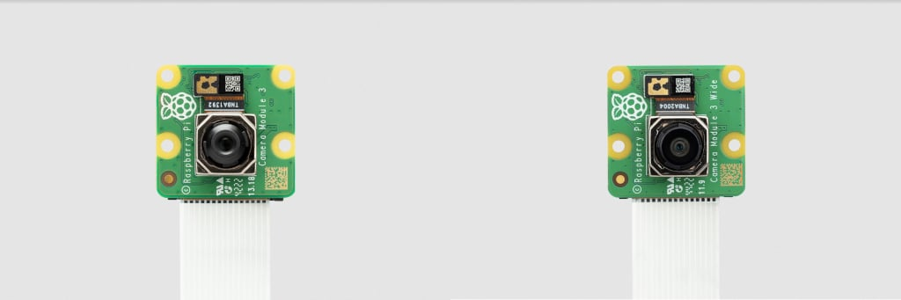
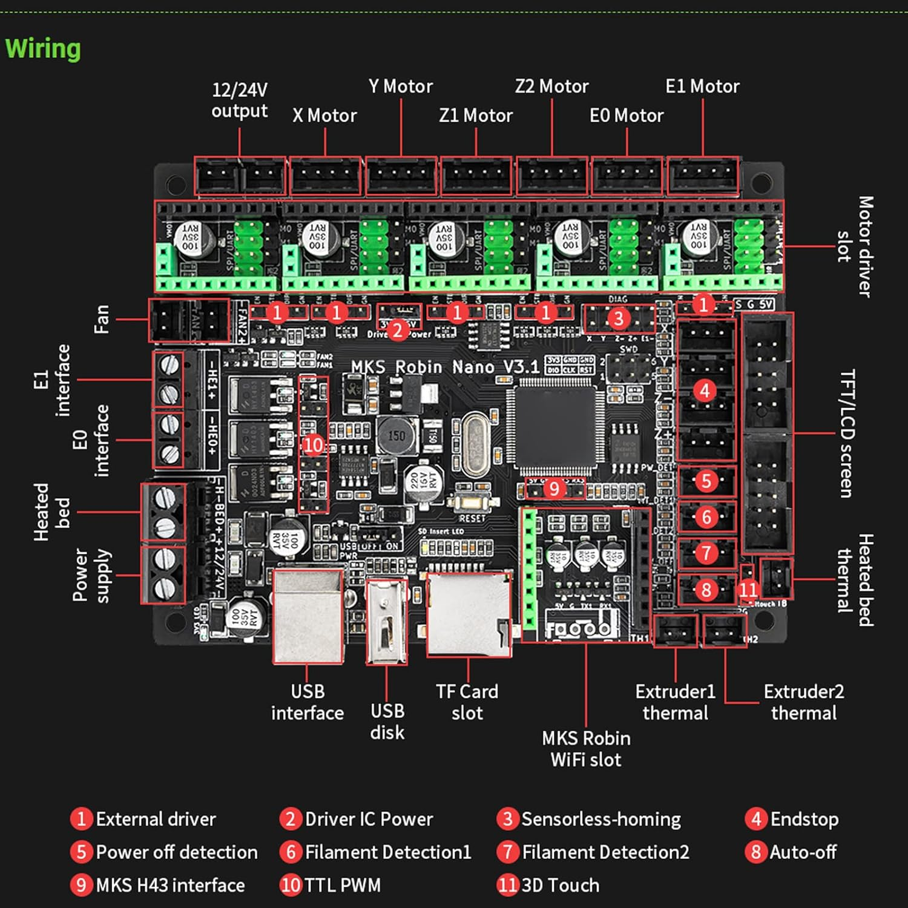
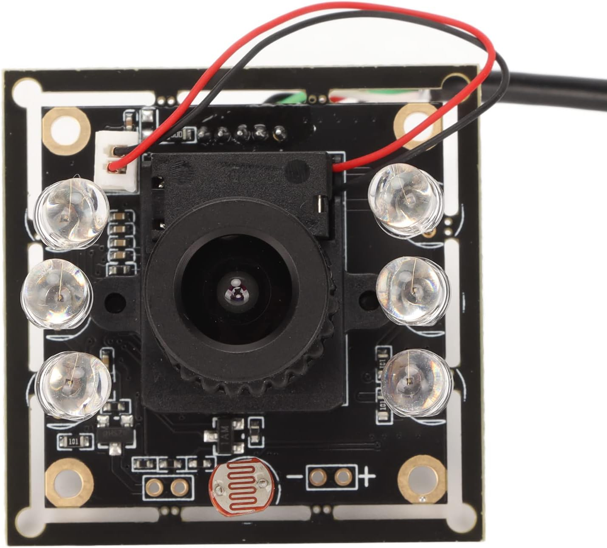
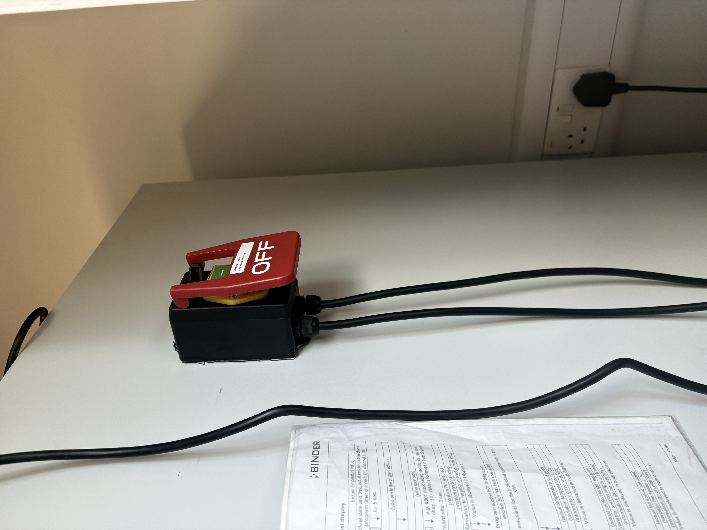
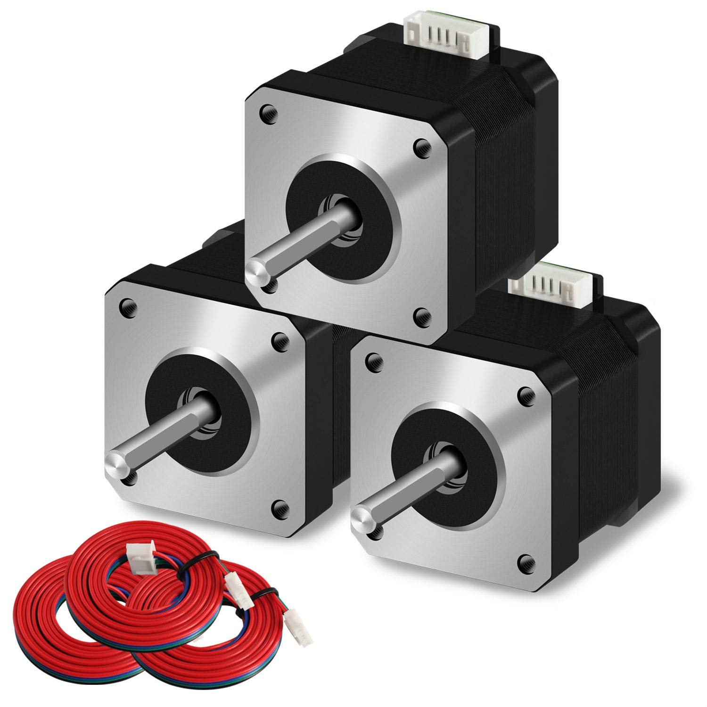
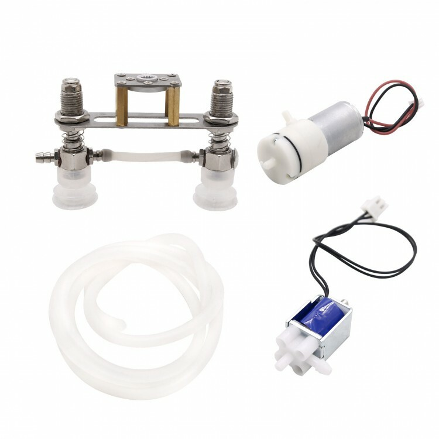
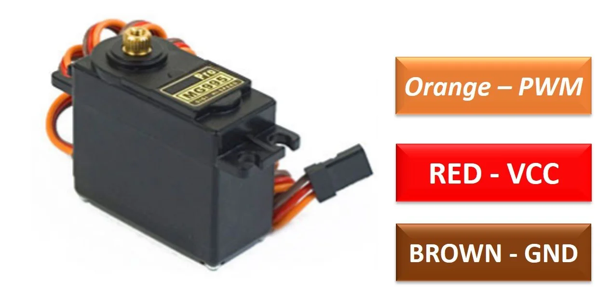
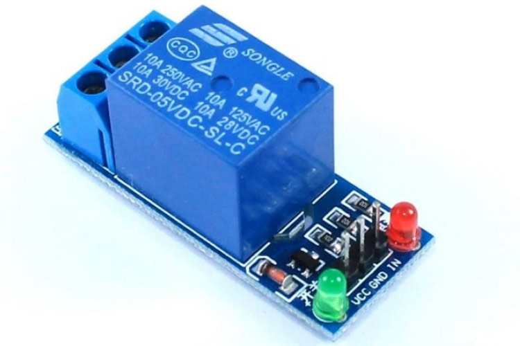
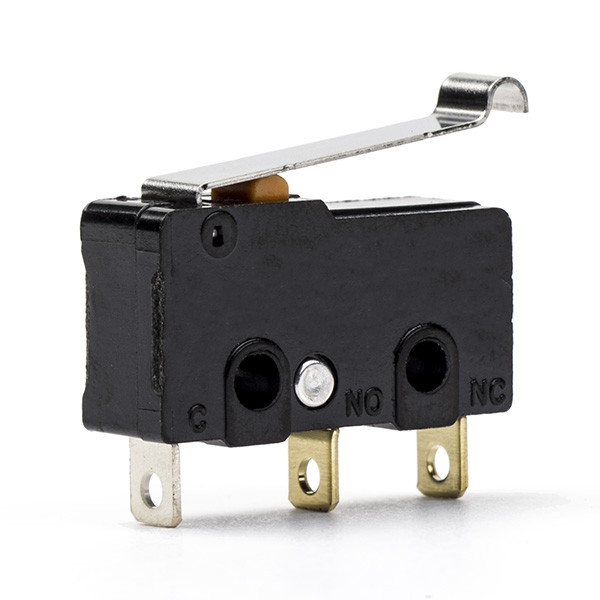
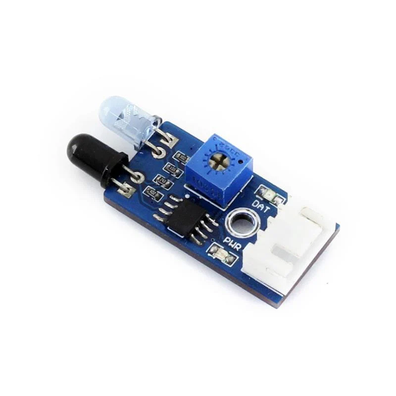

<!--
SPDX-License-Identifier: CERN-OHL-S-2.0
Copyright (c) 2025–2026 Rohan R
-->

# Hardware documentation

## Automator – electrical and control system

This document describes the complete electrical and electromechanical hardware of the [Automator system](https://github.com/rotsl/Automator).
It is derived from the system schematic, explicit author clarification, and the authoritative [`printer.cfg`](https://github.com/rotsl/Automator/blob/main/config/printer.cfg).

Software behaviour, motion planning logic, and mechanical CAD are intentionally excluded.

---

## 1. System overview

The Automator hardware consists of:

- Raspberry Pi (host controller, cameras, web UI)
- MKS Robin Nano V3.1 (Klipper motion controller)
- Independent AC-powered DC supplies
- Stepper-driven X, Y, and Z motion
- Plate handling system:
  - Vacuum pump
  - Air solenoid valve
  - Suction cup
  - Servo-driven suction cup rotation
- Imaging system:
  - LED illumination
  - USB camera (QR scanning)
  - Raspberry Pi camera (plate imaging)
- Safety systems:
  - AC-side emergency stop
  - Door interlock
  - Axis end-stops

All safety-critical power removal is implemented in hardware.

---

## 2. Power architecture

### 2.1 AC input and emergency stop

- Mains AC feeds all DC power supplies
- A physical, latching emergency stop switch is wired on the AC side
- Activating the E-stop removes AC power from:
  - 12 V DC power supply
  - 5 V peripheral DC power supply
  - Raspberry Pi 5 V adaptor

This is a true electrical power cut and does not rely on software.
Reference photo of the external E-stop wiring: [`images/estop.jpg`](images/estop.jpg).

---

### 2.2 DC power domains

| Rail | Source | Loads |
|----|----|----|
| 12 V DC | AC to DC adaptor | MKS Robin Nano V3.1, X/Y/Z stepper motors, vacuum pump, air solenoid |
| 5 V DC (peripherals) | Buck converter | Servo, relay coils, sensors, LED logic |
| 5 V DC (Raspberry Pi) | Separate AC to DC adaptor | Raspberry Pi only |
| GND | Common | All DC domains |

Explicit clarifications:

- The buck converter does not power the Raspberry Pi
- The Raspberry Pi uses a dedicated isolated 5 V supply
- 12 V is used only for motors, the MKS board, and vacuum hardware
- Both 12 V and 5 V supplies are disconnected by the AC emergency stop

---

## 3. Power tree

```text
Mains AC
└── Emergency Stop (AC-side, latching)
    |
    |
    ├── AC --> 12 V DC PSU
    │          ├── MKS Robin Nano V3.1
    │          │   ├── X stepper motor
    │          │   ├── Y stepper motor
    │          │   └── Z stepper motor
    │          |   
    │          └── 12 V --> 5 V Buck Converter
    │                       ├── Servo motor
    │                       ├── Proximity Sensor
    |                       ├── Vacuum Pump
    |                       ├── 80 MM 5V fans(2 no.s)
    |                       ├── Small 5v Fan Z motor
    |                       ├── Air Solenoid
    │                       ├── Relay Module
    │                           └── LED Strip light
    │
    └── AC --> 5 V DC PSU (Raspberry Pi adaptor)
               └── Raspberry Pi

```

- All grounds are  made common.

---

## 4. Controllers

### 4.1 Raspberry Pi

Functions:

- Klipper host
- Camera control
- Web UI and scheduler

Power:

- Dedicated 5 V adaptor
- Power removed by AC emergency stop

The Raspberry Pi does not directly drive motors, solenoids, or other inductive loads.

---

### 4.2 MKS Robin Nano V3.1

Functions:

- Motion control (Klipper MCU)
- Step / Direction / Enable outputs
- End-stop processing
- Servo and relay control outputs

Power:

- 12 V DC
- Disabled immediately by AC emergency stop

---

## 5. Motion system

| Axis | Motor Type | Supply |
|----|----|----|
| X | Stepper motor | 12 V |
| Y | Stepper motor | 12 V |
| Z | Stepper motor | 12 V |

Stepper power is fully removed when the emergency stop is activated.

---

## 6. Plate handling and imaging hardware

### 6.1 Vacuum system

Functional chain:

- Vacuum pump generates negative pressure
- Air solenoid valve controls vacuum routing
- Vacuum is applied to a suction cup
- Suction cup grips and lifts the Petri dish lid

Electrical control:

- Vacuum pump powered from 5 V via Air solenoid
- Air solenoid powered from 5 V
- Relay coils powered from 5 V peripheral rail

Vacuum is enabled only during imaging and is disabled by the emergency stop.

---

### 6.2 Servo – suction cup rotation

Purpose:

- Rotates the suction cup by 0 or 90 degrees
- Moves the lid away from the base plate during imaging
- Prevents obstruction of the raspberry camera field of view

Electrical details:

- Supply: 5 V (buck converter)
- Control: Software PWM
- Positions: 90° (over plate), 0° (rotated away)

---

### 6.3 LED illumination

- LED strip powered from 5 V peripheral rail
- Switched via relay
- Enabled only during image capture

---

## 7. Sensors and inputs

### 7.1 Door interlock

| Property | Value |
|----|----|
| Type | Proximity sensor |
| Logic | Normally open |
| Wiring | GPIO to GND |
| Pull-up | Enabled |

Opening the enclosure door triggers a controlled halt and park.

---

### 7.2 End-Stops

| Axis | End-stop |
|----|----|
| X | Present |
| Y | Present |
| Z | Present |

All end-stops are normally open and ground-triggered.

---

### 7.3  Proximity sensor

- Powered from 5 V peripheral rail
- Digital output
- Used to detect door open/closed state for the door interlock

---

## 8. Pin Mapping (from [printer.cfg](https://github.com/rotsl/Automator/blob/main/config/printer.cfg))

Controller MCU: STM32F407 (MKS Robin Nano V3.1)

### 8.1 Stepper motors and End-Stops

| Axis | Function | MCU Pin | Notes |
|----|----|----|----|
| X | STEP | PE3 | |
| X | DIR | PE2 | Inverted |
| X | ENABLE | PE4 | Inverted |
| X | ENDSTOP | PA15 | Pull-up enabled |
| Y | STEP | PE0 | |
| Y | DIR | PB9 | |
| Y | ENABLE | PE1 | Inverted |
| Y | ENDSTOP | PD2 | Pull-up enabled |
| Z | STEP | PB5 | |
| Z | DIR | PB4 | Inverted |
| Z | ENABLE | PB8 | Inverted |
| Z | ENDSTOP | PC8 | Pull-up enabled |

---

### 8.2 Actuators

| Device | Function | MCU Pin | PWM Type | Notes |
|----|----|----|----|----|
| Servo | Suction cup rotation | PA0 | Software PWM | 0–90° |
| Vacuum pump | Vacuum generation | PE5 | Software PWM | Drives relay |
| Solenoid valve | Vacuum routing | PB0 | Software PWM | Drives relay |

---

### 8.3 Raspberry Pi interfaces

| Function | Interface | Notes |
|----|----|----|
| Klipper host | USB serial | `/dev/serial/by-id/...` |
| Pi camera | CSI | Plate imaging |
| USB camera | USB | QR scanning |

No Raspberry Pi GPIO pins are used for motion control.

---

### 8.4 Raspberry Pi connections

### 8.4.1 GPIO

| GPIO | Function |
|-----|---------|
| GPIO 4 | LED relay pulse output |
| GPIO 13 | Buzzer output (physical pin 33) |
| GPIO 17 | START button input |
| GPIO 23 | Relay control for 5 V LED strip |
| GPIO 26 | Door sensor input |
| GPIO 27 | STOP / pause button input |

---

### 8.4.2 Cameras

| Interface | Device |
|---------|--------|
| CSI | Raspberry Pi camera (plate imaging) |
| USB | USB camera (QR scanning) |

---

### 8.4.3 USB interfaces

| USB Connection | Purpose |
|---------------|--------|
| USB --> MKS Robin Nano V3.1 | Klipper serial communication |
| USB --> Camera | Imaging input |

---

---

## 9. Detailed hardware references and datasheets

This section provides manufacturer-level documentation for all major electronic components used in the Automator system.

## 9.1 Raspberry Pi camera module 3

Function:

- High-resolution plate imaging

Interface:

- MIPI CSI-2 (22-pin ribbon cable)

Power:

- Supplied directly from Raspberry Pi CSI connector

Image:


References:

- [https://www.raspberrypi.com/documentation/accessories/camera.html#camera-module-3](https://www.raspberrypi.com/documentation/accessories/camera.html#camera-module-3)
- [https://www.raspberrypi.com/documentation/accessories/camera.html#hardware-specification](https://www.raspberrypi.com/documentation/accessories/camera.html#hardware-specification)
- [https://github.com/raspberrypi/documentation/blob/master/documentation/asciidoc/accessories/camera/cm3.adoc](https://github.com/raspberrypi/documentation/blob/master/documentation/asciidoc/accessories/camera/cm3.adoc)

---

## 9.2 Raspberry Pi 4 model B

Role:

- Klipper host
- Camera acquisition
- Web UI and system orchestration

Processor:

- Broadcom BCM2711

Power:

- Dedicated 5 V AC adaptor
- Power removed by AC emergency stop

GPIO usage in Automator:

- GPIO 4 – LED relay pulse output
- GPIO 13 – Buzzer output (physical pin 33)
- GPIO 17 – START button input
- GPIO 23 – LED relay control
- GPIO 26 – Door sensor input
- GPIO 27 – STOP / pause button input

Image:


Datasheets:

- [hardware/raspberry-pi-4-datasheet.pdf](https://github.com/rotsl/Automator/blob/main/hardware/raspberry-pi-4-datasheet.pdf)
- [hardware/bcm2711-peripherals.pdf](https://github.com/rotsl/Automator/blob/main/hardware/bcm2711-peripherals.pdf)

Reference:
[https://www.raspberrypi.com/documentation/computers/processors.html#bcm2711](https://www.raspberrypi.com/documentation/computers/processors.html#bcm2711)

---

## 9.3 MKS Robin Nano V3.1 motion controller

Role:

- Motion control (Klipper MCU)
- Step/Direction outputs
- End-stop processing
- Servo and relay control

MCU:

- STM32F407

Power:

- 12 V DC
- Disabled by AC emergency stop

Image:


Hardware repository:
[https://github.com/makerbase-mks/MKS-Robin-Nano-V3.X/tree/main/hardware/MKS%20Robin%20Nano%20V3.1_001](https://github.com/makerbase-mks/MKS-Robin-Nano-V3.X/tree/main/hardware/MKS%20Robin%20Nano%20V3.1_001)

---

### 9.4 USB camera

Function:

- QR / code scanning

Interface:

- USB 2.0 (UVC compliant)

Power:

- 5 V supplied from Raspberry Pi USB port

Image:


Reference:
[https://www.amazon.co.uk/gp/product/B0BL77FXPV/](https://www.amazon.co.uk/gp/product/B0BL77FXPV/)

---

## 10. Parts list (electrical)

### Controllers

- Raspberry Pi 4B 8 GB RAM, 64 GB Storage
- MKS Robin Nano V3.1

### Power

- Latching emergency stop switch (AC rated)
Emergency stop switch:

- 12 V AC to DC power supply
- 5 V AC to DC power supply (Raspberry Pi)
- DC buck converter (12 V to 5 V, peripherals)

### Motion

- [Stepper motors (X, Y, Z)](https://www.handsontec.com/dataspecs/motor_fan/nema17-42BYGH60.pdf)

NEMA17:


### Plate handling

- Vacuum pump (12 V)
- Air solenoid valve (12 V)
- Suction cup and vacuum tubing

Vacuum Apparatus:


- [Servo motor (5 V, PWM)](https://www.electronicoscaldas.com/datasheet/MG995_Tower-Pro.pdf?srsltid=AfmBOoq6seQHRh8XQbr2HIeac5lMEHgJf-k8zennii9s1Dr3yPQ_g__D)

MG995 SERVO:


### Switching and isolation

- Relay modules (5 V coil)
Relay:


### Imaging

- LED strip or LED module
- Raspberry Pi camera
- USB camera

### Sensors and safety

- Mechanical end-stop switches (X, Y, Z)
End stop switch:

- Proximity sensor
Proximity sensor:


### Miscellaneous

- Wiring and connectors
- Fuses (via Emergency Stop)
- Grounding hardware

---

## 11. Safety notes

- Emergency stop removes power at the AC level
- Motors, solenoids, and logic do not rely on software for shutdown
- Software safety features are supplementary only

---

## 12. Related files

| Path | Description |
|----|----|
| [hardware/](https://github.com/rotsl/Automator/tree/main/hardware) | Schematics and wiring |
| [config/printer.cfg](https://github.com/rotsl/Automator/blob/main/config/printer.cfg) | MKS Pin configuration |
| [documentation/](https://github.com/rotsl/Automator/blob/main/documentation/networkandprintsettings.md) | Network configuration |
| [mechanical/](https://github.com/rotsl/Automator/blob/main/mechanical/mechanical_guide.md) | CAD and assemblies |

---

## 13. Disclaimer

This hardware design is provided as-is for research use.
Users are responsible for electrical safety, compliance, and validation.

### Refer to main [project repository](https://github.com/rotsl/Automator/blob/main/README.md) for disclaimer, License and use

Document updated 30/06/2026 Rohan R  
The Sainsbury Laboratory, Norwich
