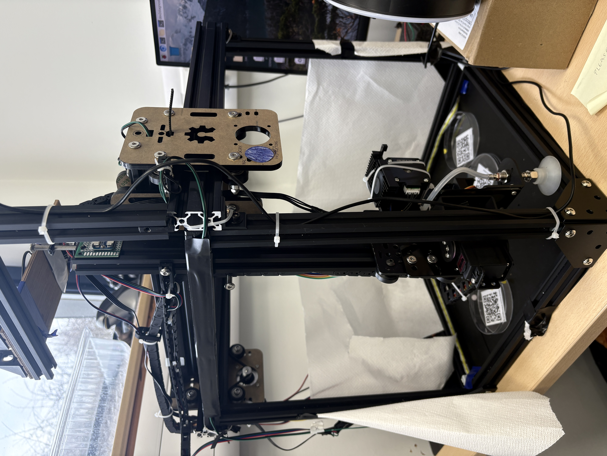
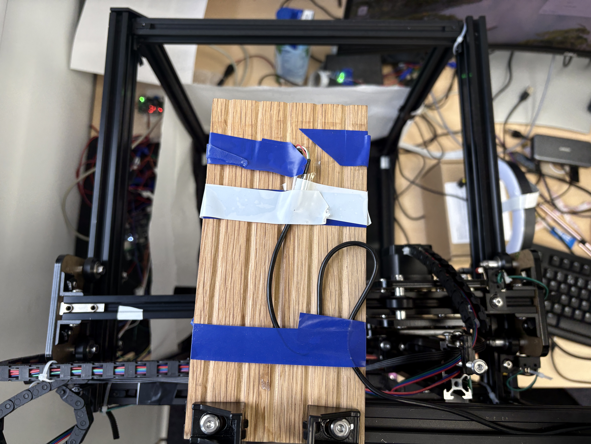
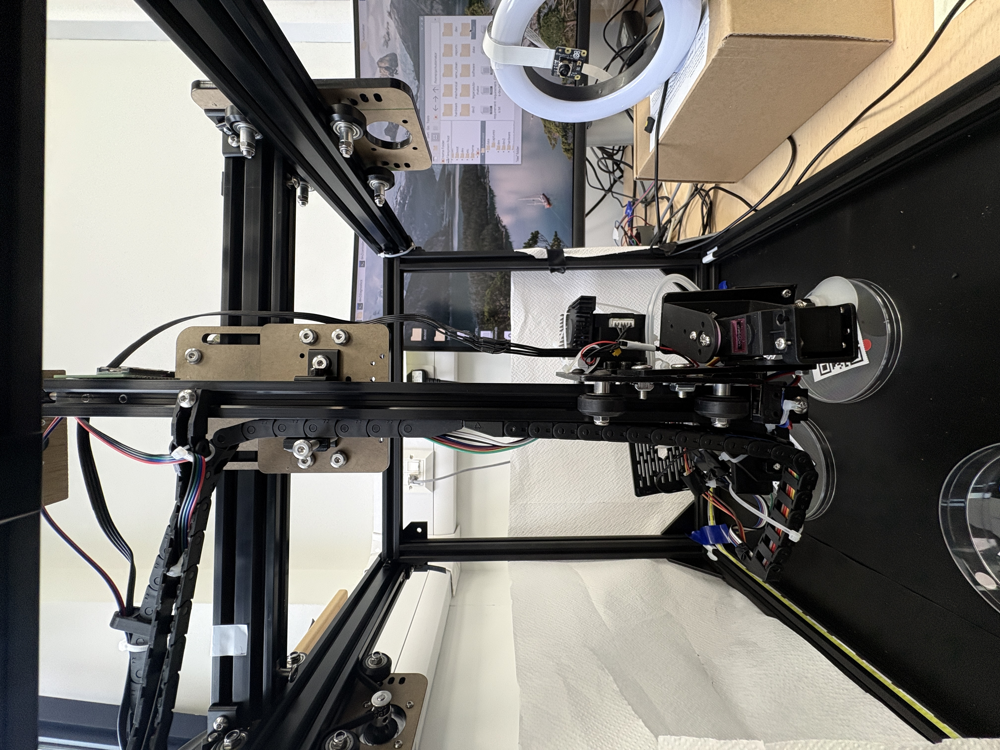
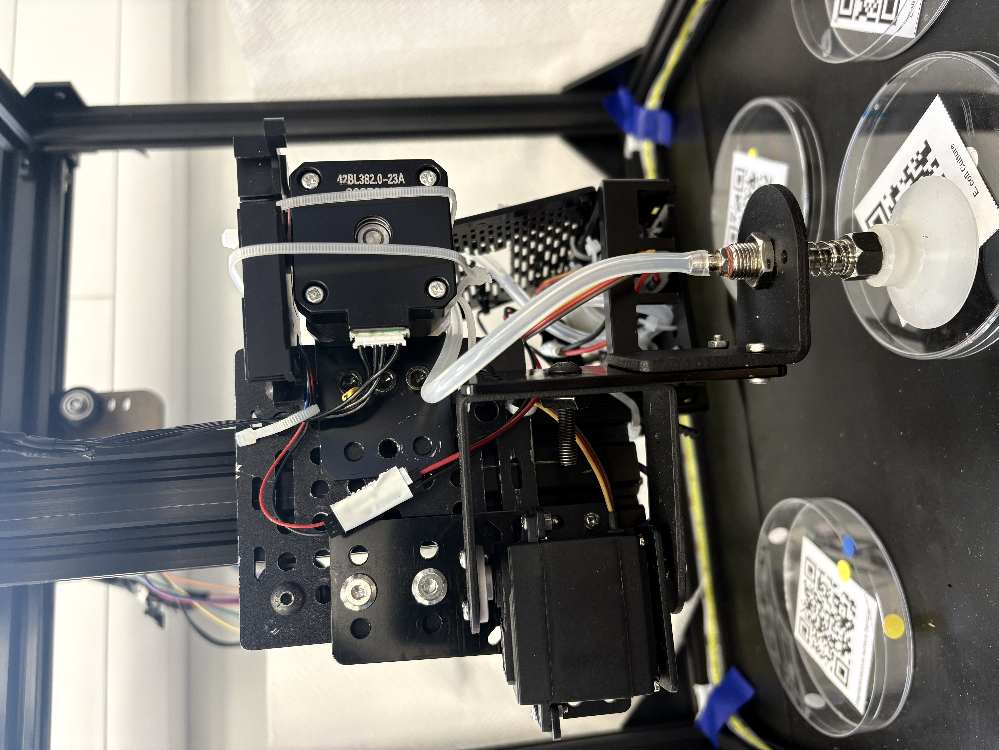
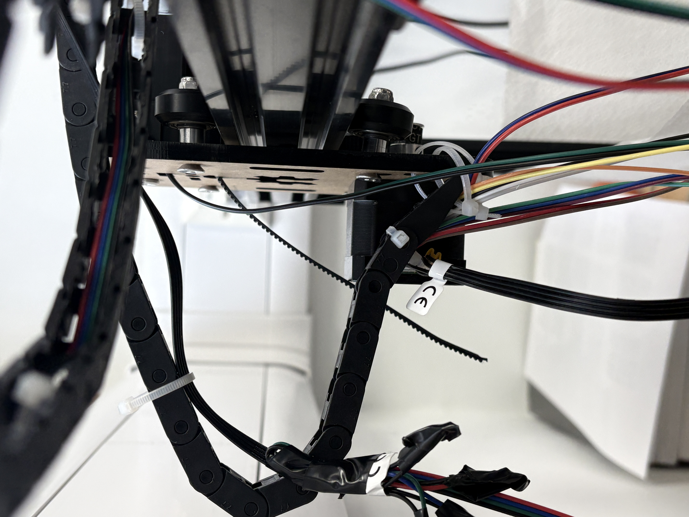
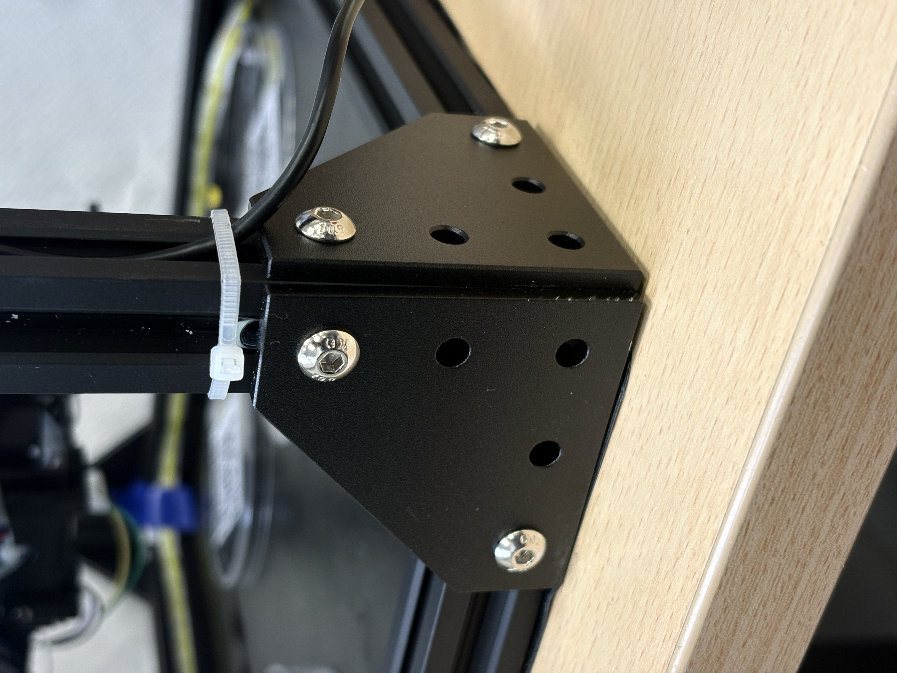
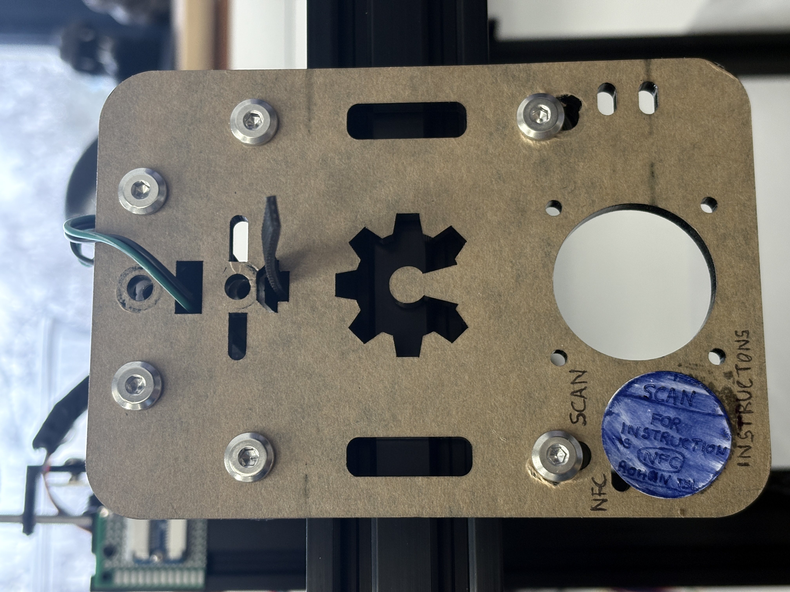

<!--
SPDX-License-Identifier: CERN-OHL-S-2.0
Copyright (c) 2025–2026 Rohan R
-->

# Project mechanical files and images

## STL files (3D models)

The following STL files are used in this project.

- `Base_LED_and_cam_case.stl`
- `Base_PIMKS.stl`
- `Cover_80mm_Two_Fans.stl`
- `LED_and_cam_case.stl`

> To preview these files, open them in a CAD viewer or slicer (e.g., PrusaSlicer, Cura, Fusion 360).

### Print specification

| Parameter | Value |
| --- | --- |
| Material | Black PETG |
| Layer thickness | 200 µm |
| Infill | 20% |

PETG is required — do not substitute PLA. PLA softens above ~60 °C and may deform near fan exhausts or in warm enclosures. PETG provides adequate heat resistance and mechanical strength for all printed parts in this assembly.

### Inspection checklist (before installation)

- [ ] No layer delamination visible on any face
- [ ] All mounting holes clear and unobstructed
- [ ] No warping on base surfaces that contact the frame
- [ ] Fan openings on `Cover_80mm_Two_Fans.stl` free of stringing or bridging defects
- [ ] Camera and LED cutouts on `LED_and_cam_case.stl` clean and correctly sized

> **Note:** No 3D-printed part is located near any stepper motor. Heat-related deformation from motor output is not a concern for this assembly.

- Preferably use [ViewSTL](https://www.viewstl.com/)
- I have attached all files on [Creality Cloud](https://www.crealitycloud.com/model-detail/696e3134dd379ce2580e8ed3?source=22)

---

## Hardware assembly photos

### Overall assembly – front view

### Top view with temporary mounting

### Z-axis and toolhead area

### Side view – pump and tubing

### Cable chain and wiring detail

---

## Structural and mounting details

### Frame corner bracket and extrusion mount

### Front mounting plate with NFC / scan cutouts

